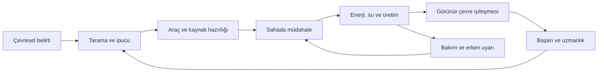
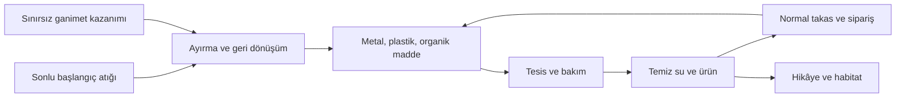

# ECOQUEST
## Oyun Tasarım Belgesi · v3

> **Bugünkü çevresel kararların, gelecek nesillerin yaşam koşullarını belirler.**
>
> Kompakt bir yerleşimi sahada müdahale, temiz üretim ve canlı bir ekosistemle dönüştüren 3D izometrik oyun.

| Belge bilgisi | Değer |
| --- | --- |
| Güncelleme | 20 Ekim 2026 |
| Proje / ekip | TÜBİTAK EcoQuest · Mustafa, Hanefi, Bilge |
| Platform | Windows PC · klavye ve fare · tek oyuncu |
| Motor | Unity 6000.0.74f1 |
| Deneyim | Sakin tempolu çevre iyileştirme, araç kullanımı ve üretim yönetimi |
| Ana hikâye | 3–5 saat hedefi; finalden sonra serbest oyun |
| Çalışma klasörü | C:/Users/Musta/Desktop/EcoQuest |
| Belgenin kapsamı | Tam hedef tasarım, başlangıç dengesi ve kaynaklara dayalı mevcut durum |
| Bu revizyonda yapılan | Yalnız GDD düzenlemesi ve kaynak incelemesi; oyun uygulaması veya test yapılmadı |

**Nasıl okunmalı?** “Karar” daha önce seçilmiş tasarım yönüdür. “Tasarım başlangıcı” bu revizyonda boşlukları kapatan somut başlangıç kuralıdır; kullanıcının tek tek onayladığı iddia edilmez. Sayısal tablolar **denge taslağıdır**; sonraki toplu oynanış çalışmasında değişebilir. Bir özelliğin burada tanımlanması, oyunda hazır olduğu anlamına gelmez. Kaynaklarda görülen gerçek durum §18'dedir.

Önceki GDD'nin sonuna eklenen kararlar ana bölümlere işlendi. Eski öneri listeleri artık alternatif kurallar oluşturmaz. Tarihsel Word belgeleri ve önceki yol haritası kaynak olarak korunur; bu sürümle çelişen 2D/FPS kamera, 48 seviye, bina kotası ve eski maliyetler hedef tasarımın yerine geçmez. Teslim tarihi bu belgede uydurulmamıştır.

### İçindekiler

| Deneyim | Sistemler | Sunum ve teslim kapsamı |
| --- | --- | --- |
| [1. Vizyon](#vizyon) | [7. Projeler ve ilerleme](#ilerleme) | [13. Arayüz ve erişilebilirlik](#arayuz) |
| [2. Dünya ve harita](#harita) | [8. Ekonomi ve market](#ekonomi) | [14. Kayıt ve devam](#kayit) |
| [3. Kontroller](#kontroller) | [9. İnşa ve üretim](#uretim) | [15. Görsel ve ses yönü](#sunum) |
| [4. Ana döngü](#dongu) | [10. Ekoloji ve zaman](#ekoloji) | [16. Eğitsel hedefler](#egitim) |
| [5. Oyun hissi](#his) | [11. Araçlar ve tehditler](#mucadele) | [17. Denge ve kapsam](#kapsam) |
| [6. Hikâye ve yönlendirme](#hikaye) | [12. Final ve serbest oyun](#final) | [18. Mevcut durum](#mevcut) |

---

## 1. Vizyon ve tasarım ilkeleri

Oyuncu çevresel sorunları olan küçük bir yerleşimde yaşar. Atıkları toplar, uygun araçla yaratıklara müdahale eder, enerji ve su altyapısı kurar, ürün yetiştirir ve habitatı iyileştirir. Evindeki çocuk bu değişimlerin insana ve geleceğe etkisini görünür kılar.

**Karar:** Sahada müdahale, aksiyon ve üretim yönetimi birlikte ana deneyimdir. Oyuncu sonraki çevre projesini kendisi seçer. Sakin tempo, akıcı ve tok etkileşim, sürekli yaşayan çevre korunur.

| İlke | Oyunda karşılığı |
| --- | --- |
| Kısa mesafe, anlamlı iş | Hedef aramak için uzun yürüyüş yerine tanınabilir alanlar ve kısa bağlantılar |
| Görünür neden ve sonuç | Kirli gölün kaynağı, arıtma bağlantısı ve toparlanan canlılar aynı hikâyeyi anlatır |
| Çözüm çeşitliliği | Toplama, ekim, altyapı, türlere uygun müdahale birbirini tamamlar |
| Kalıcı gelişim, canlı dünya | Başarı ve uzmanlık korunur; bakımsız sistemin çevresel sonucu geri gelebilir |
| Geri dönülebilir hata | Ölüm yok, beş saniyelik toparlanma var; yapı yıkılmak yerine onarılabilir |
| Beklemek amaç değildir | Ürün büyürken, hava değişirken veya sipariş beklerken yapılacak başka iş vardır |

**Tasarım başlangıcı:** Hedef kitle temel PC kontrolüne aşina gençler ve yetişkinlerdir; çevre bilgisi ön koşul değildir. Şiddet stilizedir, kan/gore yoktur. Ana oyuncu motivasyonu “bir sistemi kurdum, çalışıyor ve çevre değişiyor” hissidir. Rekabet, çevrim içi ekonomi ve hayatta kalma açlık sayaçları kapsamda değildir.

## 2. Dünya, harita ve grid

**Karar (20 Ekim güncellemesi):** Buzul dahil bütün alanlar tek, yaklaşık **150×150 metre** haritadadır (önceki 200 m kullanıcı isteğiyle küçültüldü). Harita ölçeği tek bir değerden (`Size`) ayarlanabilir. Zemin Unity Terrain değil, alçak poligon bir mesh'tir; yollar ızgara değil, eğri sokak ve patikalardır. İnşa için 2 metrelik hücre mantığı korunur; karakter serbest yürür.

Haritanın yaklaşık yarısı sağlıklı, yarısı sorunlu başlar; her bölge aynı durumda değildir. Şehir güvenli hazırlık alanıdır. Doğal yollar, merkezden çevreye kollar ve bölgeler arasında kısa bağlantılar bulunur. Koruluk rüzgârlı alanla komşu bir alt bölgedir; iki göl ayrı su koşullarını karşılaştırır.

| Alan | İşlev | Başlangıç karşıtlığı / tanınan işaret |
| --- | --- | --- |
| Şehir merkezi | Ev, çocuk, market, siparişler, atölye, acil destek | Güvenli meydan ve görünür merkez tabelası |
| Batı gölü | Temiz su örneği, erken balıkçılık ve küçük tarım | Canlı kıyı; aşırı kullanım riski |
| Doğu gölü | Kirli su, Salya, kaynak müdahalesi ve arıtma | Kirli giriş kanalı ve azalan balık |
| Sanayi | Fabrika filtresi, emisyon ve enerji dönüşümü | Belirgin baca ve bakım paneli |
| Koruluk / rüzgârlı yükselti | Yangın, ekim, habitat, rüzgâr üretimi | Yeşil ve zarar görmüş ağaç kümeleri |
| Güneşli açıklık | İlk üretim, gölge ve yerleşim öğrenimi | Açık ufuk ve güneş paneli silueti |
| Buzul | İstasyon, karbon takibi ve iklim finali | Karlı kenar, erime çizgisi ve erişilebilir patika |

Buzulun aynı küçük alanda bulunması stilize dünya tercihidir; gerçek bir iklim ölçeği iddiası değildir. Hidroelektrik için göllerden bağımsız doğal akış/kot farkı olan kısa bir akarsu koridoru ayrılır; ayrı sahne gerekmez.

**Dolaşım hedefleri:** Merkezden önemli alana yaklaşık 15–25 saniye; önemli tesislerin arasında okunabilir ve kesilmeyen yol. Bina ayak izi dışında en az bir hücre bakım erişimi korunur. Büyüyen ağaç ve yeni yapı zorunlu geçişi kapatamaz. Su/korunan habitat içine serbest bina yerleşmez. Başlangıçta coğrafya haritada görünür; keşif, sorunların nedenlerini öğrenmektir.

Görüş sisinin görevi uzak ayrıntıyı yumuşatmaktır. Sis tek başına çizimi durdurmaz; kamera mesafesi ve ayrıntı düzeyleri ayrı düzenlenir. Eski 500 metre sınırı bu küçük izometrik haritada zorunlu hedef değildir; kamera erişilebilir oyun alanını kesmemelidir.

**Sahne hedefi:** Kullanıcının işaretlediği oynanış sahnesi MainScene'dir; hedef tam akış bu sahnede sunulur. EcoWorld şu an yeni harita/sistem prototipinin bulunduğu çalışma sahnesidir. İlgili içeriklerin ana oynanışa aktarılması uygulama işidir; bu belge hiçbir sahneyi değiştirmez. Aradaki mevcut fark §18'de kaydedilir.

## 3. Kamera ve kontroller

**Karar:** Birinci şahıs yerine 3D izometrik kamera, kameraya göre WASD, sağ tıkla rota ve fareyle bağımsız hedefleme. Kamera karakteri ve yakın çalışma alanını birlikte gösterir.

**Tasarım başlangıcı:** Sabit yönlü izometrik/ortografik görünüm; yaklaşık 45° yatay yön, 55° aşağı bakış; ortografik yarı yükseklik varsayılan 10 m, tekerlekle 6–16 m (20 Ekim: kamera kullanıcı isteğiyle yaklaştırıldı). Değerler model boyutuna göre dengelenir. Kamera sınırda yumuşak durur; karakteri örten nesneler saydamlaşır. Saydamlaşma fiziksel engeli kaldırmaz.

| Girdi | Normal oynanış | Bağlama göre |
| --- | --- | --- |
| WASD | Kameraya göre hareket, aktif rotayı iptal | Menüde dünya hareketi üretmez |
| Sağ tık | Ulaşılabilir zemine rota | İnşada önizleme/başlangıç bağlantısını iptal |
| Sol tık / basılı tutma | Hedeflenen noktaya araç kullanımı | UI'da seçim; inşada geçerli yerleşimi onay |
| E | Yakındaki nesnenin gösterilen işlemi | Konuşma, hasat, filtre, tesis, dolum, balıkçılık |
| 1 / 2 / 3 / 4 / 5 | Vakum / tohum-demir / geri dönüşüm / tarama / boş el | İnşada seçilen yapı kısayolları ekranda ayrıca gösterilir |
| Q | Araç modu | Vakum: çekme–üfleme–su; tohum: ekim–demir |
| R | Varsa aracın açıkça gösterilen özel işlemi | Tohum seçimi, tıkanma giderme; inşada 90° döndürme |
| Tekerlek | Kamera yakınlaştırma | Araç değiştirme yapmaz |
| B / M / J / K | İnşa / harita / projeler / uzmanlık | Tek bir ana panel açık kalır |
| O | Yakındaki markette siparişler | Uzakta market konumunu gösterir, uzaktan teslim etmez |
| F | Final alanındaki hazır terminale odaklı başlatma | Hazırlık ekranındaki onaydan sonra; global kazara çağrı yok |
| F2 / Esc | Ayarlar / geri veya duraklatma | Önce açık paneli kapatır; sonra duraklatır |
| F5 / F9 | Hızlı kayıt / onaylı hızlı yükleme | Kayıt kuralları §14 |

Öncelik: **duraklatma ve modal ekran → inşa → araç ve hareket**. UI tıklaması dünyaya geçmez. Ulaşılamayan sağ tık hedefi açıklamayla reddedilir; karakter duvardan/sudan geçmez. Hedefleme zemine ve uygun hedefe ışınla yapılır; aradaki fiziksel engel saldırıyı durdurur. Etkileşim adayı kontur ve E etiketiyle gösterilir; aynı tuş tek işlem yapar.

Planlama ekranları dünyayı %10 hıza indirir, duraklatma durdurur. Panel değiştirirken hız yanlışlıkla normale dönmez; bütün paneller kapandığında önceki normal akış geri gelir.

## 4. Core Game Loop — ana oynanış döngüsü

**Fark et → incele → hazırlan → müdahale et → üretimi bağla → sonucu gör → geliş → bakım yap veya yeni proje seç.**

| Süre ölçeği | Oyuncunun yaptığı | Kazanımı |
| --- | --- | --- |
| Saniyeler | Toplama, hedefleme, ekim, kaçınma | Net ses, temas, animasyon ve kaynak değişimi |
| 2–5 dakika | Kıyı temizleme, ürün bakımı, hat bağlama | Görülebilir yerel sonuç |
| 20–35 dakika | Seçilmiş projede nedenleri ve altyapıyı çözme | Kalıcı başarı, uzmanlık, hikâye tepkisi |
| 3–5 saat | Birbirini destekleyen projeler ve final | Yerleşimin dönüşümü, ardından serbest oyun |

### İlk 20 dakika

| Aralık | Akış | Öğretilen |
| --- | --- | --- |
| 0–3 dk | Ev ve çocukla kısa konuşma, meydanda hareket | Amaç, izometrik hedefleme, etkileşim |
| 3–7 dk | Yakındaki atığı tarama ve toplama | Araç modu, neden–sonuç, kaynak |
| 7–12 dk | Elle temel dönüşüm, panel/batarya/şarj kurulumu | Ortak malzeme, kablo, üretim ve tüketim |
| 12–16 dk | Aracı şarj etme, küçük çevre müdahalesi | Karakter enerjisi ile elektrik farkı |
| 16–20 dk | İlk proje sonucu, uzmanlık, evden tepki | Ödül, bakım, sonraki projeyi özgür seçme |

Bu aralıklar hedef ritimdir; oyuncuyu zaman baskısıyla başarısız sayan sayaç değildir.

### Örnek: gölü canlandırma

Kirli renk ve azalan balık dikkat çeker → tarama giriş kanalını gösterir → Salya ve atıklar temizlenir → kirlilik kaynağı azaltılır → pompa/arıtma/depo enerji ve boruyla bağlanır → su kalitesi ve canlılar toparlanır → başarı kazanılır → üretimin sürekliliği izlenir. Sadece yaratık yenmek gölü tamamlamaz; bütün haritanın kusursuz olması da gerekmez.

## 5. Game Feel — oyun hissi

**Karar:** Akıcı ve tok etkileşim. Animasyonlar okunaklıdır; basit bir işlem uzun kontrol kilidi yaratmaz.

| Eylem | Görsel | Ses / his |
| --- | --- | --- |
| Yürüme | Kısa hızlanma-yavaşlama, araziye oturan adım | Zemine uygun sakin adım |
| Vakum | Nesnenin ağıza doğru çekilmesi ve girdap | Yük ve mesafeyle değişen çekiş |
| Su | Damlacık akışı, temas sıçraması, sönen alev | Akış ve kısa söndürme sesi |
| Tohum / demir | Okunur mermi; ekimde anında fidan/toprak izi | Ekimde yumuşak, demirde tok temas |
| İsabet | Küçük savrulma, kısa ışık/animasyon | Hedef türüne uygun tepki |
| Yanlış işlem | Hedef yanında kısa neden ve simge | Bir kez uyarı; basılı tutuşta ses yağmuru yok |
| Çevre toparlanması | Su rengi, yaprak, kuş ve kelebek dönüşü | Canlanan ortam katmanları |

**Denge taslağı:** Normal düşman 0,2–0,5 m savrulur; ağır Teneke daha az, boss yalnız tepki animasyonu alır. Aynı hedef 0,4 saniyede bir tam savrulma alır; sonsuz sersemletme oluşmaz. Oyuncuya sürekli uzanan çubuk ışınlar kullanılmaz. Düşman mermi yolu sürekli çizilmez; saldırı hazırlığı ve gerçek mermi yeterli bilgiyi verir.

Kamera sarsıntısı varsayılan hafif, kapatılabilir; büyük efektler hedefi, fidanı ve tehlike sınırını örtmez. Yeni tohum ilk kareden itibaren görünür; susuzluk, kirlenme, olgunluk şekil ve simgeyle ayrılır.

## 6. Hikâye, bakım ve yönlendirme

Çocuk gelecek nesli temsil eder. Kirli havaya, sıcağa ve geri dönen canlılara tepki verir. **Sürekli azalan açlık/susuzluk göstergesi yoktur.** Bakım görevleri sınırlı hikâye anlarıdır; oyuncu her birkaç dakikada eve dönmek zorunda bırakılmaz.

**Tasarım başlangıcı — üç bakım bölümü:**

| Bölüm | İstek ve açılma | Sonuç |
| --- | --- | --- |
| Temiz bir bardak su | İlk enerji projesi sonrası; 5 temiz su birimi | Arıtma ihtiyacını anlatan konuşma, ilk kez 20 YEP |
| Sağlıklı sofra | İlk temiz hasat/balık sonrası; 2 temiz ürün veya 1 temiz balık | Gıda–su ilişkisi, ilk kez 20 YEP |
| Penceredeki kuşlar | Koruluk sonrası; ev çevresinde canlı habitat | Doğa tepkisi, ilk kez 20 YEP |

Kirli gıda teslimi reddedilir ve neden açıklanır; çocuk üzerinden cezalandırıcı zarar döngüsü kurulmaz. Diğer günlük konuşmalar ödülsüz bağ kurar. Finalde önceki çevre/bakım değişimlerine göre kısa bir kapanış konuşması vardır.

Yönlendirme çevresel belirtiler, konuşma ve taramayla yapılır. Proje günlüğü **belirti / bilinen neden / olası müdahale / gözlenen sonuç** kartlarını tutar. Normalde sürekli görev oku yoktur. İsteğe bağlı üç ipucu kademesi: bölgeyi hatırlat → sorunun türünü açıkla → ilgili noktayı geçici işaretle. Başlangıç öğretimi tekrar açılabilir, okunmuş metinler geçilebilir.

## 7. Progression Loop — projeler, YEP ve uzmanlık

**Proje seç → çözümü kur → sonucu sürdür → kalıcı başarı kazan → uzmanlaş → yeni sorunu ele al.**

Başlangıç projesi yönlendiricidir; sonrakiler oyuncu seçimine açıktır. Bölgeler fiziksel olarak kilitli değildir. Temel çözüm tarifleri sorun keşfedilince açılır; gölü temizlemek için önce başka bir projede YEP biriktirme zorunluluğu kurulmaz.

### Altı ana proje

Aşağıdaki eşikler **tasarım başlangıcıdır**. Her satırın ilgili koşulları birlikte **120 simülasyon saniyesi** korunur. Normal hızda iki gerçek dakika, %10 hızda yirmi gerçek dakika eder; hızlandırılmış gün takviminin iki dakikası değildir. Koşul kaybolursa mevcut doğrulama sayacı sıfırlanır; tamamlanmış proje geri alınmaz. Oyuncunun aynı yerde beklemesi gerekmez.

| Proje | Somut eylem ve başarı şartı | Sonuç |
| --- | --- | --- |
| P1 · Mahalleye ilk enerji | Çalışan üretici, kablo, batarya ve şarj aynı ağda; araç toplam en az 10 EB şarj olmuş; ağ doğrulama boyunca üretim/rezervle şarj istasyonunu besleyebilir | 40 YEP; enerji kullanımını öğrenme; sonraki proje ipuçları |
| P2 · Gölü canlandır | Doğu gölünün kirletici girişine müdahale; o gölden su alan enerji bağlı pompa–arıtma–depo çalışır; arıtılmış suyun göle dönüşü açık; yerel su kalitesi ≥70 | 40 YEP; temiz balıkçılık/üretim; hidro tarifi |
| P3 · Koruluğu toparla | Koruluk alt bölgesinde bitki örtüsü ≥%60, habitat toparlanması ≥%50; o bölgede aktif yangın yok; sağlıklı ekim mevcut | 40 YEP; kuş/kelebek dönüşü; ev çevresi bakım bölümü |
| P4 · Sanayiyi dönüştür | Projeye işaretli fabrikaların filtreleri etkin; temiz enerji dönüşümü yapılmış; sanayi hava kalitesi ≥70 | 40 YEP; azalan emisyon ve hava baskısı |
| P5 · Yerleşimi dayanıklı yap | Bir kaynak devre dışıyken pompa/arıtma/şarj gibi seçili temel hizmetler aynı ağdan 120 sn beslenir; temiz su rezervi de tüketimi karşılar | 40 YEP; enerji ve su sürekliliği |
| P6 · Buzulu koru | İstasyon kurulup etkin; alan ağırlıklı dünya karbon endeksi ≤20; buzulun erime hızı sıfır veya altında | 40 YEP; stabil erime çizgisi ve finale hazırlık |

Koruluk projesi için önce yangın çıkarmak gerekmez. Başka bölgedeki yangın yerel koruluk başarısını engellemez. İstasyon ölçer; tek başına karbon düşürmez. Şarjın geçmişte bir kez gerçekleşmesi, boş bir batarya veya bağlantısız arıtıcı “çalışıyor” sayılmaz.

**P5 rezerv hesabı:** Gerekli elektrik, 120 saniyelik temel tüketimden mevcut güvenilir üretim çıkarılarak bulunur. Su rezervi de aynı süredeki tüketimi karşılar. Oyuncu seçtiği üreticiyi kontrol panelinden geçici kapatıp sistemi işletir; projeden dolayı haritanın tüm elektriği kesilmez.

### YEP ve açılmalar

YEP = **Yenilenebilir Enerji Puanı**; kalıcı başarı puanıdır, takas parası değildir. **Tasarım başlangıcı:** Her 40 YEP bir uzmanlık hakkı verir; toplam 360 YEP ile 9 hak. Eski 24/48 seviyelik tekrar toplama eğrisi hedef tasarım değildir.

| Tek seferlik ödül | Miktar | Toplam |
| --- | --- | --- |
| Altı ana proje | 6 × 40 YEP | 240 |
| Üç bakım bölümü (§6) | 3 × 20 YEP | 60 |
| Üç saha başarısı | 3 × 20 YEP | 60 |
| **Tamamı** | **9 uzmanlık hakkı** | **360 YEP** |

Üç saha başarısı: ilk temiz hasat ve sürdürülebilir yeniden ekim; ilk kaynak koşulunu sağlayan temiz balık; hatalı çevresel yerleşimi önizlemede görüp uygun alana kurma. Sonuncusu hasar vermeyi değil uyarıyı kullanmayı ödüllendirir.

Ganimet, tekrar hasat, düşman avı, aynı yapıyı kur/sök veya alanı yeniden kirlet/temizle sınırsız YEP vermez. Ödül kimliği kayıtlıdır ve yalnız bir kez işlenir. Çevre bozulsa da ödül, uzmanlık ve tarifler geri alınmaz.

### Uzmanlık

| Dal | Kademe başına başlangıç etkisi | Üç kademede toplam |
| --- | --- | --- |
| Enerji | Araç elektrik gideri −%8; temiz enerji üretimi +%6 | −%24 gider; +%18 üretim |
| Su | Pompa/arıtma debisi +%12; araçta su kullanımı −%5 | +%36 debi; −%15 su gideri |
| Ekoloji | Habitat toparlanması +%10; geri dönüşüm hızı +%15; büyüme hızı +%8 | +%30 / +%45 / +%24 |

Bonuslar taban değere eklenir; çarpılarak katlanmaz. Ekoloji geri dönüşüm bonusu malzeme yoktan yaratmaz, işlem hızını etkiler. Her kademe bir hak; ikinci kademe aynı dalın ilkini ve iki ana projeyi, üçüncü kademe ikinciyi ve dört ana projeyi ister. Dallar birbirini kalıcı kilitlemez. Merkezde ücretsiz yeniden dağıtım vardır; alışveriş veya kaynak ödülü üretmez.

Gölü tarayınca temel su altyapısı, sanayiyi tarayınca filtre/dönüşüm tarifi, ilk enerji sonrası rüzgâr, koruluk ipucu sonrası ağaç tohumu açılır. Uzmanlık verimi geliştirir; temel toparlanmanın tek anahtarı değildir.

## 8. Ekonomi, envanter, market ve siparişler

### Kaynak döngüsü

**Karar:** Başlangıç çöpleri sonludur. Düşman ganimetinin kazanımına günlük veya toplam kota konmaz. Düşman sayısı/oluşum hızı çevreye bağlıdır; “sınırsız ganimet” aynı anda sınırsız düşman anlamına gelmez. Oyuncu kirliliği sürdürerek malzeme biriktirebilir; bu olasılık gizlenmez. Proje/YEP ilerlemesi bundan ayrıdır. Market alım kotası doğrudan düşen metal/plastiği veya bina inşasını sınırlamaz.

| Kaynak | Kaynak ve kullanım | Stok kuralı |
| --- | --- | --- |
| Metal / plastik | Atık ve ganimet işleme; inşa, tamir, ekipman | Ortak yerleşim stoğu, taşıma seferi yok |
| Organik madde / gübre | Organik kalıntı ve bozuk ürün; bitki bakımı | Ortak stok |
| Tohum | Başlangıç, hasat geri dönüşü, market | Tür bazlı; araçta sınırlı taşıma |
| Temiz / kirli su | Doğal kaynak, pompa ve arıtma | Ayrı kalite, kapasitesi belli depo ve araç |
| Ürün / temiz balık | Yetiştirme ve su ekosistemi | Tür ve kalite korunur; temel sürümde zamanla çürümez |
| Demir top / filtre | Market veya temel atölye tarifi | Araç kapasitesi; fazlası ortak stokta |
| Elektrik | Üretim ve batarya | Yerleşim ağı ile araç bataryası ayrı |
| Karakter enerjisi | Müdahale dayanımı | Kaynak stoğu değil; §11 toparlanma sistemi |

### Normal takas ve günlük limit

Ayrı para birimi yoktur. Market temiz ürün/balık karşılığında metal/plastik, malzeme karşılığında tohum, demir top ve filtre sağlar. Temiz ürün satışı sınırsızdır. Aşağıdaki **alım** oyuncunun marketten aldığı pakettir; marketin oyuncudan aldığı ürün miktarı değildir.

**Denge taslağı — bütün marketlerde ortak günlük stok:**

| Ürün | Bir paket | Paket maliyeti | Günlük alım | Açılma |
| --- | --- | --- | --- | --- |
| Demir top | 5 adet | 3 metal | 8 paket = 40 adet | Başlangıç |
| Lahana tohumu | 5 adet | 2 plastik | 4 paket = 20 adet | Başlangıç |
| Havuç / domates / ağaç tohumu | Her biri 5 adet | 3 plastik | Tür başına 3 paket = 15 adet | İlgili tarım/koruluk ipucu |
| Küçük filtre | 1 adet | 2 metal + 1 plastik | 4 paket | Teneke taraması |
| Büyük fabrika filtresi | 1 adet | 6 metal + 4 plastik | 2 paket | Sanayi taraması |

Yenileme oyun gününün başlangıcında bir kez olur. Başarısız işlem kota tüketmez; geri satış kotayı iade etmez. Kayıt/yükleme ve farklı marketler aynı günlük sayacı kullanır. Paket bölünerek kotadan kaçılmaz.

**Normal ürün karşılıkları:** 1 temiz lahana → 2M+1P; havuç → 2M+2P; domates → 3M+2P; temiz balık → 4M+2P. M metal, P plastiktir. Marketten ürün alıp daha kârlı geri satma tarifi yoktur. Kirli ürün/balık temiz ürün olarak kabul edilmez; organik işlemeye yönlendirilir.

### Üç günlük avantajlı siparişler

**Karar:** Normal takasa ek, her üç oyun gününde isteğe bağlı daha avantajlı talepler. İlk dönem gün 3–5, sonra 6–8, 9–11…; iki sipariş, bir sonraki dönemde yenilenir. Teslim tek seferdir. Süre dolması ceza, YEP kaybı veya hikâye kaybı yaratmaz.

**Tasarım başlangıcı:** Yalnız açılmış ve üretilebilir ürünlerden talep seçilir. Bir sipariş 4 veya 8 adet aynı temiz ürünü/balığı ister; böylece aşağıdaki tam sayı karşılıklarında %25 avantaj yuvarlamayla kaybolmaz. Tür, kalite, miktar, son gün ve ödül baştan görünür. Ödül normal toplam metal/plastik karşılığının %25 fazlasıdır. Örnek: 4 temiz domatesin normal 12M+8P karşılığı, siparişte 15M+10P olur. İleride oran değişirse gösterilen gerçek ödül normal takastan mutlaka yüksek kalır.

Sipariş metal/plastik ödülü alım kotasına dahil değildir. Kısmi ürün yatırma yoktur; bütün teslim ve ödül tek işlem olur. Dönem kimliği, talepler ve teslim bayrağı kaydedilir; yükleme yeniden kura çekmez. Üç–beş saatlik oyunda yaklaşık 12–20 gün ve 4–6 sipariş dönemi beklenir; sipariş beklemek ana ilerlemenin şartı değildir.

### Çıkmaza girmeme

**Tasarım başlangıcı:** Güvenli ilk çevrede en az 50M+40P eşdeğer sonlu malzeme, 5 lahana tohumu, 20 temiz su ve dolu araç bataryası bulunur. Yaklaşık 8 metre kabloyla ilk panel–batarya–şarj zinciri 34M+24P tutar; başlangıç stoğuna sığar.

Merkezde elektriksiz elle ayırma ve yavaş acil şarj vardır. Araç elektriği sıfırken 30 saniyelik etkileşimle 15 EB alınabilir. Tohum veya su tamamen tükenirse ortak stok dahil kontrol edilerek **1 temel tohum + ilk sulamaya yetecek 2 SB** sağlanır; bu ürün ticareti için sürekli çekilemez. İlk temiz kıyıda düşük debili elle su alımı bulunur.

Günlük filtre/mermi kotası dolduğunda atölye eldeki malzemeyi aynı temel tarifle, paket başına 45 simülasyon saniyesinde işler. Sipariş verildikten sonra panel kapatılabilir, üretim sürer. Bu yol yeni malzeme üretmez; marketin hızlı tedarik rolünü korur. Bir tamiri yalnız bozuk tesisin ürünüyle finanse etmek zorunlu değildir. Fazla ganimet veya depo taşıması sessizce silinmez; toplanamayan nesne işaretli kalır.

## 9. İnşa, altyapı, tarım ve binalar

### Kurulum ve ağ kuralları

**Karar:** Uygun zeminde gridle serbest inşa; fiziksel kablo ve boru; ortak metal/plastik; çalışan tesislerde otomatik üretim. Nakliye kamyonu veya ayrıntılı taşıma lojistiği yoktur.

Yerleştirme: yapı seç → ayak izi ve çevre etkisini gör → döndür → maliyeti/bağlantıyı gör → onayla. Geçersiz zeminde neden gösterilir, kaynak harcanmaz. İnşa panelinde yapı ve bağlantı maliyeti ayrı okunur. Kablo yol üzerinde geçişi engellemez; su hattında akış yönü ve temiz/kirli tip simgesi bulunur.

**Birimler:** EB elektrik birimi, SB su birimidir. EB/sn güçtür; batarya EB depolar. Bunlar oyun birimleridir, kWh veya gerçek litre verim iddiası değildir. Tesis hızı simülasyon saniyesiyle hesaplanır.

| Yapı | Ayak izi (2 m hücre) | M / P | Başlangıç kapasitesi ve işlev |
| --- | --- | --- | --- |
| Güneş paneli | 2×2 | 12 / 6 | Uygun gündüzde en çok 4 EB/sn |
| Rüzgâr türbini | 3×3 | 80 / 40 | Uygun rüzgârda en çok 6 EB/sn; sakin havada sıfıra iner |
| Batarya | 1×1 | 8 / 6 | 240 EB; en çok 6 EB/sn doldurma/boşaltma |
| Şarj istasyonu | 1×1 | 6 / 4 | Araç bataryasına en çok 4 EB/sn |
| Su pompası | 1×1 | 8 / 8 | 1 SB/sn; SB başına 1 EB; kıyıda uygun alım |
| Su arıtma tesisi | 2×2 | 20 / 16 | 1 SB/sn; SB başına 2 EB; kirli giriş, temiz çıkış |
| Su deposu | 2×2 | 10 / 14 | 120 SB; temiz ve kirli ayrı bölmeler/tipler |
| Geri dönüşüm tesisi | 2×2 | 16 / 8 | Bir standart atık paketi / 3 sn; işlemde 2 EB/sn |
| Tarla | 3×3 | 2 / 4 | Dört ekim yuvası; temiz suyla otomatik devam sulaması |
| Küçük hidroelektrik | 3×3 + kıyı erişimi | 60 / 30 | Doğal akışa göre 0–6 EB/sn; gece de üretim |
| Buzul izleme istasyonu | 2×2 | 12 / 8 | Yerel küçük güneş/batarya dahil; ölçüm ve rapor |
| Elektrik kablosu | Hat | Metre başına 1 / 1 | Aynı ağın üretim/tüketimini bağlar |
| Su borusu | Hat | Metre başına 0 / 2 | En çok 2 SB/sn; su türü ve yönü belirli |

Tablo **denge taslağıdır**. Bina maliyetleri mevcut prototipten başlangıç referansı alır; ayak izi, hız ve kilitleri uygulandı diye okunmaz. Türbin için eski seviye başına bina kotası yoktur; alan, maliyet, habitat ve şebeke ihtiyacı sınırlar.

Ev, market/sipariş panosu ve atölye merkezde hazır hizmet yapılarıdır. Fabrika sanayide mevcut sorunun kaynağıdır; oyuncu yeni kirletici fabrika kurmaz. **Sanayi dönüşüm paketi:** fabrika başına 20M+12P, temiz şebekeye bağlantı ve 2 EB/sn işletme; filtreden ayrı işlem. Enerjisizse üretim durur, otomatik kirli yakıta dönmez.

### Elektrik ve su akışı

Elektrikte önce bağlı üretim kullanılır, açık varsa batarya boşalır, fazla üretim bataryaya gider. Öncelik sırası pompa/arıtma → şarj → geri dönüşüm → isteğe bağlı hizmetlerdir; aynı öncelikte yükler orantılı pay alır. Güç yetersizliği üretimi yavaşlatır/durdurur; malzeme yok etmez. Ağ döngüsü elektrik çoğaltmaz.

**Standart geri dönüşüm tarifleri:** Bir metal atık paketi → 1M; bir plastik atık paketi → 1P; üç organik birim → bir gübre. Büyük dünya nesnesi üzerinde kaç paket içerdiği gösterilir. Kirli hasat veya kirli balık bir organik birime işlenir. Elde ve tesiste temel çıktı aynıdır; fark işlem süresi ve elektrik kullanımındadır. Tarif, malzemeyi geri satın alıp çoğaltan bir çevrim oluşturmaz.

**Kirli kaynak → pompa → kirli boru → arıtma → temiz boru → depo → tarla / araç.** Doğal temiz kaynak arıtmayı atlayabilir. Kirli girişin doğrudan temiz hatta bağlanması reddedilir. Dolu depo pompayı durdurur; içeriği taşırıp silmez.

Doğal gölü temizlemek için arıtıcıda **göle temiz dönüş** modu bulunur; çekilen kirli su temizlenip aynı göle döner. Depoya alınan suyla çevre arıtımı aynı çıktı iki kez sayılmaz. Örnek denge: 20 SB göl dönüşü yerel su kirliliğini 1 puan azaltır; devam eden kirli giriş bununla yarışır. Sadece temiz su üretmek, kirletici kaynağı ortadan kaldırmış sayılmaz.

### Hidroelektriğin amacı

**Tasarım başlangıcı:** Göl projesi sonrası isteğe bağlı küçük akarsu santrali; güneş/rüzgâra alternatif gece üretimi sağlar. Yalnız doğal debi ve kot farkı olan işaretlenmiş kıyı hücrelerinde kurulabilir. Balık geçidi ve aşağı havzaya ayrılan asgari akış kurulumun parçasıdır. Fazla tesis aynı suyu tekrar bağımsız kaynakmış gibi sayamaz.

Kuraklıkta debi ve üretim düşer, eşik altında santral durur. Su tüketmez veya arıtmaz. Oyuncu pompasıyla devridaim yapıp bedava elektrik üretilemez. Yanlış konumun habitat etkisi önceden gösterilir; koruma eşiğini ihlal eden kurulum reddedilir. Hidroelektrik proje/final için zorunlu değildir. Büyük baraj, su altında kalan alan ve yerleşim taşıma bu sürümün dışında kalır.

### İşletme, kademe ve arıza

Her tesisin paneli girdi/çıktı, kapasite, bağlı hat, verim ve durma nedenini gösterir. **Tasarım başlangıcı:** Üretim/depolama tesisleri üç kademelidir. İkinci kademe iki proje sonrası taban yapım maliyeti kadar ilave malzemeyle, üçüncü kademe dört proje sonrası tabanın iki katıyla açılır. Kapasite/debi 1× / 1,5× / 2×; işlem başına gider aynı kalır. Bu sayede daha hızlı işleyen pompa daha çok toplam güç ister.

Dayanıklılık sıfırda yapı ve içeriği korunur, üretim durur. Tamir maliyeti eksik dayanıklılık oranı × taban malzemenin %25'i, yukarı yuvarlamadır. Söküm taban maliyetin %50'sini verir; depodaki içerik önce uyumlu depoya aktarılmalı, yer yoksa söküm durur. Taşıma aynı maliyet/bağlantı önizlemesiyle yapılır, tekrarlı YEP vermez. Fabrika ve merkez hizmetleri oyuncu tarafından sökülemez.

### Ekim, sulama ve hasat

İlk tohum ve ilk 2 SB sulama oyuncudadır; çalışan tarla kalan sulamayı sürdürür. Uygun doğal ekim alanında oyuncu elle bakım yapabilir. Durumlar: **ekildi/fidan → susuz veya büyüyor → olgun → hasat**, ayrıca kirlenme/zararlı ve kuruma. Görsel ilk ekimde belirir.

| Ürün | Uygun sıcaklık | Büyüme süresi | Bir döngü su | Hasat |
| --- | --- | --- | --- | --- |
| Lahana | 8–28 °C | 180 sn = 0,20 oyun günü | 8 SB | 2 ürün + 1 aynı tohum |
| Havuç | 5–22 °C | 240 sn ≈ 0,27 gün | 10 SB | 3 ürün + 1 aynı tohum |
| Domates | 18–34 °C | 300 sn ≈ 0,33 gün | 14 SB | 4 ürün + 1 aynı tohum |
| Ağaç | 4–36 °C | 360 sn = 0,40 gün | 12 SB kuruluş suyu | Kalıcı habitat; gıda hasadı yok |

Süreler uygun koşul ve normal hız içindir; 15 dakikalık gün esas alınır. Olgun ürünü toplamak oyuncudadır. İlk sağlıklı yetişen ağaç bir kez bir tohum geri verir; tekrar tekrar ödül üretmez.

Nem bitince büyüme durur ve uyarı çıkar; en az 120 simülasyon saniyesi müdahale süresi sonrası sağlık azalmaya başlar. İklim uyumsuzluğu ekim öncesi gösterilir; zorla uygun olmayan yere ekim ilerleme şartı değildir. Kirlenmiş ürün hasat öncesi temiz su/bakımla toparlanabilir; kirli hasat organiğe işlenir, gıda olmaz. Organik gübre oyunda zararlı baskısını azaltan stilize bakım aracıdır; her gübrenin gerçekte böcek kovduğu iddia edilmez.

Bir temiz gölde başlangıç balık nüfusu 12, güvenli av alt sınırı 4'tür. Su kalitesi ≥70 ve nüfus altında ise 120 saniyede en fazla bir balık geri gelir; kirli veya habitatı bozuk suda yenilenme azalır. Av 3–5 saniyelik erişilebilir etkileşimdir; hızlı refleks zorunluluğu yoktur. Nüfus 4'e düşünce av kapanır ve neden gösterilir. Böylece balık yenilenebilir ama sınırsız anlık stok değildir.

## 10. Çevre göstergeleri, hava ve zaman

### Gösterge modeli

Ana göstergeler hava, su, toprak, karbon, biyoçeşitlilik, ekosistem sağlığı ve sıcaklıktır. Göstergeler **oyun modelidir**; gerçek dünyaya ait tahmin veya bilimsel ölçüm olarak sunulmaz.

| Gösterge | Tasarım başlangıcı | Yön |
| --- | --- | --- |
| Hava / su / toprak kalitesi | 100 − ilgili kirlilik endeksi | Yüksek iyi |
| Karbon endeksi K | Bölgesel kaynaklar ve azaltıcı etkilerle 0–100 | Düşük iyi |
| Biyoçeşitlilik B | 55V + 30H + 0,15W | Yüksek iyi |
| Ekosistem sağlığı E | 0,30A + 0,25W + 0,20S + 0,25B | Yüksek iyi |
| Sıcaklık | Bölgenin taban sıcaklığı + 0,08K + 0,025 hava kirliliği | Ürüne/bioma göre uygun aralık |

V bitki örtüsü, H habitat toparlanmasıdır (0–1). A hava, W su, S toprak kalitesidir (0–100). Sonuçlar 0–100'e sınırlanır. Su yüzeyi olmayan alanda bağlı havzanın kalitesi kullanılır. Aynı gösterge harita ve HUD'da aynı formülle hesaplanır.

Dünya karbonu, çakışmasız bölge alanlarıyla ağırlıklı ortalamadır; çok sayıda küçük temiz bölge eklemek ortalamayı yapay düşürmez. Biyoçeşitlilik/ekosistem özettir; ayrı gizli hasar üretmez. Günlük eğilim ve en güçlü iki neden gösterilir.

### Neden ve sonuç

| Kaynak / koşul | Etki | Çözüm |
| --- | --- | --- |
| Filtresiz fabrika | Hava kirliliği ve kirli üretim karbonu | Filtre partikül baskısını azaltır; temiz enerji dönüşümü karbon kaynağını azaltır |
| Kirli kanal ve Salya | Su kalitesi, balık, arıtma debisi | Girişe müdahale, Salya temizliği, göle dönüşlü arıtma |
| Yangın | Bitki ve tesis kaybı, yerel karbon | Su, alev kaynağına müdahale, yeniden yeşillendirme |
| Gereksiz hassas alan kurulumu | Habitat/bitki örtüsü azalması | Önizleme uyarısı, uygun konum veya taşıma |
| Elektrik/su kesintisi | Üretim ve sulama yavaşlaması | Hat/arıza düzeltme, rezerv, kaynak çeşitliliği |
| Sağlıklı bitki/habitat | Yavaş doğal toparlanma ve karbon azalışı | İklime uygun ekim, temiz su, koruma |

**Denge taslağı:** Çalışan filtresiz fabrika dakikada +4 hava kirliliği/+2 karbon; filtre hava yükünü %80 azaltır, karbonu azaltmaz. Temiz enerji dönüşümü karbon yükünü %90 azaltır. Kirli kanal dakikada +3 su kirliliği; giderilmiş kaynak sıfır ekler. Sağlıklı habitatta doğal hava/karbon toparlanması dakikada 0,5–2 puan aralığındadır. Her kaynağın katkısı görünürdür; en yüksek karmaşık durum da müdahaleyle geri çevrilebilir.

İstasyon açmak sıcaklığı veya karbonu doğrudan değiştirmez. Karbon ≤20 iken buzul erime hızı durur, daha düşük değerde çizgi yavaş geri çekilir; ilk taslakta 0–20 arası saatte en fazla görünür buzul alanının %5'i toparlanır. Dünyanın tamamı bir anda mevsim değiştirmez.

### Hava ve sakin tempo

Hava açık → bulutlu → yağışlı → açılan geçişlerle işler. Rüzgâr bağımsız değişir. Tasarım başlangıcı hava dönemi 8–12 simülasyon dakikası; sert geçiş öncesi en az 30 saniye ipucu, önemli arıza/kirlilik öncesi en az 60 saniye müdahale payı. İlk 10 dakika başlangıç alanında büyük çevre olayı yoktur.

Yağmur açık ekinleri sulayabilir ve yangını hafifletebilir. Kirli hava endeksi ≥50 ise asit baskısı olasılığı açılır; sağlıklı alan sebepsiz asit yağmuru üretmez. Bulut güneşi, düşük rüzgâr türbini etkiler. Düşman etkisi ile doğal hava ayrı simge/mesaj taşır.

**Zaman kararı:** Bir oyun günü normal hızda 15 gerçek dakika; başlangıç sabah 08.00. Planlama, market, harita/günlük ve geliştirmede dünya %10 hızında; duraklatmada sıfır. Saat, düşman, yangın, tesis, bitki, proje ve siparişler aynı simülasyon saatini kullanır. UI hareketleri normal hızdadır. Oyun kapalıyken üretim veya çevre cezası işlemez.

## 11. Araçlar, düşmanlar ve toparlanma

### Araç ailesi

| Araç / mod | Oyuncunun yaptığı | Kaynak / sınır |
| --- | --- | --- |
| Vakum — çekme | Atık ve uygun Salya kalıntısını çekme; su kaynağından dolum | 2 EB/sn; 5 m temel erişim |
| Vakum — anti-vakum | Duman ve asit bulutunu dağıtma | 3 EB/sn; 5 m erişim |
| Vakum — su | Alev söndürme, sulama, temizlik | 2 SB/sn + 1 EB/sn; 6 m erişim |
| Tohum — ekim | Uygun zemine görünür tohum/fidan | 1 tohum + 2 EB; 8 m |
| Tohum — demir | Teneke zırhını zorlayıp sersemletme | 1 top + 3 EB; saniyede en fazla 2; 12 m |
| Geri dönüşüm | Uygun atığı yerinde yavaş işleme; seçili organik bakımı uygulama | Standart paket 5 sn/5 EB; gübre ayrı stoğu tüketir |
| Tarama | Neden, kalite, bağlantı ve uygunluk bilgisi | Temel bilgi ücretsiz; 12 m; hasar vermez |
| Boş el | Etkileşim ve sınırlı elle toplama | Elektriksiz toparlanma yolu |

Bunlar ilk denge değerleridir. Araç elektriği başlangıçta 100 EB, su 50 SB; karakter enerjisi ayrı 100'dür. Gövdeye göre araç boyutu ve tutuşu ayrı ayarlanır. İzometrik görünümde namlu/işlem yönü fareyi izler, ekranın köşesine FPS silahı yapıştırılmaz.

Kirli su kalitesi dolumdan önce ve araçta görünür. Temiz/kirli su karışınca araç tankı kirli sayılır; oyuncu onaylı boşaltmayla temizleyebilir. Kirli suyla kullanım tıkanma baskısı biriktirir; rastgele açıklamasız kilit yerine bir gösterge dolar. R ile 2 saniyelik temizleme boşaltımı yapılır; temel karşılaşmada tek toparlanma yolu ücretli parça değildir.

Araç geliştirmeleri merkez atölyesindedir: vakum erişimi/deposu, tohum taşıma/mesafesi, geri dönüşüm hızı. Üç kademe; kademe maliyeti başlangıçta 8M+4P, 16M+8P, 24M+12P; her kademede ilgili kapasite/erişim/hız tabana +%15. İkinci/üçüncü kademe iki/dört proje ister. YEP hakkı tüketmez; uzmanlık ile ekipman gelişimi farklıdır. Otomatik çoklu ekim temel sürüme dahil değildir; oyuncu tek hedef üzerindeki kontrolünü korur.

### Türlere uygun müdahale

| Tür | Oluşma nedeni / davranış | Okunabilir saldırı | Uygun çözüm ve kalıcı sonuç |
| --- | --- | --- | --- |
| Teneke | Kirli sanayi/atık; yavaş, dayanıklı, oyuncu ve tesis hedefi | 1 sn hazırlanan yakın vuruş veya belirgin mermi | Demirle sersemlet → 4 sn açıklıkta E ile küçük filtre; kalıcı etkisizleşme |
| Alev | Karbon ve sıcaklık baskısı; bitki/tesis ateşi | Belirgin alev birikimi ve ateş topu | Su; oluşan yangını ayrıca söndür; karbon kaynağını azalt |
| Duman | Kirli hava; güneş üretimine ve görüşe baskı | Yaklaşan bulut ve kısa yoğunlaşma | Anti-vakum; temas bölgesini dağıt, emisyonu filtrele |
| Salya | Kirli doğal su; kıyı ve arıtma debisi | Salgı atışı öncesi şişme/renk dışı şekil uyarısı | Vakumla toplama, uygun kalıntıyı işleme; su kaynağını çöz |
| Asit bulutu | Kirli hava + yağış; ekin/tesis etkisi | Zeminde 1,5 sn yağış alanı | Anti-vakumla bulutu dağıt; kirli hava kaynağına müdahale |
| İklim Canavarı | Projelerle zayıflayan birikmiş iklim baskısı | Üç okunur çevresel evre | §12; normal doğma sistemine dahil değil |

Yanlış araç kısa açıklama verir; tohum düşmana hasar mühimmatı olmaz. Büyük fabrika filtresi bina içindir, küçük filtre Teneke içindir. Filtre yalnız başarılı uygulamada tüketilir. Nişan/erişim iptalinde kaybolmaz.

**Denge taslağı:** Bölgesel ilgili kirlilik >35 ise oluşum basıncı açılır; uygun türler ağırlıkla seçilir. Bölge başına aynı anda en çok 3, harita genelinde en çok 12 normal düşman; bölgeye günde en çok 6 yeni oluşum, en az 20 saniye aralık. Başlangıç güvenli merkezde doğma yok; oyuncudan en az 12 m uzak, ulaşılabilir noktalar kullanılır. Önceden kısa çevresel belirti verilir.

Düşmanlar engellerden rota bulur; bağlantı kurulamazsa oyuncuya duvar içinden hareket etmez. Tesis hedefi türün ekoloji rolüne bağlıdır. Karakter toparlanmasında yakındakiler geri çekilir. Bölge iyileştikçe yeni doğuş azalır; mevcut düşmanlar aniden yok olmaz. Bu nüfus sınırları ganimet kazanımına ayrı günlük kota değildir.

### Toparlanma ve kayıp

**Karar:** Enerji sıfırsa ölüm/ışınlanma yok; bulunduğu yerde **5 saniyede toparlanma**. Bu sürede hareket/araç kullanımı ve tekrar hasar engellenir. Bitince 3 saniye dokunulmazlık, yakındaki düşmanlarda kısa geri çekilme vardır. Süreler dünya simülasyonu ile akar.

**Son karardaki bedelin somut tanımı:** Toparlanma başlarken mevcut araç elektriğinin %20'si bir kez gider; maksimum kapasitenin %20'si değil. Elektrik sıfırsa eksiye düşmez. Konum, envanter, ürün, YEP ve yapılar korunur. Toparlanma her karede yeniden ücret kesmez.

**Tasarım başlangıcı:** Beş saniye sonunda karakter enerjisi tam 100'e ulaşır. Normal durumda son hasardan 8 saniye sonra saniyede 5 enerji yenilenir; yeni hasar bu beklemeyi baştan başlatır. Bu yenilenme araç elektriği doldurmaz. Böylece oyuncu eksik enerjisini düzeltmek için bilerek bayılmaya teşvik edilmez.

Tesis sıfır dayanıklılıkta çalışmaz ama yıkılmaz; ürün ve rezervi saklanır. Tek toparlanma veya arıza, oyuncunun bütün yerleşimini sıfırlamaz.

## 12. İklim Canavarı ve final sonrası

**Karar:** Altı ana projenin her biri hazırlığa eşit **1/6** katkı verir. Başarı kaydı kalıcıdır. Güncel bakım sorunları ayrıca gösterilir; yeniden kirlenme kazanılmış hazırlık payını silmez.

**Tasarım başlangıcı:** En az üç proje (%50) ve buzul terminalinin keşfi finali başlatmaya yeter. Altı proje (%100) önerilen rahat hazırlıktır. Terminal rezerv, araç ve bakım uyarısını gösterir; oyuncu onayla başlatır. Açılmamış temel karşı araç tarifi varsa önce öğrenme ipucu verilir. Normal düşman doğuşu final alanında askıya alınır; diğer dünya simülasyonu sürer.

**Terminal bağlantısı:** İstasyonda 120 EB elektrik ve 60 SB temiz su kapasiteli final rezervi bulunur. Elektrik kablosu/temiz su borusundan veya E ile oyuncunun mevcut batarya/su tankından aktarım kabul eder; aynı miktar verenden düşer. İstasyonun küçük dahili güneşi yalnız ölçüm cihazını besler, bedava final rezervi üretmez. Başlangıç için terminalde en az 40 EB ve 30 SB, araçta en az 40 EB, 15 SB ve 5 demir top gerekir. Finalin kendisi bunları peşinen tüketmez; ilgili işlemde harcanır. Eksik miktarın kaynağı terminalde açıklanır. Bu yollar P1/P2/P5 tamamlanmadan seçilmiş üç projeyle de hazırlanabilir; altyapı tarifleri keşifle erişilir.

Final salt can azaltma değildir. Üç iklim odağı **uygun araçla açılıp yerleşimin enerji/su desteğiyle dengelenir**. Tasarım başlangıcı 8–12 dakikalık karşılaşma ritmidir; bu zorunlu süre veya bekleme sayacı değildir. Her evrede odağa ulaşmayı zorlaştıran üç aktif tehdit noktası vardır: ısı evresinde yangın/Alev, duman evresinde Duman/Asit, çekirdekte Teneke ve mermi baskısı. Oyuncu bunları temizler, güvenli yaklaşım kurar ve aşağıdaki kısa odak işlemini yapar. Süre aktif mücadele ve konumlanmadan doğar; deneyimli oyuncu daha hızlı bitirebilir. Hazırlık arttıkça odak gereksinimi ve baskı düşer.

| Evre | Baskı ve uyarı | Oyuncunun karşılığı | Evre bitişi |
| --- | --- | --- | --- |
| Isı odağı | Alev alanı; 3 sn ön uyarı; kuraklık işareti | Suyla alevi temizle, odağa 12 SB ulaştır | Açık odağı 4 sn dengede tut |
| Duman odağı | Görüş/üretim baskısı; enerji kesintisi uyarısı | Anti-vakumla 3 sn dağıt; rezervden terminale 20 EB aktar | Beslenen odak 4 sn açık kalsın |
| Çekirdek | Ağır mermi ve dönüşümlü baskı | 5 demir top isabetiyle zırhı aç, terminalde E ile stabilizasyon | Üç odağın tamamı dengelendiğinde zafer |

Tablodaki miktarlar %50 hazırlık içindir; %100'de su/elektrik ve gereken demir sayısı %25 azalır, adetler yukarı yuvarlanır. Odaklar arası ilerleme aynı denemede korunur. İlgili odak dışına sınırsız ateş ederek aşama atlanmaz. Normal vuruşlar yalnız tehdidi geçici geri iter.

**Başlangıç baskı ritmi:** İlk elektrik kesintisi 35. saniyede, sonra 45 saniyede bir 12 saniye; yalnız güneş/rüzgâr üretimi baskılanır, dolu batarya ve uygun hidro katkı verir. İlk kuraklık 55., ilk duman 75. saniyede; sonra 60 saniye aralıkla. Kuraklık bir dalgada açık su rezervinden en çok %20 alır; kapalı depo bunu yarıya indirir. Duman yerel final bölgesine +5 hava kirliliği ekler; bütün harita aniden bozulmaz. Aynı anda iki büyük baskı başlatılmaz; çakışma varsa sonraki olay ertelenir.

Oyuncu toparlanırsa deneme sonlandırılır: geçici final düşmanları/baskıları kaldırılır, üç odak deneme ilerlemesi sıfırlanır. Yerleşim, eldeki kalan kaynaklar, gerçek hasar ve kalıcı proje ilerlemesi korunur. Terminalden hazır olunca tekrar başlanır. Oyuncu aynı menüden isteyerek denemeden çekilebilir.

**Zafer:** Üç odak dengelendiğinde bir kez sonuç, çocuk/yerleşim kapanışı ve tam kayıt oluşur. Eksik boss modeli, yüklenemeyen hedef veya boş düşman listesi zafer sayılmaz; başlatma açıklamayla durur. Zaferden sonra boss kendiliğinden yeniden doğmaz. Kalan projeler, bakım, hidro, uzmanlık, üretim ve siparişlerle serbest oyun sürer.

## 13. Arayüz, menüler ve erişilebilirlik

### Bilgi düzeni

**Tasarım başlangıcı:** Temiz, sıcak ve doğa temalı arayüz; koyu zemin üzerinde açık metin, yeşil/kehribar/mavi vurgu. Ahşap asset paketinin eksik bağımlılıkları arayüzün çalışmasının şartı değildir.

| Konum / ekran | Öncelikli bilgi | Etkileşim |
| --- | --- | --- |
| Sol üst | Karakter enerjisi ve ayrı araç elektriği | Açıklama için simge; aynı “enerji” etiketiyle karıştırılmaz |
| Alt orta | 1–5 araçlar, seçili mod, mühimmat/su | Aktif slot şekil ve çerçeveyle belirgin |
| Sağ üst | Küçük harita, gün/saat, hava | M ile ayrıntılı harita |
| Hedef yanında | Etkileşim, bakım ihtiyacı, geçersiz işlem | Kısa, bağlama bağlı; kalıcı yazı yığını yok |
| Proje günlüğü | Seçili projenin nedeni, koşulları, 120 sn ilerlemesi | J; isteğe bağlı ipucu |
| Tesis paneli | Girdi/çıktı, rezerv, bağlantı, öncelik, arıza | E; tamir, kademe, taşıma/söküm |
| Market / sipariş | Verilen-alınan miktar, paket/adet, kota ve gün | İşlem öncesi açık karşılık |
| Uzmanlık | Hak sayısı, üç dal, toplam etki | K; seçme ve merkezde yeniden dağıtım |

Bütün çevre göstergeleri sürekli ekranı doldurmaz. HUD yerel özet ve değişimi gösterir; ayrıntılı katkılar tarama/harita ekranındadır. Büyük uyarı aynı olay için tek bildirim üretir, tekrarı günlüğe gider. Kritik simge metin ve şekille desteklenir.

### Menü akışı

**Açılış → ana menü → yeni oyun / devam / kayıtlar / ayarlar → oyun.** Yeni oyun mevcut slotları sessizce silmez. Duraklatma menüsü: devam, kaydet/yükle, ayarlar, öğretici/kontroller, ana menüye dön, çıkış. Kaydedilmemiş ilerleme varsa son kayıt zamanı gösterilir. Oyun içindeki panel kapatma ile uygulamadan çıkma aynı onaya bağlanmaz.

### Okunabilirlik ve erişilebilirlik

- Temel dil **Türkçe**. Bütün metinler çeviri anahtarıyla tutulur; İngilizce ikinci dil için yer ayrılır. İlk hedef sürümde eksik çeviri varmış gibi çalışan dil seçeneği gösterilmez.
- 1280×720, 1920×1080 ve geniş ekran yerleşimi hedeflenir. 1080p'de gövde metni başlangıçta 20–22 px, yardımcı metin en az 18 px; %100 / %125 / %150 UI ölçeği bulunur. Panel taşarsa metni küçültmek yerine kaydırma kullanılır.
- Font Türkçe İ/ı/Ş/Ğ/Ç/Ö/Ü karakterlerini içerir; uzaklığa bağlı dünya yazısı ve ekran metni ayrı ölçeklenir. Pikselli metin, düşük çözünürlüklü atlas ve aşırı ince çizgi temel tasarım değildir.
- Renk körlüğü için alternatif palet, desen/simge ve yazılı durum birlikte kullanılır. Tehlike yalnız kırmızı/yeşil ayrımıyla anlatılmaz.
- Kamera sarsıntısı ve hareket bulanıklığı kapatılabilir; varsayılan sarsıntı düşük, bulanıklık kapalıdır. Güçlü yanıp sönmeler azaltılır.
- Tuş atama değiştirilebilir; çakışan atamada oyuncu uyarılır. Fare hassasiyeti ve yakınlaştırma yönü ayarlanır.
- Araç basılı tutma yerine aç/kapat seçeneği; balıkçılıkta zaman baskısız etkileşim; konuşma yazıları bekletilebilir.
- Ana ses, müzik, ortam, efekt ve UI ayrı %0–100 ayarlanır. Sözlü bilgi altyazılıdır. Kaynak uyarısı yalnız sesten anlaşılmak zorunda değildir.

## 14. Kayıt, yükleme ve güvenli devam

**Tasarım başlangıcı:** Üç elle kayıt slotu, bir hızlı kayıt ve dönüşümlü üç otomatik kayıt. Aynı oturumun bütün verisi tek tutarlı anlık görüntüye aittir; dünya ve envanter farklı anlardan birleşmez.

| Veri grubu | Kaydedilen |
| --- | --- |
| Oyuncu | Konum/yön, karakter enerjisi/toparlanma, araç seçimi/modu, elektrik/su/kalite |
| Envanter | Tür bazlı tohum/ürün/balık, malzeme, filtre, mühimmat, geliştirmeler |
| Yapı ve ağ | Kalıcı kimlik, konum/dönüş, kademe, dayanıklılık, kablo/boru uçları, rezerv, işlem kuyruğu |
| Tarım ve çevre | Bitki yaşı/nem/sağlık/zararlı/kirlilik; bölgesel göstergeler, habitat, yangın, filtre/dönüşüm durumu |
| Dünya | Gün/saat, hava geçişi, toplanmış atık kimlikleri, ganimet, balık nüfusu, normal düşmanlar ve doğuş bütçeleri |
| İlerleme | Projeler ve mevcut doğrulama süresi, YEP/ödül kimlikleri, uzmanlık, bakım/hikâye, ipuçları |
| Ekonomi | Günlük market alımları, sipariş dönemi/talepleri/teslimleri |
| Final | Hazırlık başarıları, zafer ve güvenli ön-final kaydı; aktif deneme istisnası aşağıda |
| Tercihler | Ses, görüntü, erişilebilirlik, tuşlar; profil ayarları slot dışındadır |

Otomatik kayıt aktif oynanışta **180 gerçek saniyede bir**, ayrıca proje başarısı, büyük teslim ve final zaferi sonrası gerçekleşir. Duraklatma/ana menü süreleri otomatik kayıt aralığına eklenmez. Kaydetme alışveriş, ödül, bağlantı kurma gibi işlemin ortasında kesilmez; işlemin tamamlanmış halini alır.

**Final istisnası:** Başlatmadan hemen önce tam güvenli kayıt oluşturulur. Aktif boss denemesinde hızlı/elle/otomatik dünya kaydı ertelenir; kayıt isteği ve neden görünür. Oyundan çıkıp dönmek ön-final durumuna, bütün kaynak ve dünyayla birlikte döner. Başarısızlık veya terminalden gönüllü çekilme sonrasında dünyada devam seçilirse kalan gerçek durum yeniden kaydedilir. Böylece yarım boss dövüşüyle başka zamana ait envanter birleştirilmez.

Yükleme mevcut sahneyi temiz bir başlangıçtan kurar, sonra kimliklerle durumu uygular; düşman/bitki/ödül iki kere oluşmaz. Mevcut sipariş yeniden üretilmez, toplanmış atık geri gelmez, gün geriye alınarak mevcut oturumla malzeme biriktirilmez. Bir kaydı yüklemek tüm dünya anını geri getirir, bazı alt sistemleri seçerek birleştirmez.

Kayıtlar sürüm numarası taşır. Yarım yazma eski sağlam kaydı bozmaz; son sağlam yedek korunur. Eski şema okunamıyorsa açıklama gösterilir, dosya silinmez. Bozuk kayıt, dolu disk veya erişim hatasında “kaydedildi” mesajı verilmez. Otomatik kayıt bulut hizmetine bağlı değildir; oyun kapalıyken zaman ilerlemez.

## 15. Görsel yön, ses ve varlık ihtiyaçları

### Görsel dil

Stilize düşük poligonlu 3D, net siluet ve izometrik açıdan okunaklı etkileşim. Sağlıklı alanlar canlı ama neon olmayan yeşil/mavi; kirli alanlar solgun kahve/gri, fakat durum yalnız renkle anlatılmaz. Su yüzeyindeki tortu, kırık yaprak, baca dumanı ve canlıların miktarı değişimi destekler.

Güneş paneli, pompa, arıtma ve depo uzaktan farklı siluete sahiptir. Bağlantı noktası ve işlem yönü model üzerinde okunur. Tesis modeli gerçek dünyadaki bütün makine ayrıntısını taşımak zorunda değildir; giriş–işlem–çıkış oyuncu için anlamlı olmalıdır.

| Varlık grubu | Gerekli içerik |
| --- | --- |
| Karakter | İzometrik yürüme/koşma, araç tutuş, kullanım, hasat, etkileşim, toparlanma |
| Araçlar | Dört araç + boş el; moda göre okunur efekt, görünür tohum/demir mermi |
| Tesis | Panel, türbin, batarya, şarj, pompa, arıtma, depo, geri dönüşüm, tarla, küçük hidro, istasyon |
| Hizmet / hikâye | Ev içi etkileşim köşesi, çocuk, market, pano, atölye, fabrika filtre/dönüşüm bölümü |
| Doğa | Tohum/fidan/olgun/kurumuş bitki, temiz/kirli kıyı, balık, kuş, kelebek, buzul çizgisi |
| Tehdit | Beş normal tür; saldırı hazırlıkları, etkisizleşme; finalin üç odağı |
| Arayüz | Kaynak/araç/mod simgeleri, bağlantı/durum işaretleri, harita noktaları |
| Efekt | Vakum, su, ekim, metal temas, yangın/söndürme, yağmur, asit, duman |

Mevcut uygun varlıklar önce kullanılır. Eksik modeller için kullanıcının belirttiği **game-assets / Leonardo → Meshy** akışı üretim aşamasında değerlendirilebilir; bu belge çalışmasında üretim veya indirme yapılmaz. Kullanılan varlığın kaynağı/lisansı, ölçeği, pivotu, malzemesi ve çarpıştırıcı ihtiyacı kaydedilir. Modellerin bulunması mekaniklerin tamamlandığı anlamına gelmez.

### Ses ve müzik

| Katman | Kullanım |
| --- | --- |
| Bölge ortamı | Merkezde sakin yerleşim; gölde su; korulukta yaprak/kuş; sanayide mekanik uğultu; buzulda rüzgâr |
| Çevre değişimi | Sağlık arttıkça canlı katmanlar açılır; tek eşikte ani ses değişimi olmaz |
| Araç ve temas | Her mod farklı; sürekli akış ile tek isabet ayırt edilir |
| Arayüz | Seçim, onay, geçersiz işlem ve başarı; kısa ve tekrar sınırlı |
| Müzik | Sakin ana tema, çalışma/iyileşme varyasyonu, seyrek tehdit katmanı, üç aşamalı final, huzurlu kapanış |

Müzik aralıksız dramatik baskı yaratmaz. Kritik uyarı geldiğinde ortam/müzik hafif kısılır. Birden fazla tesis veya aynı tip düşman sesleri üst üste aşırı yükselmez. Konuşmalar ilk sürümde yazılı olabilir; profesyonel seslendirme kampanyayı tamamlamanın koşulu değildir. Prototipteki üretilmiş sesler kaynakta bulunan başlangıçtır, bitmiş müzik/ses paketi diye sunulmaz.

## 16. Eğitsel hedefler ve mesaj

Amaç ezber soruları arasında oynatmak değil, eylem ve sonuçla nedenleri görünür kılmaktır. Her proje sonunda isteğe bağlı kısa bir öğrenme kartı vardır; oyun ilerlemek için kartın okunmasını sınamaz.

| Proje | Oyuncunun ayırt etmesi beklenen kavram | Oyun içindeki kanıt |
| --- | --- | --- |
| İlk enerji | Üretim, depolama ve tüketim farklıdır | Panel üretirken batarya dolar; araç şarjı depodan gider |
| Göl | Kaynağı azaltma ile kirli suyu arıtma birbirini tamamlar | Giriş çözülmezse arıtma yükü sürer |
| Koruluk | Habitat ve çeşitlilik, yalnız ağaç sayısından fazlasıdır | Uygun bitki/su ile kuş/kelebek geri gelir |
| Sanayi | Hava filtresi karbon sorununu tek başına çözmez | Filtre sonrası hava iyileşir; temiz enerji karbonu ayrıca etkiler |
| Dayanıklılık | Yenilenebilir kaynakların koşulları ve rezerv farklıdır | Bulut/düşük rüzgârda farklı kaynak ve batarya hizmeti sürdürür |
| Buzul | Yerel kararların birikimli iklim etkisi vardır | Kaynak dönüşümü ve habitat dünya karbonunu düşürür |

Kısa açıklamalar “bu oyunda” ölçeğini belirtir. Dakikalar içinde büyüyen ağaç, geri çekilen buzul, asit canavarı ve gübreyle zararlı kontrolü stilize temsillerdir. YEP, endeks ve oyun birimleri gerçek çevre ölçümü diye sunulmaz.

**Sonraki değerlendirme için tanımlı, şu an uygulanmayan ölçüm:** İsteğe bağlı oyun öncesi/sonrası beş kısa soru: güneşsiz zamanda üretim/depo; filtre ve karbon ayrımı; kirli gölün yeniden kirlenmesi; biyoçeşitlilik; su/enerji rezervi. Oyun içi gözlemde oyuncunun bir nedeni açıklaması ve uygun müdahaleyi seçmesi izlenir. Akademik başarı veya bilimsel etkililik bu belgeden çıkarılamaz. Bu çalışma sırasında anket, kullanıcı deneyi veya test yapılmaz.

## 17. Başlangıç dengesi, kapsam ve bitiş tanımı

### Tek bakışta temel değerler

| Parametre | Başlangıç değeri |
| --- | --- |
| Ana hikâye / devam | 3–5 saat / serbest oyun |
| Harita | Yaklaşık 150×150 m; alçak poligon zemin, eğri yollar; inşada 2 m hücre |
| İlk görünür sonuç | İlk 15–20 dakika |
| Gün | 15 gerçek dakika; normal hızda |
| Planlama / duraklatma | %10 / %0 dünya hızı |
| Proje doğrulama | 120 simülasyon saniyesi |
| Proje / uzmanlık | 6 proje; toplam 360 YEP; 40 YEP başına 1 hak; 3 dal × 3 kademe |
| Sipariş | Gün 3, 6, 9…; dönem başına 2; yaklaşık %25 avantaj |
| Toparlanma | 5 sn + 3 sn dokunulmazlık; mevcut araç elektriği −%20 |
| Normal düşman yoğunluğu | Bölge 3, dünya 12; bölge başına günde 6 yeni oluşum |
| Final açılma / önerilen hazırlık | 3 proje / 6 proje |
| Kayıt | 3 elle + 1 hızlı + dönüşümlü 3 otomatik; aktif oynanışta 180 gerçek sn |
| Dil | Türkçe; İngilizceye hazır metin yapısı |
| Performans tasarım hedefi | 1080p orta ayarda 60 kare/sn |

**Performans hedefinin sınırı:** Bu sayı ölçülmüş sonuç veya doğrulanmış minimum donanım değildir. Planlama referansı 4 fiziksel çekirdek, 16 GB RAM ve 4 GB ayrık GPU sınıfıdır; kesin destek listesi son performans çalışmasında belirlenir. 720p düşük ayar seçeneği, efekt yoğunluğu ve gölge/ayrıntı seçenekleri tasarıma dahildir. Oyuncudan donanım satın alması istenmez.

### Tam hedef sürüm

Bir kompakt harita, altı proje, üç bakım bölümü, üç saha başarısı, dokuz uzmanlık kademesi, araç/modlar, türlere özel mücadele, binalar ve ağlar, tarım/balık, normal takas ve siparişler, canlı çevre, üç evreli final, serbest oyun, tam kayıt, menüler, erişilebilirlik ve gerekli ses/görsel geri bildirim birlikte kapsamdadır.

Önce küçük bir oynanabilir bölüm kurmak üretim sıralaması olabilir; bu, kalan projeleri/siparişleri/uzmanlığı/finali kapsamdan çıkarmak anlamına gelmez. Büyük baraj, çevrim içi çok oyuncu, konsol/mobil, uzun ulaşım, zorunlu çocuk açlık sayacı ve çevrim dışı üretim bu sürüme eklenmez.

### Belgenin tamamlanması ile oyunun tamamlanması

Bu revizyon tasarım boşluklarını **somut başlangıç kurallarıyla** kapatır. Denge sayıları gelecekte ayarlanabilir; bu durum mekaniklerin belirsiz bırakıldığı anlamına gelmez. Şu anda oyun tamamlandı veya testlerden geçti denmez.

Kalan üretim sırası: sahne/izometrik giriş tutarlılığı → temel döngü ve ekonomi → proje/uzmanlık eşikleri → tam kayıt → bakım/final → arayüz/ses/sunum → bütünleşik oyun ve performans çalışması. Haritanın güzelleştirmesi mekaniklerden sonra yapılır. **Kullanıcı isteğiyle test çalıştırma bu GDD tamamlanana kadar ertelenmiştir; bu revizyonda test, Play Mode, derleme veya oyun çıktısı üretilmedi.** Daha sonra yapılacak testlere bu belgenin tamamlanması otomatik başlama talimatı değildir.

## 18. Mevcut proje analizi ve tasarıma kalan mesafe

> **21 Ekim 2026 güncellemesi:** Aşağıdaki tablo ve listeler 20 Ekim incelemesinin anlık görüntüsüdür; içindeki farkların çoğu sonradan kapatıldı ve Play Mode'da denendi. Kapatılanlar: altı projenin hedef koşulları (Doğu Gölü girişi + yerel arıtma/göle dönüş, Koruluk alt bölgesi, kesinti altında dayanıklılık), hidroelektrik (doğal akış alanı, balık geçidi, düz kurulum zemini), temiz balık takası ve tür bazlı siparişler, 360 YEP / 9 hak, buzul istasyonunun yalnız ölçmesi, üç odaklı final ve düzgün yenilgi, kayıt kapsamı (yapılar, depolar, düşmanlar, atıklar, filtreler, final rezervi ve zafer), çıkmaza girmeme yolları (§8). Güncel durum için belgenin sonundaki **Uygulama durumu** tablosu esas alınır. Gerçek fare/klavye denemesi hâlâ oyuncu tarafından yapılmalıdır.

**Kanıt türü:** 20 Ekim 2026 tarihli kaynak dosyası ve sahne metni incelemesi. “Kaynakta var” derlenmiş, çalışırken görülmüş veya oynanışta doğrulanmış demek değildir. Bu bölüm hedef tasarımın yerine geçmez.

### Kaynakta görülen karşılıklar

| Sistem | Kaynakta görülen | Tam hedefe kalan |
| --- | --- | --- |
| Harita | [BuildEcoWorldMap](Assets/Scripts/Editor/BuildEcoWorldMap.cs): Size=200 ve ortak ölçek; EcoWorld'de yedi bölge | 15–25 sn dolaşım ölçülmedi; koruluk/rota/yerleşim uyumu ayrıca ele alınacak |
| Kamera / hareket | [PlayerController](Assets/Scripts/Player/PlayerController.cs), [EcoIsoCamera](Assets/Scripts/Player/EcoIsoCamera.cs): izometrik yön, WASD, sağ tık, hedefleme, yakınlaştırma, saydamlaşma | Kamera perspektif/30° FOV; hedef ortografik başlangıçla farklı. Navigasyon hazır değilken düz çizgiye yönelme hedef güvenli rota davranışını karşılamaz |
| Araç / tarım | [PlayerWeaponSystem](Assets/Scripts/Weapons/PlayerWeaponSystem.cs), [PlantedSeed](Assets/Scripts/Weapons/PlantedSeed.cs), [EcoCropCatalog](Assets/Scripts/World/EcoCropCatalog.cs) | Araçlar ve ekim kaynakta var; ürün türleri/süreler/ödüller v3 hedef dengesiyle aynı değil; tam izometrik sunum doğrulanmadı |
| İnşa / ağ | [EcoBuildingCatalog](Assets/Scripts/World/EcoBuildingCatalog.cs), [EcoBuildController](Assets/Scripts/Player/EcoBuildController.cs), [EcoPowerNode](Assets/Scripts/World/EcoPowerNode.cs), [EcoWaterNode](Assets/Scripts/World/EcoWaterNode.cs) | Eski seviye/bina kotaları sürüyor; yeni ayak izleri, rezerv önceliği ve göle temiz dönüş hedefleri tam karşılanmıyor |
| Hidroelektrik | Katalog ve enerji düğümü türlerinde karşılığı yok | §9'daki doğal akış, balık geçidi ve üretim sistemi henüz uygulama değil |
| Market | [EcoMarket](Assets/Scripts/World/EcoMarket.cs): günlük paket alım sınırları, satış, filtre/tohum | Temiz balık takası yok; gün/sayaç ve bütün türlerin hedef sözleşmesine taşınması gerekiyor |
| Sipariş | [EcoOrders](Assets/Scripts/World/EcoOrders.cs): üç günlük dönem, iki talep, tek teslim | Genel Food üzerinden teslim; tür/kalite bazlı sözleşme ve ödül yuvarlaması hedefle eşit değil |
| Projeler | [EcoProjects](Assets/Scripts/World/EcoProjects.cs): altı proje, 120 sn, proje başına 40 YEP, 1/6 hazırlık | Koşullar prototip düzeyinde; aşağıdaki somut farklar var |
| YEP / uzmanlık | [EcoProgression](Assets/Scripts/Player/EcoProgression.cs): 24 seviye; [EcoSpecialization](Assets/Scripts/World/EcoSpecialization.cs): 3×3 kademe, seviye/2 hak | 240 proje YEP'i yalnız seviye 4 ve 2 hak yapıyor; dokuz hak için eski eğri 3740 YEP istiyor. V3'teki 360 YEP/9 hak ve tek seferlik ödüller uygulanmış değil |
| Toparlanma | [PlayerVitals](Assets/Scripts/Enemies/PlayerVitals.cs): beş saniye, elektrik bedeli, üç saniye koruma/geri itme | Kaynakta mevcut; bu incelemede çalışma doğrulaması yapılmadı |
| Ekoloji / tehdit | [EcoRegion](Assets/Scripts/World/EcoRegion.cs), [EcoEnemySpawnZone](Assets/Scripts/Enemies/EcoEnemySpawnZone.cs), [EnemyEcoTarget](Assets/Scripts/Enemies/EnemyEcoTarget.cs) | Bölge durumu, türe bağlı doğma ve yapı etkileri var; tüm göstergelerin ve v3 katsayılarının ortaklaşması hedef |
| Buzul | [EcoGlacierStation](Assets/Scripts/World/EcoGlacierStation.cs), [EcoGlacierMelt](Assets/Scripts/World/EcoGlacierMelt.cs): etkinleştirme, karbon ve çizgi | İstasyonun erime eşiğine doğrudan bonusu var; hedefte istasyon ölçer, çevreyi kendiliğinden düzeltmez |
| Final | [EcoFinale](Assets/Scripts/World/EcoFinale.cs): %50 açılma, güç ölçeği, elektrik/kuraklık/duman | Üç odağa dayalı final, düzgün başarısızlık ve yeniden hazırlık hedefi tamamlanmış değil |
| Hikâye / çocuk | Proje kartları bazı açıklamalar içeriyor | §6'daki bakım zinciri, çocuğun bağlı tepkileri ve kapanış için tamamlanmış kaynak/sahne akışı gösterilmedi |
| Arayüz / ses | [EcoWorldHUD](Assets/Scripts/UI/EcoWorldHUD.cs), [EcoMarketUI](Assets/Scripts/UI/EcoMarketUI.cs), [EcoAudio](Assets/Scripts/World/EcoAudio.cs): HUD, markette yavaşlama, üretilmiş ortam/olay sesleri | Bütün panellerde ortak zaman yönetimi, tam ayarlar/erişilebilirlik, müzik ve menü akışı tamamlandı sayılmaz |
| Kayıt | [EcoWorldSave](Assets/Scripts/World/EcoWorldSave.cs): dünya, yapılar/hatlar, bitkiler, projeler, siparişler, uzmanlık ve zafer alanları | Tek tutarlı kayıt, depo/düşman/atık/filtre durumu, slot/yedek ve final istisnası tamamlanmış değil |

### Proje koşullarındaki açık farklar

- Enerji projesi ilk şarjı hatırladıktan sonra güncel çalışan ağ şartını sürdürmüyor.
- Göl projesi herhangi bir arıtıcıyı sayabiliyor; Doğu gölüne gerçek bağlantı ve kirli kaynağa müdahale aranmıyor.
- Koruluk hedefi kodda Güneşli Bölge'deki ağaçlara ve sahne genelindeki yangına bağlı; hedefte koruluk alt bölgesinin kendi koşulları kullanılmalı.
- Dayanıklılık mevcut yapıların varlığını kontrol ediyor; aynı ağ, dolu rezerv ve kesintide gerçek hizmet sürekliliğiyle eşdeğer değil.
- Tekrarlı hasat/işleme/kurulum gibi eylemler mevcut kaynaklarda YEP verebiliyor; v3'ün ödül kimlikleriyle sınırlandırılmış ilerlemesi farklıdır.

### Kayıt ve finalde açık farklar

Ekili bitki türü, yaş, nem, büyüme, sağlık, zararlı ve kirlenme artık kayıt kodunda bulunur; önceki “bitkiler kaydedilmiyor” notu güncel değildir. Buna karşılık dünya otomatik kaydı ile ayrı envanter/YEP oturum kaydı aynı işlem değildir; F5 yoluyla yazılan envanter ile otomatik dünya kaydı farklı anlara ait olabilir.

Depoların su/elektrik içeriği, normal düşmanlar, toplanmış başlangıç atıkları ve fabrika filtreleri genel kayıt kapsamını tamamlamıyor. Koddaki “boss sırasında kaydetme” yorumu bunu engelleyen gerçek koşul ile desteklenmiyor. Üç slot/atomik anlık görüntü/yedekleme hedefi mevcut tek anahtar yaklaşımından farklıdır.

Finalde canlı düşman şablonu bulunamaması doğrudan zafer bayrağı verebiliyor; bu tamamlanma değildir. Toparlanma ile denemenin bitmesi ve yeniden hazırlık akışı bağlı değil. Boss canı/aşama zamanlayıcısı saklanmıyor. Mevcut %50–100 hazırlık aralığının can/hasarı 1450→700 ve 16→10; eski notlardaki 2200/22 formülün %0 uç değerleriydi. V3 bu prototip hasar yarışı yerine §12'deki araç/altyapı odaklarını tanımlar.

### Sahne ve depo gerçeği

[EcoWorld.unity](Assets/Scenes/EcoWorld.unity) içinde proje, kayıt, uzmanlık, final ve buzul istasyonu bağlantıları bulunur; aynı yeni bağlantılar [MainScene.unity](Assets/Scenes/MainScene.unity) içinde bulunmuyor. [EditorBuildSettings](ProjectSettings/EditorBuildSettings.asset) hâlâ MainScene'i önce, EcoWorld'ü sonra listeliyor. Bu nedenle “kod var” ifadesi kullanıcının açtığı ana sahnede bütün yeni akışın bulunduğunu kanıtlamaz.

İnceleme başlangıcında yerel depo ana dalı bir commit ileride/bir commit geride; PlantedSeed.cs Git tarafından çözümlenmemiş birleşim olarak işaretli. Çok sayıda önceden mevcut sahne/varlık/kod değişikliği de var. Bu revizyonda bunlar düzeltilmedi, birleştirilmedi veya yayımlanmadı. Bu not anlık durumdur; GDD tasarım kararı değildir.

### Bu revizyonda kapatılan tasarım boşlukları

| Önce açık kalan | Bu belgede karşılığı |
| --- | --- |
| Kamera ve harita kararı eski FPS/640 m notlarıyla çelişiyordu | §2–3 ana karar; mevcut fark §18 |
| Game Feel, kısa/uzun döngü ve ilk oturum | §4–5; süre ölçekleri ve somut geri bildirimler |
| Projelerin gerçek sonucu ve YEP erişimi | §7; koşullar, 360 YEP, dokuz kademe |
| Sınırsız ganimet / market sınırının anlamı | §8; paket/adet, dünya günü, satış ve inşa ayrımı |
| Güneş, su, hidro ve diğer yapıların bağımlılığı | §9; girdi/çıktı, maliyet, doğal akış, tarif |
| Karbon, biyoçeşitlilik ve canlı denge | §10; tanımlı endeksler ve kaynak müdahalesi |
| Bayılma bedeli, saldırı ve final başarısızlığı | §11–12 |
| Kayıt slotları ve final sırasında devam | §14 |
| Dil, erişilebilirlik, ses/müzik ve okunabilirlik | §13 ve §15 |
| Öğrenme hedefleri ve performans beklentisi | §16–17; uygulama/ölçüm iddiasından ayrı |

**Belge sonucu:** Tasarım ve başlangıç dengesi tanımlıdır. Uygulamada kalan işler açıkça kaydedilmiştir. Bu revizyon yalnız GDD'yi tamamlar; oyun dosyalarını değiştirmez ve test sonucu üretmez.

## Uygulama durumu (otomatik güncelleme)

| Madde | Durum |
|---|---|
| Derleme, EcoWorld sahnesinin menüden yeniden kurulması, EditorBuildSettings sırası (EcoWorld önce) | Uygulandı |
| EcoSettings (arayüz ölçeği %100/125/150, renk körü paleti), başlangıç ekranı (yeni oyun/devam/slotlar/ayarlar) ve duraklatma menüsü, 3 manuel slot + hızlı + final öncesi slot arayüzü | Uygulandı |
| Ses: ana/müzik/ortam/efekt/arayüz ayrı sürgüleri, sessiz mod, dünya sağlığına göre değişen prosedürel müzik | Uygulandı (müzik sentezlenmiş, sanatçı yapımı değildir) |
| EcoStory: mahalle çocuğu, 3 bakım anı (20 YEP), 3 saha görevi (20 YEP) | Uygulandı (AwardOnce kimlikleriyle) |
| Final: buzul istasyonundaki terminal, 120 EB/60 SB rezerv (kayda yazılır), 3 odak, yenilgide sıfırlama, %100 hazırlıkta %25 düşük gereksinim, baskıların örtüşmemesi, final öncesi güvenli kayıt, şablon yoksa zafer verilmez | Uygulandı |
| Buzul istasyonu elektrik talebi ve erime hızı ölçümü | Uygulandı (güç düğümü yoksa güçlü sayılır) |
| Tuş yeniden atama (WASD, koş, etkileşim, mod, inşa, günlük, harita vb.), basılı tutma/aç-kapat seçeneği | Uygulandı (ayarlar > tuş atamaları; çakışmada takas; ekrandaki ipuçları varsayılan harfleri gösterir) |
| Kamera sarsıntısı ve bulanıklık/hasar vurgusu anahtarları | Uygulandı (EcoCameraFx; hasarda sarsıntı + kenar vurgusu, ayardan kapatılır) |
| Renk körü paleti | Uygulandı (menü, final, proje çubuğu, HUD göstergeleri) |
| 5 soruluk ön/son anket ve performans ölçümü | Uygulandı (EcoSurvey: yerel JSON; EcoPerf: F3, FPS/alt %1/bellek, CSV) |
| MainScene bağlantıları | Bilerek yapılmadı: MainScene'e dokunulmaz; oyun EcoWorld'den çalışır |
| Gerçek klavye/fare hissi | 21 Ekim: Unity penceresinde gerçek fare ve klavyeyle denendi (aşağıdaki satır) |
| Doğu Gölü kirletici girişi ve Batı Gölü doğal akış (hidro) alanı sahnede | Uygulandı (builder; giriş [E] ile kapanır, proje durumu bunu okur) |
| Final terminal rezervi kayıt/yükleme (global kanca) | Uygulandı ve doğrulandı |
| Saha görevleri (hasat/yeniden ekim/balık) | EcoDiscoveries ödüllendirir; EcoStory yalnız 3 bakım anını ödüllendirir |
| Konsol uyarıları: "The tree … Nature/Soft Occlusion" | Bilinen sınır: kullanıcının Assets/Terrains/New Terrain.asset dosyasından geliyor (MainScene arazisi); dokunulmadı |
| Harita yeniden kuruldu (20 Ekim) | Uygulandı: 150×150 m, Terrain yerine alçak poligon zemin mesh'i, spline yollar (kaldırım, şerit, yaya geçidi, göbekli kavşak), kıvrımlı sokaklar, Koruluk bölgesi, dereler, sınır ormanı; ayrıntı Documentation/EcoWorldMap.md |
| Kirliliğin zeminde görünmesi (§5, §15) | Uygulandı: EcoPollutionField + zemin shader'ı; kirli bölge soluk kahve-gri, toparlanınca yeşil döner |
| Arayüz (§13) | Uygulandı: elle çizilmiş 85 ikon, katlanabilir HUD kartları, [H] Tam/Sade/Gizli, hızlı erişim düğmeleri, [F1] kontroller, ikonlu menü/günlük/uzmanlık/sipariş/pazar/ses pencereleri |
| [M] harita (§13) | Uygulandı: yakınlaştır/kaydır, bölge sınırları, rüzgâr/hava simgeleri, ilgi noktaları, fareyle bakılan bölgenin bilgi kartı (göstergeler, iklim, canlı görevler, fırsatlar) |
| Düşman avı YEP vermez (§7) | Uygulandı: Teneke filtresi artık +12 YEP vermiyor |
| Buzul istasyonu yalnız ölçer (§7, §10) | Uygulandı: erime eşiğine bonus yok; erime alan ağırlıklı dünya karbonuna (≤20 durur, altında yavaş toparlanır) bağlı |
| Tesis kademeleri, tamir, söküm (§9) | Uygulandı ve Play Mode'da doğrulandı: 2. kademe 2 proje + taban maliyet, 3. kademe 4 proje + 2× taban; kapasite 1× / 1,5× / 2× (batarya dahil); tamir = eksik oran × taban × %25; söküm tabanın %50'si |
| Rüzgâr tarifi (§7) | Uygulandı: rüzgâr türbini, bölge keşfi ve "Mahalleye ilk enerji" projesinden sonra açılır |
| Fabrika emisyonu (§10) | Uygulandı: filtresiz +4 hava / +2 karbon dakikada; filtre havayı %80 azaltır; temiz enerji karbonu %90 azaltır |
| Hava uyarısı (§10) | Uygulandı: yağmur/fırtınadan ~45 sn önce harita kartında ve mesajla uyarı (deterministik tahmin) |
| Güvenli şehir (§2, §11) | Uygulandı: şehir ve üs cepleri düşman doğurmaz |
| Final kuraklığı (§12) | Uygulandı: açık rezervden en çok %20, kapalı depodan %10 |
| Harita fare etkileşimi | Önce enjekte edilen fare konumuyla, 21 Ekim'de Unity penceresinde gerçek fareyle doğrulandı (üzerine gelme, tıklayıp sabitleme, tekerlek, sürükleme, sağ tık, Esc) |
| Kayıt/yükleme (§14) | Play Mode'da doğrulandı: hızlı kayıttan sonra değiştirilen metal, ekin, sanayi havası ve oyuncu konumu hızlı yüklemeyle geri geldi; final zaferi (`Won`) kayıtta kalıyor |
| Ses (§15) | Play Mode'da doğrulandı: müzik + ortam katmanları, tek dinleyici; sanayiye girince fabrika uğultusu 0,02 → 0,15 |
| Öğrenme kartı (§16) | Play Mode'da doğrulandı: gerçek 10 EB şarjla P1 koşulu sağlandı, 120 sn sonunda +40 YEP, 1 uzmanlık hakkı ve "Biliyor muydun?" kartı |
| Final (§12) | Play Mode'da baştan sona doğrulandı: başlatma kapıları sırayla reddediyor (istasyon → %50 hazırlık → terminal 40 EB/30 SB → araç 40 EB/15 SB/5 top); odaklar sırasız ilerlemiyor; ısı → duman (terminalden 20 EB) → çekirdek (5 top + E) → zafer; yenilgide karşılaşma temizleniyor, rezerv korunuyor |
| Final arayüzü | Yenilendi: ikonlu canavar/faz kartı (baskı çubuğu, 3 faz rozeti, ilerleme çubuğu), terminal yakınında başlatma kontrol listesi (✓/✗), temalı mesaj kartı; hedef kartı final durumunu gösteriyor; anket açıkken mesaj süresi durur |
| Terminal menzili | Düzeltildi: [F] başlatma, [E] rezerv/çekirdek ve ipucu kartı aynı 9 m menzili kullanıyor (önce E 7 m'de kesiliyordu) |
| Menü + anket | Düzeltildi: menüden açılan anket artık menünün üstüne binmiyor; kapanınca menüye dönülüyor; anket penceresi ikonlu |
| Market açılışı | Düzeltildi: 10. teklif (temiz balık sat) eklenince kart dizileri 9'da kalmıştı ve market açılırken hata veriyordu; artık 4 sütunlu ızgara 12 karta kadar taşır. Balık kartında doğru bedel, cüzdanda "Geliştirme kademesi x/27" |
| Çıkmaza girmeme (§8) | Uygulandı ve Play Mode'da doğrulandı: market > "Destek ve atölye" sekmesi. Acil şarj (araç 0 EB iken 30 sn yakında kal → +15 EB), temel destek (tohum/ürün yokken ya da su <2 SB iken günde bir kez 1 lahana tohumu + 2 SB), elektriksiz elle ayırma, atölye (günlük stok bitince aynı tarifle paket başına 45 sn, sıra 3, panel kapansa da sürer, günlük sayaca dokunmaz) |
| Hidroelektrik (§9) | Düzeltildi ve doğrulandı: doğal akış alanı kıyı eğiminde olduğu için santral hiç kurulamıyordu; derenin yanına düz bir kurulum zemini eklendi. 60M/30P ile kuruluyor, kuru havada 1,29 EB/sn (yağmurda artar), kabloyla bataryayı dolduruyor. Yeni alçak poligon model: kırmızı çatılı türbin evi, verimle dönen su çarkı, kanal, üç basamaklı balık geçidi, durum lambası; "burada kurulabilir" tabelası santral kurulunca gizlenir |
| Sipariş ve market satışı (§8) | Play Mode'da doğrulandı: yanlış tür reddedilir; 4 domates → 15M+10P (%25 ek); teslim tek seferlik. Temiz balık 4M+2P, satış sınırsız; alımda günlük sınır (8 paket demir top) işliyor |
| Sahne GUID'i | Düzeltildi: harita her kurulduğunda sahne silinip kopyalandığı için GUID değişiyor, Build Settings eski GUID'de kalıyordu. Artık sahne yerinde üzerine yazılıyor ve Build Settings girişi yenileniyor |
| Gerçek fare/klavye denemesi (21 Ekim) | Unity penceresinde gerçek tıklama ve tuşlarla denendi: menüden Yeni oyun, WASD, sağ tıkla yürüme, [M] harita (üzerine gelince bölge kartı, tıklayıp sabitleme, tekerlekle yakınlaştırma, sürükleyip kaydırma, sağ tıkla bırakma, Esc), [F1], [J], HUD kartını katlama, araç yuvasına tıklama |
| Başlangıçta düşman saldırısı (§11) | Düzeltildi: sahneye yerleştirilmiş 5 başlangıç düşmanı üste, oyuncunun 1–4 m yanında doğup ilk saniyede saldırıyordu. Artık güvenli merkezin dışına, oyuncudan ≥20 m uzağa (algılama 12 m) kendi yönlerinde taşınıyorlar |
| Tek Esc tek pencere | Düzeltildi: Esc ile günlük/harita/market/uzmanlık/siparişler kapanırken aynı basış duraklatma menüsünü de açıyordu |
| Büyük harita yerleşimi | Düzeltildi: lejant pencereden taşıyordu ve dar ekranda kesiliyordu; bölge adları ilgi noktası simgelerinin altında kalıyordu. Günlük alt başlığı kısaltıldı |
| [E] ile market ve çocuk (§6, §8) | Gerçek tuşla denendi ve düzeltildi: market yalnız fare imleci tam üstündeyken açılıyordu; artık yanında E yeterli. Çocuk ve market yakınında alt bilgi satırı "[E] Konuş" / "MARKET • [E]" gösteriyor. Destek kartlarının açıklamaları kısaltıldı |
| Üst bildirimler | Düzeltildi: bölgeye girince çıkan bölge şeridi ile "keşfedildi" bildirimi aynı yere çiziliyordu; bildirim artık şeridin altına iniyor |
| Bakım anları YEP'i (§6, §7) | Gerçek E ile denendi ve düzeltildi: çocuk "+20 YEP" yazıyordu ama ödül kimliği (care.water/meal/birds) YEP tablosunda yoktu, hiç YEP verilmiyordu; 360 YEP / 9 hak bu yüzden tamamlanamazdı. Artık iki bakım anıyla YEP 40/360 ve 1 hak; eski kayıtlarda tamamlanmış bakım anlarının YEP'i yüklemede verilir; mesaj yalnız gerçekten verilen YEP'i gösterir |
| Ayarlar (§13) | Gerçek fareyle denendi ve düzenlendi: arayüz ölçeği, kaydırıcılar, tuş atama (Harita M→N→varsayılan) çalışıyor. %125'te küçük ekranda "Geri" düğmesi "Tuş atamaları"nın üstüne biniyordu; içerik artık kaydırılabilir alanda. Kaydırıcılar ve "Sesi kapat" temaya uygun; başlıklar AYARLAR / TUŞ ATAMALARI / KAYIT SLOTLARI |
