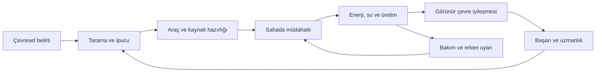
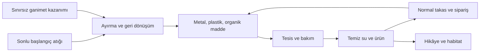

# ECOQUEST
## Oyun Tasarım Belgesi · v4

> **Bugünkü çevresel kararların, gelecek nesillerin yaşam koşullarını belirler.**
>
> Kompakt bir yerleşimi sahada müdahale, temiz üretim ve canlı bir ekosistemle dönüştüren 3D izometrik oyun.

| Belge bilgisi | Değer |
| --- | --- |
| Güncelleme | 27 Ekim 2026 |
| Proje / ekip | TÜBİTAK EcoQuest · Mustafa, Hanefi, Bilge |
| Platform | Windows PC · klavye ve fare · tek oyuncu |
| Motor / oyun sahnesi | Unity 6000.0.74f1 · `Assets/Scenes/EcoWorld.unity` (Build Settings'te ilk sahne) |
| Deneyim | Sakin tempolu çevre iyileştirme: sistem kur, çalıştır, dünyanın değiştiğini gör |
| Ana hikâye | 3–5 saat; finalden sonra serbest oyun |
| Önceki sürüm | `GDD.md` (v3) arşiv olarak durur; 20–27 Ekim ayrıntılı uygulama günlüğü oradadır |
| Bu sürümün dayanağı | v3 + 27 Ekim'e kadarki kararlar + akış incelemesi (`Documentation/GDD_v3_Inceleme.md`) |

**Nasıl okunmalı?** Belge üç kısımdır.

1. **Deneyim (A–B):** Oyuncunun ne hissetmesi gerektiği, ilk oturum ve tempo. Bir özelliğin gerekip gerekmediği önce buna göre tartılır.
2. **Sistemler (§1–§17):** Güncel kurallar. Numaralar v3 ile aynıdır; eski göndermeler geçerli kalır.
3. **Yönetim (§18–§21):** Ölçüm planı, açık sorular, karar kaydı ve uygulama özeti.

Etiketler:
- **Karar:** Kullanıcının seçtiği yön. Ancak kullanıcı değiştirir.
- **Tasarım başlangıcı:** Boşluğu dolduran somut kural. Playtest'le değişebilir.
- **Denge taslağı:** Sayısal başlangıç değeri.
- **Öneri [etiket]:** İncelemeden gelen, henüz onaylanmamış değişiklik. Etiketi şunlardan biridir:
  - **[Karar içinde]:** Mevcut kararları bozmaz.
  - **[Açık soru]:** Belgenin boş bıraktığı bir yeri doldurur.
  - **[Karar değişikliği]:** Bir kararı değiştirir; kullanıcı onayı gerekir.

**Uygulandı** demek, kodda var ve en az bir kez oyunda denendi demektir. Gerçek oyuncu testinin yerini tutmaz.

### İçindekiler

| Deneyim | Sistemler | Sunum ve yönetim |
| --- | --- | --- |
| [A. Deneyim hedefi](#deneyim) | [7. Projeler ve ilerleme](#ilerleme) | [13. Arayüz ve erişilebilirlik](#arayuz) |
| [B. Oyuncu yolculuğu ve tempo](#yolculuk) | [8. Ekonomi ve market](#ekonomi) | [14. Kayıt ve devam](#kayit) |
| [1. Vizyon](#vizyon) | [9. İnşa ve üretim](#uretim) | [15. Görsel ve ses yönü](#sunum) |
| [2. Dünya ve harita](#harita) | [10. Ekoloji, ölçüler ve zaman](#ekoloji) | [16. Eğitsel hedefler ve anket](#egitim) |
| [3. Kontroller](#kontroller) | [11. Araçlar ve tehditler](#mucadele) | [17. Denge ve kapsam](#kapsam) |
| [4. Ana döngü](#dongu) | [12. Final ve serbest oyun](#final) | [18. Ölçüm ve playtest](#olcum) |
| [5. Oyun hissi](#his) | | [19. Açık sorular](#acik) |
| [6. Hikâye ve yönlendirme](#hikaye) | | [20. Karar kaydı](#kararlar) · [21. Uygulama özeti](#durum) |

---

## A. Deneyim hedefi

**Deneyim cümlesi:** Oyuncu kirli bir yerleşimde bir sorunun **nedenini** bulur, doğru aracı ve doğru altyapıyı seçip **kendi kurduğu bir sistemle** çözer ve dünyanın bunu **gözle görülür biçimde** geri verdiğini yaşar. Göl renk değiştirir, balık döner, ölçüm değeri "sağlıksız"dan "iyi"ye iner, çocuk fark eder.

**Hedeflenen estetikler (MDA, öncelik sırasıyla):**
1. **İfade:** Yerleşimi kendi düzeninle kurmak.
2. **Keşif:** Nedeni bulmak, yeri tanımak.
3. **Anlatı:** Çocuk ve değişen dünya.
4. **Zorluk:** Hafif; doğru araç ve sistem seçimi, final.
5. **Teslimiyet:** Sakin vakit, akşam ışıkları.

**Duygu kaynakları (Lazzaro):**
- **Easy Fun:** Merak ve "geri geldi" hayreti.
- **Altered States:** Rahatlama.
- **Hard Fun:** Türe uygun müdahale ve final.
- **People Fun:** Tek oyunculu olduğu için yok. Okulda paylaşım için §19'daki açık soruya bakın.

**Kalp etkinliği:** Bir proje için altyapı kurup 120 saniye çalıştırmak ve sonucu görmek. Ekim, atık ve tehdit bu etkinliği besler; onun yerine geçmez.

### Deneyim sütunları

Her yeni özellik en az bir sütuna hizmet etmelidir. Hizmet etmeyen özellik dondurulmaya veya kesilmeye adaydır. Sınanabilir cümleler §18'deki playtest planında ölçülür.

| Sütun | Anlamı | Sınanabilir cümle | Hizmet eden başlıca sistemler |
| --- | --- | --- | --- |
| **1. Gördüğün neden, çözdüğün neden** | Her sorunun görünür bir kaynağı vardır; doğru müdahale kaynağı hedefler | Oyuncu oturum sonunda en az bir sorunun nedenini ve çözümünü kendi sözleriyle anlatabiliyor mu? | Tarama, bölge kartı ve gerçek ölçüler, kirletici giriş, filtre ve karbon ayrımı (§10, §11) |
| **2. Kurduğun sistem yaşar** | Panel, batarya, boru ve tarla oyuncu bakmasa da çalışır, durunca nedenini söyler | Oyuncu bir sistemin neden durduğunu (gece, kesinti, boş depo) oyunun söylediğiyle anlayıp düzeltebiliyor mu? | İnşa ve ağlar, tesis paneli, P1 ve P5 (§9) |
| **3. Dünya geri verir** | İyileşme sayıda kalmaz; renk, ses, canlı ve çocukla görünür | Proje bitişleri oyuncuların arkadaşına anlatacağı an oluyor mu? | Zemin kirliliği, canlılar, müzik katmanları, çocuk, dönüşüm anı (§5, §6, §15) |
| **4. Sakin ama boş değil** | Ölüm yok, acele yok; ama her bekleme anında anlamlı bir iş var | Oyuncular 10 saniyeden uzun boşta kalıyor mu? Kaybolmuş hissediyorlar mı? | Hedef kartı ve yön oku, hafif ceza, çıkmaza girmeme (§6, §8, §11) |

**Özelliklerin sütunlara dağılımı:**

| Özellik | Sütun | Not |
| --- | --- | --- |
| Tarama, bölge kartı, gerçek ölçüler | 1 | — |
| Türe uygun müdahale | 1, 4 | Hafif risk hissi |
| İnşa, kablo, boru, tesis paneli | 2 | — |
| P1–P6 projeleri | 1, 2, 3 | Kalp etkinliği |
| Hidroelektrik | 2 | İsteğe bağlı; cila önceliği düşük |
| Tesis kademeleri, uzmanlık | 2 | Verim; gerçek seçim için S4 |
| Zemin kirliliği, canlılar, müzik, çocuk | 3 | — |
| Ekim, balık, market | 4 | Bekleme anında iş, kaynak |
| Siparişler | 4 | İsteğe bağlı orta vadeli hedef |
| Hedef kartı, yön oku | 4 | Erişim; keşfe dokunmamalı (S2) |
| Final | 1, 2, 3 | Tehditler türe göre çözülür, yerleşimin enerjisi ve suyu kullanılır, kapanış yerleşimin dönüşümünü gösterir |
| Fener, gece ışıkları | 3, 4 | Kalıp kalmayacağı S7 |

Hiçbir sütuna doğrudan hizmet etmeyen özellik yoktur. En zayıf bağlı olanlar hidroelektrik ve 3. tesis kademesidir. Yeni iş gerektiğinde bunlar ertelenir.

### Oyuncu

- **Hedef oyuncu (tasarım başlangıcı, onay bekliyor: §19 S9):** Temel PC kontrolüne aşina, 14 yaş üstü gençler ve yetişkinler. TÜBİTAK projesi bağlamında lise ve üniversite öğrencileri öncelikli. Çevre bilgisi ön koşul değildir.
- **Motivasyon profili (Yee):**
  - **Yüksek:** Keşif, İlerleme, Kişiselleştirme (yerleşimi kendi düzeninle kurmak).
  - **Orta:** Mekanikler (sistemi verimli işletmek).
  - **Düşük:** Rekabet, Sosyalleşme.
- **Zorluk tercihi:** Fiziksel zorluk düşük; analitik zorluk (neden bulma) ve öngörü (gece, kesinti, rezerv) orta.
- **Acemi ve deneyimli oyuncu:**
  - Acemi oyuncu hedef kartı ve okla ilerler.
  - Deneyimli oyuncu projelerin sırasını kendisi seçer, üretimi optimize eder ve finali erken (%50 hazırlıkla) başlatabilir.
  - Ayrı bir zorluk seçeneği için §19'daki açık soruya bakın.
- **Oturum:**
  - Hedef oturum 30–60 dakika.
  - Doğal bırakma noktaları: proje bitişi (otomatik kayıt), gün sonu, sipariş teslimi.
  - Ana hikâye 3–5 saat, yani 4–8 oturum.

## B. Oyuncu yolculuğu ve tempo

### Hedef hiyerarşisi

| Ölçek | Hedef | Oyuncu nereden görür |
| --- | --- | --- |
| Saniye | Hedefle, çek, sula, ek, vur | İmleç konturu, [E] etiketi, araç efekti ve sesi |
| Dakika | Sıradaki adım ("Bitkini sula · [1] vakum, [Q] su modu") | Üstteki hedef kartı ve yön oku (§6) |
| 20–35 dk | Seçilen projenin koşulları ve 120 saniyelik doğrulama | J günlüğü, proje çubuğu |
| Oturum | 1–2 proje ve bir bakım anı | Günlük, YEP ve uzmanlık |
| Oyun | Finale hazırlık (%50–100), buzulu korumak | Hazırlık yüzdesi, buzul çizgisi |

Aynı anda açık seçenek sayısı: ilk projeden sonra en çok beş proje, üç bakım anı ve iki sipariş. Hedef kartı her an **tek** bir sonraki adım gösterir.

### İlk oturum (gerçek hedef zinciri)

**Karar (27 Ekim, S1):** Gün 900 saniyedir. Gün ışığı 06:00–20:00 arasıdır ve gerçek sürenin üçte ikisini (10 dakika) kaplar; gece 5 dakikadır. Gündüz bir oyun saati ~43 sn, gece ~30 sn eder. Oyun **07:00**'de başlar; ilk gün batımı oyunun **9,3. dakikasında** gelir (Uygulandı; editörde ölçüldü).

**Başlangıç üssü:** Üste hazır bir güneş paneli, rüzgâr türbini, batarya ve şarj istasyonu vardır. Batarya yarı dolu başlar (125/250 EB, Ö1). P1 bu hazır ağı da sayar; bu yüzden ilk proje "ağ kur" değil, "üsteki şarj istasyonunda aracına 10 EB şarj et ve ağ 120 sn beslemeyi sürdürsün"tür.

| Aralık | Hedef kartı | Öğretilen | Duygu |
| --- | --- | --- | --- |
| 0–2 dk | "Mahalle çocuğuyla konuş · Şehir meydanı, [E]" ve yön oku | Hareket, etkileşim, amaç | Merak |
| 2–4 dk | "Tarlaya tohum ek · [2] tohum aracı, sol tık", ardından "Bitkini sula · [1] vakum, [Q] su modu" | Araç ve mod | Küçük başarı |
| 3–6 dk | Bitki büyürken: "İlk enerji · şarj istasyonunda [E] ile aracına 10 EB şarj et (x/10)"; ok üsteki istasyonu gösterir. Araç doluysa "aracın dolu; biraz kullan, sonra…" | Şarj, ağ, depolama | Küçük başarı |
| 4–8 dk | "Mahalleye ilk enerji · doğrulanıyor x/120 sn" | Ağın beslemeyi sürdürmesi | Bekleyiş |
| ~6 dk | "Olgun bitkiyi hasat et · yanında [E]" (araya girer) | Hasat, yeniden ekim (saha başarısı +20 YEP) | Yeterlilik |
| ~6–8 dk (tahmini) | P1 tamam: +40 YEP, uzmanlık hakkı, öğrenme kartı | Üretim, depolama ve tüketim farkı | Doruk |
| ~9 dk | Gün batımı ipucu (Ö2): "Güneş batıyor · panel durur, batarya ve rüzgâr gece işi sürdürür · [6] fener" | Gece ve depolama; fener | Hafif kaygı, rahatlama |
| 8 dk → | Göl: "Gölü canlandır · kirletici girişi kapat, yanında [E]", sonra "~16 plastik eksik (Salya, hasat)" ya da "[B] kıyıya pompa → arıtma → depo kur" | Kaynak, maliyet, planlama | Merak |

Hedef kartının sırası: ekim → sulama → (bitki büyürken) açık projenin adımı → hasat. Proje adımı artık elde ürün olmasını beklemez (Ö3, Ö5; uygulandı, editörde denendi: 07:00 başlangıç, 125 EB batarya, şarj → doğrulama → P1 → göl adımları).

**Düzeltme (27 Ekim):** İlk incelemede "ilk gece P1'i kilitliyor" denmişti. Bu yanlıştı: üsteki hazır ağda rüzgâr türbini ve 80 EB'lik batarya olduğu için P1 gece de tamamlanabiliyordu. Gerçek sorunlar şunlardı:
- Yön oku P1 için Güneş Ovası'nın ortasını gösteriyordu.
- Proje adımı ancak hasattan sonra çıkıyordu.
- Kart ne yapılacağını söylemiyordu.

Üçü de Ö3 ve Ö5 ile düzeltildi.

Hedef: ilk büyük başarı **≤ 15. dakika**; zincir P1 adımına ekim ve sulamadan hemen sonra (~3. dk) geçiyor; P1'in bitişi tahminen ~6–8. dakika. Playtest'te ölçülecek.

### Tempo ve duygu eğrisi

**Tasarım başlangıcı:** Oyunun doruğu savaş değil, **dönüşüm anıdır**. Gerilim tehditlerden, rahatlama ise oyuncunun kendi kurduğu sistemin çalışmasından gelir. Sabit tempo yerine dalga hedeflenir (Baumann 2016).

| Faz | Süre | Hedeflenen duygu | Yoğunluk (1–5) | Oyuncunun kararları | Dinlenme |
| --- | --- | --- | --- | --- | --- |
| Açılış | 0–20 dk | Merak, ilk yeterlilik | 2 | Neyi önce kuracağı | Büyüme süresi; atık toplama |
| İlk gece | ~6–13 dk | Hafif kaygı, batarya sayesinde rahatlama | 3 | Fener, bataryayı nasıl kullanacağı | Sabah |
| Proje döngüsü (×5) | Her biri 20–35 dk | Neden bul → kur → bekle → **dönüşüm** | 2 → 4 → 2 | Hangi proje, hangi konum, hangi kaynak | Proje sonrası bakım, siparişler |
| Final | 8–12 dk | Gerilim, fiero | 5 | Ne zaman başlatacağı (%50 mi, %100 mü), odak sırası | Odaklar arası |
| Serbest oyun | Sınırsız | Huzur, sahiplik | 1 | Kalan projeler, düzen | Her zaman |

**Dönüşüm anı.**
- **Öneri [Karar içinde]:** Ana proje 120 saniyelik doğrulamayı tamamladığında 4–6 saniyelik kısa bir an oynar:
  1. Kamera hafifçe bölgeye döner.
  2. Zemin ve su rengi geçer, canlılar gelir, müzikte kısa bir motif çalar.
  3. Bölge kartı gerçek ölçünün değişimini gösterir: "AQI 169 → 62 · sağlıksız → orta", "Oksijen 3,8 → 7,2 mg/L".
  4. Çocuk tek cümleyle tepki verir.
- Bu an herhangi bir tuşla geçilebilir. Kontrol kaybı bütçesi için §11'e bakın.

**Gece ve gündüz ritmi.** Gece kısa bir "yarı-siper"dir:
- Tehdit doğuşu artmaz.
- Üretim azalır ve depolama önem kazanır.
- Lambalar ve pencereler yanar.

Gece günün üçte biridir (5 dakika, S1 kararı).

### İmza an

**Seçilen aday: "Göl geri geliyor"** (P2, Fabrika Gölü).
- Kirletici giriş kapanır, arıtma suyu göle döner, su rengi değişir, balık sayısı artar.
- Kartta oksijen 3,8 mg/L'den 7 mg/L'nin üstüne çıkar.

İlk oturumda görülmez; ikinci ve üçüncü oturumun doruğudur. İlk oturumun imza adayı **ilk gece**dir: güneş batınca şarj istasyonunun bataryadan çalışmaya devam etmesi. Şu an akşam ışıkları ağdaki enerjiden bağımsız yanıyor (19:00'da), bu yüzden an görünmüyor. **Öneri [Karar içinde]:** Oyuncunun kurduğu şarj istasyonunun çalışma ışığı yalnız ağda enerji varken yansın; böylece batarya gece gözle görülür. İki aday da oyuncunun kendi kurduğu sisteme bağlıdır (Sütun 2 ve 3).

---

## 1. Vizyon ve tasarım ilkeleri

Oyuncu çevresel sorunları olan küçük bir yerleşimde yaşar. Atıkları toplar, uygun araçla yaratıklara müdahale eder, enerji ve su altyapısı kurar, ürün yetiştirir ve habitatı iyileştirir. Evindeki çocuk bu değişimlerin insana ve geleceğe etkisini görünür kılar.

**Karar:** Sahada müdahale, aksiyon ve üretim yönetimi birlikte ana deneyimdir. Oyuncu sonraki çevre projesini kendisi seçer. Sakin tempo, akıcı ve tok etkileşim, sürekli yaşayan çevre korunur.

| İlke | Oyunda karşılığı |
| --- | --- |
| Kısa mesafe, anlamlı iş | Hedef aramak için uzun yürüyüş yerine tanınabilir alanlar ve kısa bağlantılar |
| Görünür neden ve sonuç | Kirli gölün kaynağı, arıtma bağlantısı ve toparlanan canlılar aynı hikâyeyi anlatır |
| Çözüm çeşitliliği | Toplama, ekim, altyapı, türlere uygun müdahale birbirini tamamlar |
| Kalıcı gelişim, canlı dünya | Başarı ve uzmanlık korunur; bakımsız sistemin çevresel sonucu geri gelebilir |
| Geri dönülebilir hata | Ölüm yok, beş saniyelik toparlanma var; yapı yıkılmak yerine onarılabilir |
| Beklemek amaç değildir | Ürün büyürken, hava değişirken veya sipariş beklerken yapılacak başka iş vardır |

**Tasarım başlangıcı:** Hedef kitle temel PC kontrolüne aşina gençler ve yetişkinlerdir; çevre bilgisi ön koşul değildir. Şiddet stilizedir, kan/gore yoktur. Ana oyuncu motivasyonu “bir sistemi kurdum, çalışıyor ve çevre değişiyor” hissidir. Rekabet, çevrim içi ekonomi ve hayatta kalma açlık sayaçları kapsamda değildir.

## 2. Dünya, harita ve grid

**Karar (20 Ekim güncellemesi):** Buzul dahil bütün alanlar tek, yaklaşık **150×150 metre** haritadadır (önceki 200 m kullanıcı isteğiyle küçültüldü). Harita ölçeği tek bir değerden (`Size`) ayarlanabilir. Zemin Unity Terrain değil, alçak poligon bir mesh'tir; yollar ızgara değil, eğri sokak ve patikalardır. İnşa için 2 metrelik hücre mantığı korunur; karakter serbest yürür.

Haritanın yaklaşık yarısı sağlıklı, yarısı sorunlu başlar; her bölge aynı durumda değildir. Şehir güvenli hazırlık alanıdır. Doğal yollar, merkezden çevreye kollar ve bölgeler arasında kısa bağlantılar bulunur. Orman rüzgârlı alanla komşu bir alt bölgedir; iki göl ayrı su koşullarını karşılaştırır.

**Karar (27 Ekim, kullanıcı isteği):** Bölge adları oyuncunun bir bakışta anlayacağı sade adlardır: **Şehir, Güneş Ovası, Rüzgâr Tepeleri, Orman, Balık Gölü, Fabrika Gölü, Fabrikalar, Buzul Dağı** (üs içindeki küçük alanlar: Üs, Eski Atölye). Kayıtlar, keşifler ve projeler bölgeyi değişmeyen bir anahtarla (eski ad) bulur; ad değişse de eski kayıtlar çalışır. Haritadaki bölge kartı 0–100 puanların altında gerçek ölçüleri gösterir: hava için PM2.5 (µg/m³) ve AQI, su için çözünmüş oksijen (mg/L), toprak için organik madde (%), karbon için CO₂ (ppm). Başlangıç değerleri gerçekçi aralıktadır: Şehir AQI ≈ 84 (orta), Fabrikalar AQI ≈ 169 (sağlıksız), temiz bölgeler ≈ 30–57; komşu bölgelerin sıcaklıkları birkaç derece farklıdır (ılıman bahar günü 16–22 °C; buzul yüzeyi ≈ −2,5 °C). Bölge kartındaki "Fırsatlar" listesi kaldırıldı. Yollar tek bir ağdır: sokaklar ya başka bir yola bağlanır, ya harita dışına devam eder ya da dönüş cebiyle biter; kavşaklar tek parça asfalt ve kavisli köşe kaldırımlarıyla birleşir; üs ana caddeye patikayla bağlıdır.

| Alan | İşlev | Başlangıç karşıtlığı / tanınan işaret |
| --- | --- | --- |
| Şehir | Ev, çocuk, market, siparişler, atölye, acil destek | Güvenli meydan ve görünür merkez tabelası |
| Balık Gölü (batı) | Temiz su örneği, erken balıkçılık ve küçük tarım | Canlı kıyı; aşırı kullanım riski |
| Fabrika Gölü (doğu) | Kirli su, Salya, kaynak müdahalesi ve arıtma | Kirli giriş kanalı ve azalan balık |
| Fabrikalar | Fabrika filtresi, emisyon ve enerji dönüşümü | Belirgin baca ve bakım paneli |
| Orman / Rüzgâr Tepeleri | Yangın, ekim, habitat, rüzgâr üretimi | Yeşil ve zarar görmüş ağaç kümeleri |
| Güneş Ovası | İlk üretim, gölge ve yerleşim öğrenimi | Açık ufuk ve güneş paneli silueti |
| Buzul Dağı | İstasyon, karbon takibi ve iklim finali | Karlı kenar, erime çizgisi ve erişilebilir patika |

Buzulun aynı küçük alanda bulunması stilize dünya tercihidir; gerçek bir iklim ölçeği iddiası değildir. Hidroelektrik için göllerden bağımsız doğal akış/kot farkı olan kısa bir akarsu koridoru ayrılır; ayrı sahne gerekmez.

**Dolaşım hedefleri:** Merkezden önemli alana yaklaşık 15–25 saniye; önemli tesislerin arasında okunabilir ve kesilmeyen yol. Bina ayak izi dışında en az bir hücre bakım erişimi korunur. Büyüyen ağaç ve yeni yapı zorunlu geçişi kapatamaz. Su/korunan habitat içine serbest bina yerleşmez. Başlangıçta coğrafya haritada görünür; keşif, sorunların nedenlerini öğrenmektir.

Görüş sisinin görevi uzak ayrıntıyı yumuşatmaktır. Sis tek başına çizimi durdurmaz; kamera mesafesi ve ayrıntı düzeyleri ayrı düzenlenir. Eski 500 metre sınırı bu küçük izometrik haritada zorunlu hedef değildir; kamera erişilebilir oyun alanını kesmemelidir.

**Sahne:** Oyun `EcoWorld` sahnesinden çalışır ve Build Settings'te ilk sırada yer alır (21 Ekim kararı). `MainScene` kullanıcının ayrı çalışmasıdır; araçlar ve menüler ona dokunmaz.

## 3. Kamera ve kontroller

**Karar:** Birinci şahıs yerine 3D izometrik kamera, kameraya göre WASD, sağ tıkla rota ve fareyle bağımsız hedefleme. Kamera karakteri ve yakın çalışma alanını birlikte gösterir.

**Tasarım başlangıcı:** Sabit yönlü izometrik/ortografik görünüm; yaklaşık 45° yatay yön, 50° aşağı bakış; ortografik yarı yükseklik varsayılan 5,5 m, tekerlekle 4–10 m (20 Ekim: kamera kullanıcı isteğiyle yaklaştırıldı; değerler uygulamadakiyle aynıdır). Değerler model boyutuna göre dengelenir. Kamera sınırda yumuşak durur; karakteri örten nesneler saydamlaşır. Saydamlaşma fiziksel engeli kaldırmaz.

| Girdi | Normal oynanış | Bağlama göre |
| --- | --- | --- |
| WASD | Kameraya göre hareket, aktif rotayı iptal | Menüde dünya hareketi üretmez |
| Sağ tık | Ulaşılabilir zemine rota | İnşada önizleme/başlangıç bağlantısını iptal |
| Sol tık / basılı tutma | Hedeflenen noktaya araç kullanımı | UI'da seçim; inşada geçerli yerleşimi onay |
| E | Yakındaki nesnenin gösterilen işlemi | Konuşma, hasat, filtre, tesis, dolum, balıkçılık |
| 1 / 2 / 3 / 4 / 5 / 6 | Vakum / tohum-demir / geri dönüşüm / tarama / boş el / fener | İnşada seçilen yapı kısayolları ekranda ayrıca gösterilir |
| Q | Araç modu | Vakum: çekme–üfleme–su; tohum: ekim–demir |
| R | Varsa aracın açıkça gösterilen özel işlemi | Tohum seçimi, tıkanma giderme; inşada 90° döndürme |
| Tekerlek | Kamera yakınlaştırma | Araç değiştirme yapmaz |
| B / M / J / K | İnşa / harita / projeler / uzmanlık | Tek bir ana panel açık kalır |
| O | Yakındaki markette siparişler | Uzakta market konumunu gösterir, uzaktan teslim etmez |
| F | Final alanındaki hazır terminale odaklı başlatma | Hazırlık ekranındaki onaydan sonra; global kazara çağrı yok |
| F2 / Esc | Ayarlar / geri veya duraklatma | Önce açık paneli kapatır; sonra duraklatır |
| F5 / F9 | Hızlı kayıt / onaylı hızlı yükleme | Kayıt kuralları §14 |
| H / F1 / F3 | Arayüz Tam–Sade–Gizli / kontroller paneli / performans çubuğu | Tuşlar ayarlardan yeniden atanır |

Öncelik: **duraklatma ve modal ekran → inşa → araç ve hareket**. UI tıklaması dünyaya geçmez. Ulaşılamayan sağ tık hedefi açıklamayla reddedilir; karakter duvardan/sudan geçmez. Hedefleme zemine ve uygun hedefe ışınla yapılır; aradaki fiziksel engel saldırıyı durdurur. Etkileşim adayı kontur ve E etiketiyle gösterilir; aynı tuş tek işlem yapar.

Planlama ekranları dünyayı %10 hıza indirir, duraklatma durdurur. Panel değiştirirken hız yanlışlıkla normale dönmez; bütün paneller kapandığında önceki normal akış geri gelir.

## 4. Core Game Loop — ana oynanış döngüsü

**Fark et → incele → hazırlan → müdahale et → üretimi bağla → sonucu gör → geliş → bakım yap veya yeni proje seç.**

| Süre ölçeği | Oyuncunun yaptığı | Kazanımı |
| --- | --- | --- |
| Saniyeler | Toplama, hedefleme, ekim, kaçınma | Net ses, temas, animasyon ve kaynak değişimi |
| 2–5 dakika | Kıyı temizleme, ürün bakımı, hat bağlama | Görülebilir yerel sonuç |
| 20–35 dakika | Seçilmiş projede nedenleri ve altyapıyı çözme | Kalıcı başarı, uzmanlık, hikâye tepkisi |
| 3–5 saat | Birbirini destekleyen projeler ve final | Yerleşimin dönüşümü, ardından serbest oyun |

### İlk oturum

İlk oturumun gerçek hedef zinciri, saatleri ve bilinen sorunu **B. Oyuncu yolculuğu ve tempo** bölümündedir. Aralıklar hedef ritimdir; oyuncuyu zaman baskısıyla başarısız sayan sayaç değildir.

### Örnek: gölü canlandırma

Fabrika Gölü'nde kirli renk ve azalan balık dikkat çeker → tarama giriş kanalını gösterir → Salya ve atıklar temizlenir → kirlilik kaynağı azaltılır → pompa/arıtma/depo enerji ve boruyla bağlanır → su kalitesi ve canlılar toparlanır → başarı kazanılır → üretimin sürekliliği izlenir. Sadece yaratık yenmek gölü tamamlamaz; bütün haritanın kusursuz olması da gerekmez.

## 5. Game Feel — oyun hissi

**Karar:** Akıcı ve tok etkileşim. Animasyonlar okunaklıdır; basit bir işlem uzun kontrol kilidi yaratmaz.

| Eylem | Görsel | Ses / his |
| --- | --- | --- |
| Yürüme | Kısa hızlanma-yavaşlama, araziye oturan adım | Zemine uygun sakin adım |
| Vakum | Nesnenin ağıza doğru çekilmesi ve girdap | Yük ve mesafeyle değişen çekiş |
| Su | Damlacık akışı, temas sıçraması, sönen alev | Akış ve kısa söndürme sesi |
| Tohum / demir | Okunur mermi; ekimde anında fidan/toprak izi | Ekimde yumuşak, demirde tok temas |
| İsabet | Küçük savrulma, kısa ışık/animasyon | Hedef türüne uygun tepki |
| Yanlış işlem | Hedef yanında kısa neden ve simge | Bir kez uyarı; basılı tutuşta ses yağmuru yok |
| Çevre toparlanması | Su rengi, yaprak, kuş ve kelebek dönüşü | Canlanan ortam katmanları |
| Proje tamamlanması | Dönüşüm anı: bölgeye kısa kamera dönüşü, ölçü değişimi (öneri, bkz. B) | Kısa müzik motifi, çocuğun tepkisi |

**Denge taslağı:** Normal düşman 0,2–0,5 m savrulur; ağır Teneke daha az, boss yalnız tepki animasyonu alır. Aynı hedef 0,4 saniyede bir tam savrulma alır; sonsuz sersemletme oluşmaz. Oyuncuya sürekli uzanan çubuk ışınlar kullanılmaz. Düşman mermi yolu sürekli çizilmez; saldırı hazırlığı ve gerçek mermi yeterli bilgiyi verir.

Kamera sarsıntısı varsayılan hafif, kapatılabilir; büyük efektler hedefi, fidanı ve tehlike sınırını örtmez. Yeni tohum ilk kareden itibaren görünür; susuzluk, kirlenme, olgunluk şekil ve simgeyle ayrılır.

## 6. Hikâye, bakım ve yönlendirme

Çocuk gelecek nesli temsil eder. Kirli havaya, sıcağa ve geri dönen canlılara tepki verir. **Sürekli azalan açlık/susuzluk göstergesi yoktur.** Bakım görevleri sınırlı hikâye anlarıdır; oyuncu her birkaç dakikada eve dönmek zorunda bırakılmaz.

**Tasarım başlangıcı — üç bakım bölümü:**

| Bölüm | İstek ve açılma | Sonuç |
| --- | --- | --- |
| Temiz bir bardak su | İlk enerji projesi sonrası; 5 temiz su birimi | Arıtma ihtiyacını anlatan konuşma, ilk kez 20 YEP |
| Sağlıklı sofra | İlk temiz hasat/balık sonrası; 2 temiz ürün veya 1 temiz balık | Gıda–su ilişkisi, ilk kez 20 YEP |
| Penceredeki kuşlar | Orman projesi sonrası; ev çevresinde canlı habitat | Doğa tepkisi, ilk kez 20 YEP |

Kirli gıda teslimi reddedilir ve neden açıklanır; çocuk üzerinden cezalandırıcı zarar döngüsü kurulmaz. Diğer günlük konuşmalar ödülsüz bağ kurar. Finalde önceki çevre/bakım değişimlerine göre kısa bir kapanış konuşması vardır.

**Yönlendirme (27 Ekim kararı):** Üstteki hedef kartı her an tek bir sonraki adımı ve tuşunu söyler ("Tarlaya tohum ek · [2] tohum aracı, sol tık"). Hedefin bir yeri varsa üstünde bir işaret ve mesafe görünür. Hedef ekran dışındaysa ekran kenarında yön oku ve "Mahalle çocuğu 81 m" gibi bir etiket çıkar. Projelerde ok ilgili yeri gösterir: kirletici giriş, filtresiz fabrika, orman, buzul istasyonu.

Ok şu durumlarda görünmez:
- Hedefe 5 m'den yakınken.
- Bir panel veya harita açıkken.
- Arayüz gizliyken.

Hedef kartının önceliği: final → 30 m içindeki tehdit → çocukla tanışma → ekim → hasat → sulama → açık projenin bir sonraki adımı → atık toplama. Proje adımı somut işi ve tuşu söyler: "şarj istasyonunda [E]", "kirletici girişi kapat", "~16 plastik eksik (Salya, hasat)", "doğrulanıyor x/120 sn" (27 Ekim, Ö3/Ö5).

Çevresel belirtiler, konuşma ve tarama yönlendirmenin ikinci katmanıdır. Proje günlüğü (J) **belirti / bilinen neden / olası müdahale / gözlenen sonuç** kartlarını tutar. Üç ipucu kademesi sunar: bölgeyi hatırlat → sorunun türünü açıkla → ilgili noktayı geçici işaretle. Başlangıç öğretimi tekrar açılabilir, okunmuş metinler geçilebilir.

**Öneri [Karar içinde] (§19 S2):** Yön oku öğretici zincirde (çocuk → P1) her zaman açık kalsın. P1'den sonra projelerde ok, üçüncü ipucu kademesinin ("Yerini göster") 60 saniyelik işareti olsun. Ayarlarda "Her zaman / Öğretici / Kapalı" seçeneği bulunsun. Amaç: ilk dakikalarda kaybolmayı önlerken orta oyunda nedeni bulma merakını (Sütun 1) oyuncuya bırakmak.

## 7. Progression Loop — projeler, YEP ve uzmanlık

**Proje seç → çözümü kur → sonucu sürdür → kalıcı başarı kazan → uzmanlaş → yeni sorunu ele al.**

Başlangıç projesi yönlendiricidir; sonrakiler oyuncu seçimine açıktır. Bölgeler fiziksel olarak kilitli değildir. Temel çözüm tarifleri sorun keşfedilince açılır; gölü temizlemek için önce başka bir projede YEP biriktirme zorunluluğu kurulmaz.

### Altı ana proje

Aşağıdaki eşikler **tasarım başlangıcıdır**. Her satırın ilgili koşulları birlikte **120 simülasyon saniyesi** korunur. Normal hızda iki gerçek dakika, %10 hızda yirmi gerçek dakika eder; hızlandırılmış gün takviminin iki dakikası değildir. Koşul kaybolursa mevcut doğrulama sayacı sıfırlanır; tamamlanmış proje geri alınmaz. Oyuncunun aynı yerde beklemesi gerekmez.

| Proje | Somut eylem ve başarı şartı | Sonuç |
| --- | --- | --- |
| P1 · Mahalleye ilk enerji | Çalışan üretici, kablo, batarya ve şarj aynı ağda; araç toplam en az 10 EB şarj olmuş; ağ doğrulama boyunca üretim/rezervle şarj istasyonunu besleyebilir | 40 YEP; enerji kullanımını öğrenme; sonraki proje ipuçları |
| P2 · Gölü canlandır | Fabrika Gölü'nün kirletici girişine müdahale; o gölden su alan enerji bağlı pompa–arıtma–depo çalışır; arıtılmış suyun göle dönüşü açık; yerel su kalitesi ≥70 | 40 YEP; temiz balıkçılık/üretim; hidro tarifi |
| P3 · Ormanı toparla | Orman alt bölgesinde bitki örtüsü ≥%60, habitat toparlanması ≥%50; o bölgede aktif yangın yok; sağlıklı ekim mevcut | 40 YEP; kuş/kelebek dönüşü; ev çevresi bakım bölümü |
| P4 · Sanayiyi dönüştür | Projeye işaretli fabrikaların filtreleri etkin; temiz enerji dönüşümü yapılmış; Fabrikalar bölgesinin hava kalitesi ≥70 | 40 YEP; azalan emisyon ve hava baskısı |
| P5 · Yerleşimi dayanıklı yap | Bir kaynak devre dışıyken pompa/arıtma/şarj gibi seçili temel hizmetler aynı ağdan 120 sn beslenir; temiz su rezervi de tüketimi karşılar | 40 YEP; enerji ve su sürekliliği |
| P6 · Buzulu koru | İstasyon kurulup etkin; alan ağırlıklı dünya karbon endeksi ≤20; buzulun erime hızı sıfır veya altında | 40 YEP; stabil erime çizgisi ve finale hazırlık |

Orman projesi için önce yangın çıkarmak gerekmez. Başka bölgedeki yangın yerel orman başarısını engellemez. İstasyon ölçer; tek başına karbon düşürmez. Şarjın geçmişte bir kez gerçekleşmesi, boş bir batarya veya bağlantısız arıtıcı “çalışıyor” sayılmaz.

**P5 rezerv hesabı:** Gerekli elektrik, 120 saniyelik temel tüketimden mevcut güvenilir üretim çıkarılarak bulunur. Su rezervi de aynı süredeki tüketimi karşılar. Oyuncu seçtiği üreticiyi kontrol panelinden geçici kapatıp sistemi işletir; projeden dolayı haritanın tüm elektriği kesilmez.

**P1'den P2'ye geçiş (hesap):** P1 üsteki hazır ağla tamamlandığında başlangıç stoğu (50M+40P) bütünüyle kalır. P2'nin kabaca maliyeti şöyledir:

| Kalem | Maliyet |
| --- | --- |
| Pompa | 8M+8P |
| Arıtma | 20M+16P |
| Depo | 10M+14P |
| ~15 m boru | 0M+30P |
| ~10 m kablo | 10M+10P |
| **Toplam** | **≈ 48M+78P** |

Oyundaki tahmin kıyıda ~6 m boru ve kablo varsayar: ≈ 44M+56P. Başlangıç stoğuyla eksik yaklaşık 16 plastiktir; bu, üç Salya ya da birkaç temiz hasat eder. Kendi ağını kurup P1'i öyle bitiren oyuncuda eksik daha büyüktür.

**Uygulandı (Ö5):**
- J'deki proje kartı tahmini malzemeyi ve eldekini gösterir ("Tahmini malzeme: ~44 metal · ~56 plastik (sende 50 · 40)").
- Malzeme eksikken hedef kartı eksiği ve kaynağını söyler ("Gölü canlandır · ~16 plastik eksik (Salya, hasat)").
- Tahmin; göl, Fabrikalar (büyük filtre, dönüşüm paketi) ve dayanıklılık için yalnız eksik yapıları sayar.

**Öneri [Karar içinde], bekliyor:** Göl kıyısında pompa, arıtma ve depoyu 6 m içinde kurmaya uygun düz bir alan işaretlensin.

### YEP ve açılmalar

YEP = **Yenilenebilir Enerji Puanı**; kalıcı başarı puanıdır, takas parası değildir. **Tasarım başlangıcı:** Her 40 YEP bir uzmanlık hakkı verir; toplam 360 YEP ile 9 hak. Eski 24/48 seviyelik tekrar toplama eğrisi hedef tasarım değildir.

| Tek seferlik ödül | Miktar | Toplam |
| --- | --- | --- |
| Altı ana proje | 6 × 40 YEP | 240 |
| Üç bakım bölümü (§6) | 3 × 20 YEP | 60 |
| Üç saha başarısı | 3 × 20 YEP | 60 |
| **Tamamı** | **9 uzmanlık hakkı** | **360 YEP** |

Üç saha başarısı: ilk temiz hasat ve sürdürülebilir yeniden ekim; ilk kaynak koşulunu sağlayan temiz balık; hatalı çevresel yerleşimi önizlemede görüp uygun alana kurma. Sonuncusu hasar vermeyi değil uyarıyı kullanmayı ödüllendirir.

Ganimet, tekrar hasat, düşman avı, aynı yapıyı kur/sök veya alanı yeniden kirlet/temizle sınırsız YEP vermez. Ödül kimliği kayıtlıdır ve yalnız bir kez işlenir. Çevre bozulsa da ödül, uzmanlık ve tarifler geri alınmaz.

### Uzmanlık

| Dal | Kademe başına başlangıç etkisi | Üç kademede toplam |
| --- | --- | --- |
| Enerji | Araç elektrik gideri −%8; temiz enerji üretimi +%6 | −%24 gider; +%18 üretim |
| Su | Pompa/arıtma debisi +%12; araçta su kullanımı −%5 | +%36 debi; −%15 su gideri |
| Ekoloji | Habitat toparlanması +%10; geri dönüşüm hızı +%15; büyüme hızı +%8 | +%30 / +%45 / +%24 |

Bonuslar taban değere eklenir; çarpılarak katlanmaz. Ekoloji geri dönüşüm bonusu malzeme yoktan yaratmaz, işlem hızını etkiler. Her kademe bir hak; ikinci kademe aynı dalın ilkini ve iki ana projeyi, üçüncü kademe ikinciyi ve dört ana projeyi ister. Dallar birbirini kalıcı kilitlemez. Merkezde ücretsiz yeniden dağıtım vardır; alışveriş veya kaynak ödülü üretmez.

**Not:** 9 hak 9 kademeye eşittir; bütün ödülleri alan oyuncu bütün kademeleri alır, seçim yalnız sıralamadır. Gerçek seçim için §19 S4'e bakın.

Gölü tarayınca temel su altyapısı, Fabrikalar'ı tarayınca filtre/dönüşüm tarifi, ilk enerji sonrası rüzgâr, orman ipucu sonrası ağaç tohumu açılır. Uzmanlık verimi geliştirir; temel toparlanmanın tek anahtarı değildir.

## 8. Ekonomi, envanter, market ve siparişler

### Kaynak döngüsü

**Karar:** Başlangıç çöpleri sonludur. Düşman ganimetinin kazanımına günlük veya toplam kota konmaz. Düşman sayısı/oluşum hızı çevreye bağlıdır; “sınırsız ganimet” aynı anda sınırsız düşman anlamına gelmez. Oyuncu kirliliği sürdürerek malzeme biriktirebilir; bu olasılık gizlenmez. Proje/YEP ilerlemesi bundan ayrıdır. Hesap: kirli dört bölgede günde en çok ~24 tehdit, ganimetle ~70P eder (§11). Domates tarımı günde ~96P verir. Kirliliği sürdürmek tarımdan kârlı değildir. Market alım kotası doğrudan düşen metal/plastiği veya bina inşasını sınırlamaz.

| Kaynak | Kaynak ve kullanım | Stok kuralı |
| --- | --- | --- |
| Metal / plastik | Atık ve ganimet işleme; inşa, tamir, ekipman | Ortak yerleşim stoğu, taşıma seferi yok |
| Organik madde / gübre | Organik kalıntı ve bozuk ürün; bitki bakımı | Ortak stok |
| Tohum | Başlangıç, hasat geri dönüşü, market | Tür bazlı; araçta sınırlı taşıma |
| Temiz / kirli su | Doğal kaynak, pompa ve arıtma | Ayrı kalite, kapasitesi belli depo ve araç |
| Ürün / temiz balık | Yetiştirme ve su ekosistemi | Tür ve kalite korunur; temel sürümde zamanla çürümez |
| Demir top / filtre | Market veya temel atölye tarifi | Araç kapasitesi; fazlası ortak stokta |
| Elektrik | Üretim ve batarya | Yerleşim ağı ile araç bataryası ayrı |
| Karakter enerjisi | Müdahale dayanımı | Kaynak stoğu değil; §11 toparlanma sistemi |

### Normal takas ve günlük limit

Ayrı para birimi yoktur. Market temiz ürün/balık karşılığında metal/plastik, malzeme karşılığında tohum, demir top ve filtre sağlar. Temiz ürün satışı sınırsızdır. Aşağıdaki **alım** oyuncunun marketten aldığı pakettir; marketin oyuncudan aldığı ürün miktarı değildir.

**Denge taslağı — bütün marketlerde ortak günlük stok:**

| Ürün | Bir paket | Paket maliyeti | Günlük alım | Açılma |
| --- | --- | --- | --- | --- |
| Demir top | 5 adet | 3 metal | 8 paket = 40 adet | Başlangıç |
| Lahana tohumu | 5 adet | 2 plastik | 4 paket = 20 adet | Başlangıç |
| Havuç / domates / ağaç tohumu | Her biri 5 adet | 3 plastik | Tür başına 3 paket = 15 adet | İlgili tarım/orman ipucu |
| Küçük filtre | 1 adet | 2 metal + 1 plastik | 4 paket | Teneke taraması |
| Büyük fabrika filtresi | 1 adet | 6 metal + 4 plastik | 2 paket | Fabrikalar taraması |

Yenileme oyun gününün başlangıcında bir kez olur. Başarısız işlem kota tüketmez; geri satış kotayı iade etmez. Kayıt/yükleme ve farklı marketler aynı günlük sayacı kullanır. Paket bölünerek kotadan kaçılmaz.

**Normal ürün karşılıkları:** 1 temiz lahana → 2M+1P; havuç → 2M+2P; domates → 3M+2P; temiz balık → 4M+2P. M metal, P plastiktir. Marketten ürün alıp daha kârlı geri satma tarifi yoktur. Kirli ürün/balık temiz ürün olarak kabul edilmez; organik işlemeye yönlendirilir.

### Üç günlük avantajlı siparişler

**Karar:** Normal takasa ek, her üç oyun gününde isteğe bağlı daha avantajlı talepler. İlk dönem gün 3–5, sonra 6–8, 9–11…; iki sipariş, bir sonraki dönemde yenilenir. Teslim tek seferdir. Süre dolması ceza, YEP kaybı veya hikâye kaybı yaratmaz.

**Tasarım başlangıcı:** Yalnız açılmış ve üretilebilir ürünlerden talep seçilir. Bir sipariş 4 veya 8 adet aynı temiz ürünü/balığı ister; böylece aşağıdaki tam sayı karşılıklarında %25 avantaj yuvarlamayla kaybolmaz. Tür, kalite, miktar, son gün ve ödül baştan görünür. Ödül normal toplam metal/plastik karşılığının %25 fazlasıdır. Örnek: 4 temiz domatesin normal 12M+8P karşılığı, siparişte 15M+10P olur. İleride oran değişirse gösterilen gerçek ödül normal takastan mutlaka yüksek kalır.

Sipariş metal/plastik ödülü alım kotasına dahil değildir. Kısmi ürün yatırma yoktur; bütün teslim ve ödül tek işlem olur. Dönem kimliği, talepler ve teslim bayrağı kaydedilir; yükleme yeniden kura çekmez. Üç–beş saatlik oyunda yaklaşık 12–20 gün ve 4–6 sipariş dönemi beklenir; sipariş beklemek ana ilerlemenin şartı değildir.

### Çıkmaza girmeme

**Tasarım başlangıcı:** Güvenli ilk çevrede en az 50M+40P eşdeğer sonlu malzeme, 5 lahana tohumu, 20 temiz su ve dolu araç bataryası bulunur. Yaklaşık 8 metre kabloyla ilk panel–batarya–şarj zinciri 34M+24P tutar; başlangıç stoğuna sığar.

Merkezde elektriksiz elle ayırma ve yavaş acil şarj vardır. Araç elektriği sıfırken 30 saniyelik etkileşimle 15 EB alınabilir. Tohum veya su tamamen tükenirse ortak stok dahil kontrol edilerek **1 temel tohum + ilk sulamaya yetecek 2 SB** sağlanır; bu ürün ticareti için sürekli çekilemez. İlk temiz kıyıda düşük debili elle su alımı bulunur.

Günlük filtre/mermi kotası dolduğunda atölye eldeki malzemeyi aynı temel tarifle, paket başına 45 simülasyon saniyesinde işler. Sipariş verildikten sonra panel kapatılabilir, üretim sürer. Bu yol yeni malzeme üretmez; marketin hızlı tedarik rolünü korur. Bir tamiri yalnız bozuk tesisin ürünüyle finanse etmek zorunlu değildir. Fazla ganimet veya depo taşıması sessizce silinmez; toplanamayan nesne işaretli kalır.

## 9. İnşa, altyapı, tarım ve binalar

### Kurulum ve ağ kuralları

**Karar:** Uygun zeminde gridle serbest inşa; fiziksel kablo ve boru; ortak metal/plastik; çalışan tesislerde otomatik üretim. Nakliye kamyonu veya ayrıntılı taşıma lojistiği yoktur.

Yerleştirme: yapı seç → ayak izi ve çevre etkisini gör → döndür → maliyeti/bağlantıyı gör → onayla. Geçersiz zeminde neden gösterilir, kaynak harcanmaz. İnşa panelinde yapı ve bağlantı maliyeti ayrı okunur. Kablo yol üzerinde geçişi engellemez; su hattında akış yönü ve temiz/kirli tip simgesi bulunur.

**Birimler:** EB elektrik birimi, SB su birimidir. EB/sn güçtür; batarya EB depolar. Bunlar oyun birimleridir, kWh veya gerçek litre verim iddiası değildir. Tesis hızı simülasyon saniyesiyle hesaplanır.

| Yapı | Ayak izi (2 m hücre) | M / P | Başlangıç kapasitesi ve işlev |
| --- | --- | --- | --- |
| Güneş paneli | 2×2 | 12 / 6 | Uygun gündüzde en çok 4 EB/sn |
| Rüzgâr türbini | 3×3 | 80 / 40 | Uygun rüzgârda en çok 6 EB/sn; sakin havada sıfıra iner |
| Batarya | 1×1 | 8 / 6 | 240 EB; en çok 6 EB/sn doldurma/boşaltma |
| Şarj istasyonu | 1×1 | 6 / 4 | Araç bataryasına en çok 4 EB/sn |
| Su pompası | 1×1 | 8 / 8 | 1 SB/sn; SB başına 1 EB; kıyıda uygun alım |
| Su arıtma tesisi | 2×2 | 20 / 16 | 1 SB/sn; SB başına 2 EB; kirli giriş, temiz çıkış |
| Su deposu | 2×2 | 10 / 14 | 120 SB; temiz ve kirli ayrı bölmeler/tipler |
| Geri dönüşüm tesisi | 2×2 | 16 / 8 | Bir standart atık paketi / 3 sn; işlemde 2 EB/sn |
| Tarla | 3×3 | 2 / 4 | Dört ekim yuvası; temiz suyla otomatik devam sulaması |
| Küçük hidroelektrik | 3×3 + kıyı erişimi | 60 / 30 | Doğal akışa göre 0–6 EB/sn; gece de üretim |
| Buzul izleme istasyonu | 2×2 | 12 / 8 | Yerel küçük güneş/batarya dahil; ölçüm ve rapor |
| Elektrik kablosu | Hat | Metre başına 1 / 1 | Aynı ağın üretim/tüketimini bağlar |
| Su borusu | Hat | Metre başına 0 / 2 | En çok 2 SB/sn; su türü ve yönü belirli |

Tablo **denge taslağıdır**. Bina maliyetleri mevcut prototipten başlangıç referansı alır; ayak izi, hız ve kilitleri uygulandı diye okunmaz. Türbin için eski seviye başına bina kotası yoktur; alan, maliyet, habitat ve şebeke ihtiyacı sınırlar.

Ev, market/sipariş panosu ve atölye merkezde hazır hizmet yapılarıdır. Fabrika, Fabrikalar bölgesindeki mevcut sorunun kaynağıdır; oyuncu yeni kirletici fabrika kurmaz. **Sanayi dönüşüm paketi:** fabrika başına 20M+12P, temiz şebekeye bağlantı ve 2 EB/sn işletme; filtreden ayrı işlem. Enerjisizse üretim durur, otomatik kirli yakıta dönmez.

### Elektrik ve su akışı

Elektrikte önce bağlı üretim kullanılır, açık varsa batarya boşalır, fazla üretim bataryaya gider. Öncelik sırası pompa/arıtma → şarj → geri dönüşüm → isteğe bağlı hizmetlerdir; aynı öncelikte yükler orantılı pay alır. Güç yetersizliği üretimi yavaşlatır/durdurur; malzeme yok etmez. Ağ döngüsü elektrik çoğaltmaz.

**Standart geri dönüşüm tarifleri:** Bir metal atık paketi → 1M; bir plastik atık paketi → 1P; üç organik birim → bir gübre. Büyük dünya nesnesi üzerinde kaç paket içerdiği gösterilir. Kirli hasat veya kirli balık bir organik birime işlenir. Elde ve tesiste temel çıktı aynıdır; fark işlem süresi ve elektrik kullanımındadır. Tarif, malzemeyi geri satın alıp çoğaltan bir çevrim oluşturmaz.

**Kirli kaynak → pompa → kirli boru → arıtma → temiz boru → depo → tarla / araç.** Doğal temiz kaynak arıtmayı atlayabilir. Kirli girişin doğrudan temiz hatta bağlanması reddedilir. Dolu depo pompayı durdurur; içeriği taşırıp silmez.

Doğal gölü temizlemek için arıtıcıda **göle temiz dönüş** modu bulunur; çekilen kirli su temizlenip aynı göle döner. Depoya alınan suyla çevre arıtımı aynı çıktı iki kez sayılmaz. Örnek denge: 20 SB göl dönüşü yerel su kirliliğini 1 puan azaltır; devam eden kirli giriş bununla yarışır. Sadece temiz su üretmek, kirletici kaynağı ortadan kaldırmış sayılmaz.

### Hidroelektriğin amacı

**Tasarım başlangıcı:** Göl projesi sonrası isteğe bağlı küçük akarsu santrali; güneş/rüzgâra alternatif gece üretimi sağlar. Yalnız doğal debi ve kot farkı olan işaretlenmiş kıyı hücrelerinde kurulabilir. Balık geçidi ve aşağı havzaya ayrılan asgari akış kurulumun parçasıdır. Fazla tesis aynı suyu tekrar bağımsız kaynakmış gibi sayamaz.

Kuraklıkta debi ve üretim düşer, eşik altında santral durur. Su tüketmez veya arıtmaz. Oyuncu pompasıyla devridaim yapıp bedava elektrik üretilemez. Yanlış konumun habitat etkisi önceden gösterilir; koruma eşiğini ihlal eden kurulum reddedilir. Hidroelektrik proje/final için zorunlu değildir. Büyük baraj, su altında kalan alan ve yerleşim taşıma bu sürümün dışında kalır.

### İşletme, kademe ve arıza

Her tesisin paneli girdi/çıktı, kapasite, bağlı hat, verim ve durma nedenini gösterir. **Tasarım başlangıcı:** Üretim/depolama tesisleri üç kademelidir. İkinci kademe iki proje sonrası taban yapım maliyeti kadar ilave malzemeyle, üçüncü kademe dört proje sonrası tabanın iki katıyla açılır. Kapasite/debi 1× / 1,5× / 2×; işlem başına gider aynı kalır. Bu sayede daha hızlı işleyen pompa daha çok toplam güç ister.

Dayanıklılık sıfırda yapı ve içeriği korunur, üretim durur. Tamir maliyeti eksik dayanıklılık oranı × taban malzemenin %25'i, yukarı yuvarlamadır. Söküm taban maliyetin %50'sini verir; depodaki içerik önce uyumlu depoya aktarılmalı, yer yoksa söküm durur. Taşıma aynı maliyet/bağlantı önizlemesiyle yapılır, tekrarlı YEP vermez. Fabrika ve merkez hizmetleri oyuncu tarafından sökülemez.

### Ekim, sulama ve hasat

İlk tohum ve ilk 2 SB sulama oyuncudadır; çalışan tarla kalan sulamayı sürdürür. Uygun doğal ekim alanında oyuncu elle bakım yapabilir. Durumlar: **ekildi/fidan → susuz veya büyüyor → olgun → hasat**, ayrıca kirlenme/zararlı ve kuruma. Görsel ilk ekimde belirir.

| Ürün | Uygun sıcaklık | Büyüme süresi | Bir döngü su | Hasat |
| --- | --- | --- | --- | --- |
| Lahana | 8–28 °C | 180 sn = 0,20 oyun günü | 8 SB | 2 ürün + 1 aynı tohum |
| Havuç | 5–22 °C | 240 sn ≈ 0,27 gün | 10 SB | 3 ürün + 1 aynı tohum |
| Domates | 18–34 °C | 300 sn ≈ 0,33 gün | 14 SB | 4 ürün + 1 aynı tohum |
| Ağaç | 4–36 °C | 360 sn = 0,40 gün | 12 SB kuruluş suyu | Kalıcı habitat; gıda hasadı yok |

Süreler uygun koşul ve normal hız içindir; 15 dakikalık gün esas alınır. Olgun ürünü toplamak oyuncudadır. İlk sağlıklı yetişen ağaç bir kez bir tohum geri verir; tekrar tekrar ödül üretmez.

Nem bitince büyüme durur ve uyarı çıkar; en az 120 simülasyon saniyesi müdahale süresi sonrası sağlık azalmaya başlar. İklim uyumsuzluğu ekim öncesi gösterilir; zorla uygun olmayan yere ekim ilerleme şartı değildir. Kirlenmiş ürün hasat öncesi temiz su/bakımla toparlanabilir; kirli hasat organiğe işlenir, gıda olmaz. Organik gübre oyunda zararlı baskısını azaltan stilize bakım aracıdır; her gübrenin gerçekte böcek kovduğu iddia edilmez.

Bir temiz gölde başlangıç balık nüfusu 12, güvenli av alt sınırı 4'tür. Su kalitesi ≥70 ve nüfus altında ise 120 saniyede en fazla bir balık geri gelir; kirli veya habitatı bozuk suda yenilenme azalır. Av 3–5 saniyelik erişilebilir etkileşimdir; hızlı refleks zorunluluğu yoktur. Nüfus 4'e düşünce av kapanır ve neden gösterilir. Böylece balık yenilenebilir ama sınırsız anlık stok değildir.

## 10. Çevre göstergeleri, hava ve zaman

### Gösterge modeli

Ana göstergeler hava, su, toprak, karbon, biyoçeşitlilik, ekosistem sağlığı ve sıcaklıktır. Göstergeler **oyun modelidir**; gerçek dünyaya ait tahmin veya bilimsel ölçüm olarak sunulmaz. **27 Ekim kararı:** Bölge kartı her 0–100 puanın altında gerçek dünyadaki karşılık birimini gösterir, çevre kartı da kısa halini. Amaç, oyuncunun puanı tanıdığı bir ölçekle okumasıdır (Sütun 1).

| Puan | Gösterilen gerçek ölçü | Dönüşüm (uygulamadaki) |
| --- | --- | --- |
| Hava kirliliği a | PM2.5 (µg/m³) ve AQI | PM2.5 = 3 + 1,2a; AQI ABD EPA 2024 kırılma noktalarıyla; ad: iyi / orta / hassas gruplar için sağlıksız / sağlıksız … |
| Su kirliliği w | Çözünmüş oksijen (mg/L) | max(0,5; 9,6 − 0,09w) |
| Toprak kirliliği s | Organik madde (%) | 0,5 + 4,5·(1 − s/100)^1,5 |
| Karbon k | CO₂ (ppm) | 425 + 2,5k |

**Başlangıç değerleri:**

| Bölge | Sıcaklık | Hava | Diğer |
| --- | --- | --- | --- |
| Şehir | ≈ 21 °C | AQI ≈ 84 (orta) | — |
| Fabrikalar | ≈ 22 °C | AQI ≈ 169 (sağlıksız) | CO₂ ≈ 570 ppm |
| Fabrika Gölü | — | — | Oksijen ≈ 3,8 mg/L |
| Temiz bölgeler | 16–20 °C | AQI ≈ 30–57 | — |
| Buzul Dağı | ≈ −2,5 °C | — | — |

Komşu bölgelerin sıcaklık farkı birkaç dereceyi geçmez.

| Gösterge | Tasarım başlangıcı | Yön |
| --- | --- | --- |
| Hava / su / toprak kalitesi | 100 − ilgili kirlilik endeksi | Yüksek iyi |
| Karbon endeksi K | Bölgesel kaynaklar ve azaltıcı etkilerle 0–100 | Düşük iyi |
| Biyoçeşitlilik B | 55V + 30H + 0,15W | Yüksek iyi |
| Ekosistem sağlığı E | 0,30A + 0,25W + 0,20S + 0,25B | Yüksek iyi |
| Sıcaklık | Bölgenin taban sıcaklığı + 0,08K + 0,025 hava kirliliği | Ürüne/bioma göre uygun aralık |

V bitki örtüsü, H habitat toparlanmasıdır (0–1). A hava, W su, S toprak kalitesidir (0–100). Sonuçlar 0–100'e sınırlanır. Su yüzeyi olmayan alanda bağlı havzanın kalitesi kullanılır. Aynı gösterge harita ve HUD'da aynı formülle hesaplanır.

Dünya karbonu, çakışmasız bölge alanlarıyla ağırlıklı ortalamadır; çok sayıda küçük temiz bölge eklemek ortalamayı yapay düşürmez. Biyoçeşitlilik/ekosistem özettir; ayrı gizli hasar üretmez. Günlük eğilim ve en güçlü iki neden gösterilir.

### Neden ve sonuç

| Kaynak / koşul | Etki | Çözüm |
| --- | --- | --- |
| Filtresiz fabrika | Hava kirliliği ve kirli üretim karbonu | Filtre partikül baskısını azaltır; temiz enerji dönüşümü karbon kaynağını azaltır |
| Kirli kanal ve Salya | Su kalitesi, balık, arıtma debisi | Girişe müdahale, Salya temizliği, göle dönüşlü arıtma |
| Yangın | Bitki ve tesis kaybı, yerel karbon | Su, alev kaynağına müdahale, yeniden yeşillendirme |
| Gereksiz hassas alan kurulumu | Habitat/bitki örtüsü azalması | Önizleme uyarısı, uygun konum veya taşıma |
| Elektrik/su kesintisi | Üretim ve sulama yavaşlaması | Hat/arıza düzeltme, rezerv, kaynak çeşitliliği |
| Sağlıklı bitki/habitat | Yavaş doğal toparlanma ve karbon azalışı | İklime uygun ekim, temiz su, koruma |

**Denge taslağı:** Çalışan filtresiz fabrika dakikada +4 hava kirliliği/+2 karbon; filtre hava yükünü %80 azaltır, karbonu azaltmaz. Temiz enerji dönüşümü karbon yükünü %90 azaltır. Kirli kanal dakikada +3 su kirliliği; giderilmiş kaynak sıfır ekler. Sağlıklı habitatta doğal hava/karbon toparlanması dakikada 0,5–2 puan aralığındadır. Her kaynağın katkısı görünürdür; en yüksek karmaşık durum da müdahaleyle geri çevrilebilir.

İstasyon açmak sıcaklığı veya karbonu doğrudan değiştirmez. Karbon ≤20 iken buzul erime hızı durur, daha düşük değerde çizgi yavaş geri çekilir; ilk taslakta 0–20 arası saatte en fazla görünür buzul alanının %5'i toparlanır. Dünyanın tamamı bir anda mevsim değiştirmez.

### Hava ve sakin tempo

Hava açık → bulutlu → yağışlı → açılan geçişlerle işler. Rüzgâr bağımsız değişir. Tasarım başlangıcı hava dönemi 8–12 simülasyon dakikası; sert geçiş öncesi en az 30 saniye ipucu, önemli arıza/kirlilik öncesi en az 60 saniye müdahale payı. İlk 10 dakika başlangıç alanında büyük çevre olayı yoktur.

Yağmur açık ekinleri sulayabilir ve yangını hafifletebilir. Kirli hava endeksi ≥50 ise asit baskısı olasılığı açılır; sağlıklı alan sebepsiz asit yağmuru üretmez. Bulut güneşi, düşük rüzgâr türbini etkiler. Düşman etkisi ile doğal hava ayrı simge/mesaj taşır.

**Zaman kararı:** Bir oyun günü normal hızda 15 gerçek dakikadır. Gün ışığı 06:00–20:00 arasıdır ve gerçek sürenin üçte ikisini kaplar (10 dk); gece 5 dakikadır (27 Ekim, S1).
- Güneşin yüksekliği 13:00'te en yüksektir.
- Sokak lambaları 19:00'da yanar.
- Oyun 07:00'de başlar.
- Hava tahmini aynı saat modelini kullanır. Planlama, market, harita/günlük ve geliştirmede dünya %10 hızında; duraklatmada sıfır. Saat, düşman, yangın, tesis, bitki, proje ve siparişler aynı simülasyon saatini kullanır. UI hareketleri normal hızdadır. Oyun kapalıyken üretim veya çevre cezası işlemez.

## 11. Araçlar, düşmanlar ve toparlanma

### Araç ailesi

| Araç / mod | Oyuncunun yaptığı | Kaynak / sınır |
| --- | --- | --- |
| Vakum — çekme | Atık ve uygun Salya kalıntısını çekme; su kaynağından dolum | 2 EB/sn; 5 m temel erişim |
| Vakum — anti-vakum | Duman ve asit bulutunu dağıtma | 3 EB/sn; 5 m erişim |
| Vakum — su | Alev söndürme, sulama, temizlik | 2 SB/sn + 1 EB/sn; 6 m erişim |
| Tohum — ekim | Uygun zemine görünür tohum/fidan | 1 tohum + 2 EB; 8 m |
| Tohum — demir | Teneke zırhını zorlayıp sersemletme | 1 top + 3 EB; saniyede en fazla 2; 12 m |
| Geri dönüşüm | Uygun atığı yerinde yavaş işleme; seçili organik bakımı uygulama | Standart paket 5 sn/5 EB; gübre ayrı stoğu tüketir |
| Tarama | Neden, kalite, bağlantı ve uygunluk bilgisi | Temel bilgi ücretsiz; 12 m; hasar vermez |
| Boş el | Etkileşim ve sınırlı elle toplama | Elektriksiz toparlanma yolu |
| Fener | Gece ve karanlıkta imlecin gösterdiği yeri aydınlatma | Açıkken araç elektriği harcar; sol tık aç/kapat |

Bunlar ilk denge değerleridir. Araç elektriği başlangıçta 100 EB, su 50 SB; karakter enerjisi ayrı 100'dür. Gövdeye göre araç boyutu ve tutuşu ayrı ayarlanır. İzometrik görünümde namlu/işlem yönü fareyi izler, ekranın köşesine FPS silahı yapıştırılmaz.

Kirli su kalitesi dolumdan önce ve araçta görünür. Temiz/kirli su karışınca araç tankı kirli sayılır; oyuncu onaylı boşaltmayla temizleyebilir. Kirli suyla kullanım tıkanma baskısı biriktirir; rastgele açıklamasız kilit yerine bir gösterge dolar. R ile 2 saniyelik temizleme boşaltımı yapılır; temel karşılaşmada tek toparlanma yolu ücretli parça değildir.

Araç geliştirmeleri merkez atölyesindedir: vakum erişimi/deposu, tohum taşıma/mesafesi, geri dönüşüm hızı. Üç kademe; kademe maliyeti başlangıçta 8M+4P, 16M+8P, 24M+12P; her kademede ilgili kapasite/erişim/hız tabana +%15. İkinci/üçüncü kademe iki/dört proje ister. YEP hakkı tüketmez; uzmanlık ile ekipman gelişimi farklıdır. Otomatik çoklu ekim temel sürüme dahil değildir; oyuncu tek hedef üzerindeki kontrolünü korur.

### Türlere uygun müdahale

| Tür | Oluşma nedeni / davranış | Okunabilir saldırı | Uygun çözüm ve kalıcı sonuç |
| --- | --- | --- | --- |
| Teneke | Kirli fabrika/atık; yavaş, dayanıklı, oyuncu ve tesis hedefi | 1 sn hazırlanan yakın vuruş veya belirgin mermi | Demirle sersemlet → 4 sn açıklıkta E ile küçük filtre; kalıcı etkisizleşme |
| Alev | Karbon ve sıcaklık baskısı; bitki/tesis ateşi | Belirgin alev birikimi ve ateş topu | Su; oluşan yangını ayrıca söndür; karbon kaynağını azalt |
| Duman | Kirli hava; güneş üretimine ve görüşe baskı | Yaklaşan bulut ve kısa yoğunlaşma | Anti-vakum; temas bölgesini dağıt, emisyonu filtrele |
| Salya | Kirli doğal su; kıyı ve arıtma debisi | Salgı atışı öncesi şişme/renk dışı şekil uyarısı | Vakumla toplama, uygun kalıntıyı işleme; su kaynağını çöz |
| Asit bulutu | Kirli hava + yağış; ekin/tesis etkisi | Zeminde 1,5 sn yağış alanı | Anti-vakumla bulutu dağıt; kirli hava kaynağına müdahale |
| İklim Canavarı | Projelerle zayıflayan birikmiş iklim baskısı | Üç okunur çevresel evre | §12; normal doğma sistemine dahil değil |

**Ganimet (uygulamadaki):**

| Tür | Ganimet |
| --- | --- |
| Teneke | 6M (filtre 2M+1P harcar) |
| Salya | 5P |
| Asit bulutu | 3P |
| Duman | 2P |
| Alev | 2P |

Ganimet YEP vermez.

Yanlış araç kısa açıklama verir; tohum düşmana hasar mühimmatı olmaz. Büyük fabrika filtresi bina içindir, küçük filtre Teneke içindir. Filtre yalnız başarılı uygulamada tüketilir. Nişan/erişim iptalinde kaybolmaz.

**Denge taslağı:** Bölgesel ilgili kirlilik >35 ise oluşum basıncı açılır; uygun türler ağırlıkla seçilir. Bölge başına aynı anda en çok 3, harita genelinde en çok 12 normal düşman; bölgeye günde en çok 6 yeni oluşum, en az 20 saniye aralık. Başlangıç güvenli merkezde doğma yok; oyuncudan en az 12 m uzak, ulaşılabilir noktalar kullanılır. Önceden kısa çevresel belirti verilir.

Düşmanlar engellerden rota bulur; bağlantı kurulamazsa oyuncuya duvar içinden hareket etmez. Tesis hedefi türün ekoloji rolüne bağlıdır. Karakter toparlanmasında yakındakiler geri çekilir. Bölge iyileştikçe yeni doğuş azalır; mevcut düşmanlar aniden yok olmaz. Bu nüfus sınırları ganimet kazanımına ayrı günlük kota değildir.

### Toparlanma ve kayıp

**Karar:** Enerji sıfırsa ölüm/ışınlanma yok; bulunduğu yerde **5 saniyede toparlanma**. Bu sürede hareket/araç kullanımı ve tekrar hasar engellenir. Bitince 3 saniye dokunulmazlık, yakındaki düşmanlarda kısa geri çekilme vardır. Süreler dünya simülasyonu ile akar.

**Son karardaki bedelin somut tanımı:** Toparlanma başlarken mevcut araç elektriğinin %20'si bir kez gider; maksimum kapasitenin %20'si değil. Elektrik sıfırsa eksiye düşmez. Konum, envanter, ürün, YEP ve yapılar korunur. Toparlanma her karede yeniden ücret kesmez.

**Tasarım başlangıcı:** Beş saniye sonunda karakter enerjisi tam 100'e ulaşır. Normal durumda son hasardan 8 saniye sonra saniyede 5 enerji yenilenir; yeni hasar bu beklemeyi baştan başlatır. Bu yenilenme araç elektriği doldurmaz. Böylece oyuncu eksik enerjisini düzeltmek için bilerek bayılmaya teşvik edilmez.

Tesis sıfır dayanıklılıkta çalışmaz ama yıkılmaz; ürün ve rezervi saklanır. Tek toparlanma veya arıza, oyuncunun bütün yerleşimini sıfırlamaz.

**Kontrol kaybı bütçesi:**

| Kaynak | Süre | Not |
| --- | --- | --- |
| Toparlanma | 5 sn | Ardından 3 sn dokunulmazlık |
| Dönüşüm anı (öneri) | 4–6 sn | Herhangi bir tuşla geçilir |
| Diğer | — | Oyuncuyu sersemleten başka bir düşman etkisi yoktur |

Yoğun bir dakikada oyuncu en çok ~5 sn kontrolsüz kalır.

## 12. İklim Canavarı ve final sonrası

**Karar:** Altı ana projenin her biri hazırlığa eşit **1/6** katkı verir. Başarı kaydı kalıcıdır. Güncel bakım sorunları ayrıca gösterilir; yeniden kirlenme kazanılmış hazırlık payını silmez.

**Tasarım başlangıcı:** En az üç proje (%50) ve buzul terminalinin keşfi finali başlatmaya yeter. Altı proje (%100) önerilen rahat hazırlıktır. Terminal rezerv, araç ve bakım uyarısını gösterir; oyuncu onayla başlatır. Açılmamış temel karşı araç tarifi varsa önce öğrenme ipucu verilir. Normal düşman doğuşu final alanında askıya alınır; diğer dünya simülasyonu sürer.

**Terminal bağlantısı:** İstasyonda 120 EB elektrik ve 60 SB temiz su kapasiteli final rezervi bulunur. Elektrik kablosu/temiz su borusundan veya E ile oyuncunun mevcut batarya/su tankından aktarım kabul eder; aynı miktar verenden düşer. İstasyonun küçük dahili güneşi yalnız ölçüm cihazını besler, bedava final rezervi üretmez. Başlangıç için terminalde en az 40 EB ve 30 SB, araçta en az 40 EB, 15 SB ve 5 demir top gerekir. Finalin kendisi bunları peşinen tüketmez; ilgili işlemde harcanır. Eksik miktarın kaynağı terminalde açıklanır. Bu yollar P1/P2/P5 tamamlanmadan seçilmiş üç projeyle de hazırlanabilir; altyapı tarifleri keşifle erişilir.

Final salt can azaltma değildir. Üç iklim odağı **uygun araçla açılıp yerleşimin enerji/su desteğiyle dengelenir**. Tasarım başlangıcı 8–12 dakikalık karşılaşma ritmidir; bu zorunlu süre veya bekleme sayacı değildir. Her evrede odağa ulaşmayı zorlaştıran üç aktif tehdit noktası vardır: ısı evresinde yangın/Alev, duman evresinde Duman/Asit, çekirdekte Teneke ve mermi baskısı. Oyuncu bunları temizler, güvenli yaklaşım kurar ve aşağıdaki kısa odak işlemini yapar. Süre aktif mücadele ve konumlanmadan doğar; deneyimli oyuncu daha hızlı bitirebilir. Hazırlık arttıkça odak gereksinimi ve baskı düşer.

| Evre | Baskı ve uyarı | Oyuncunun karşılığı | Evre bitişi |
| --- | --- | --- | --- |
| Isı odağı | Alev alanı; 3 sn ön uyarı; kuraklık işareti | Suyla alevi temizle, odağa 12 SB ulaştır | Açık odağı 4 sn dengede tut |
| Duman odağı | Görüş/üretim baskısı; enerji kesintisi uyarısı | Anti-vakumla 3 sn dağıt; rezervden terminale 20 EB aktar | Beslenen odak 4 sn açık kalsın |
| Çekirdek | Ağır mermi ve dönüşümlü baskı | 5 demir top isabetiyle zırhı aç, terminalde E ile stabilizasyon | Üç odağın tamamı dengelendiğinde zafer |

Tablodaki miktarlar %50 hazırlık içindir; %100'de su/elektrik ve gereken demir sayısı %25 azalır, adetler yukarı yuvarlanır. Odaklar arası ilerleme aynı denemede korunur. İlgili odak dışına sınırsız ateş ederek aşama atlanmaz. Normal vuruşlar yalnız tehdidi geçici geri iter.

**Başlangıç baskı ritmi:** İlk elektrik kesintisi 35. saniyede, sonra 45 saniyede bir 12 saniye; yalnız güneş/rüzgâr üretimi baskılanır, dolu batarya ve uygun hidro katkı verir. İlk kuraklık 55., ilk duman 75. saniyede; sonra 60 saniye aralıkla. Kuraklık bir dalgada açık su rezervinden en çok %20 alır; kapalı depo bunu yarıya indirir. Duman yerel final bölgesine +5 hava kirliliği ekler; bütün harita aniden bozulmaz. Aynı anda iki büyük baskı başlatılmaz; çakışma varsa sonraki olay ertelenir.

Oyuncu toparlanırsa deneme sonlandırılır: geçici final düşmanları/baskıları kaldırılır, üç odak deneme ilerlemesi sıfırlanır. Yerleşim, eldeki kalan kaynaklar, gerçek hasar ve kalıcı proje ilerlemesi korunur. Terminalden hazır olunca tekrar başlanır. Oyuncu aynı menüden isteyerek denemeden çekilebilir.

**Zafer:** Üç odak dengelendiğinde bir kez sonuç, çocuk/yerleşim kapanışı ve tam kayıt oluşur. Eksik boss modeli, yüklenemeyen hedef veya boş düşman listesi zafer sayılmaz; başlatma açıklamayla durur. Zaferden sonra boss kendiliğinden yeniden doğmaz. Kalan projeler, bakım, hidro, uzmanlık, üretim ve siparişlerle serbest oyun sürer.

## 13. Arayüz, menüler ve erişilebilirlik

### Bilgi düzeni

**Karar (23 Ekim 2026):** Sıcak, doğa temalı "saha defteri" arayüzü: ahşap çerçeveli krem kâğıt kartlar üzerinde koyu mürekkep yazı, yeşil/kehribar/mavi vurgu (Kenney UI Pack Adventure, CC0). Dünyanın üstünde çerçevesiz yazı bırakılmaz; kompakt satırlar da (Sade mod, daraltılmış kartlar, saat/hava) kâğıt şerit üstündedir. Üzerine gelinen buton ahşap kalır, yüzü adaçayı yeşiline döner. Ahşap asset paketinin eksik bağımlılıkları arayüzün çalışmasının şartı değildir.

| Konum / ekran | Öncelikli bilgi | Etkileşim |
| --- | --- | --- |
| Sol üst | Karakter enerjisi ve ayrı araç elektriği | Açıklama için simge; aynı “enerji” etiketiyle karıştırılmaz |
| Alt orta | 1–5 araçlar, seçili mod, mühimmat/su | Aktif slot şekil ve çerçeveyle belirgin |
| Üst orta | Sıradaki hedef ve tuşu; hedef işareti / ekran kenarı yön oku | §6 |
| Sağ üst | Küçük harita, gün/saat, hava | M ile ayrıntılı harita |
| Hedef yanında | Etkileşim, bakım ihtiyacı, geçersiz işlem | Kısa, bağlama bağlı; kalıcı yazı yığını yok |
| Proje günlüğü | Seçili projenin nedeni, koşulları, 120 sn ilerlemesi | J; isteğe bağlı ipucu |
| Tesis paneli | Girdi/çıktı, rezerv, bağlantı, öncelik, arıza | E; tamir, kademe, taşıma/söküm |
| Market / sipariş | Verilen-alınan miktar, paket/adet, kota ve gün | İşlem öncesi açık karşılık |
| Uzmanlık | Hak sayısı, üç dal, toplam etki | K; seçme ve merkezde yeniden dağıtım |

Bütün çevre göstergeleri sürekli ekranı doldurmaz. HUD yerel özet ve değişimi gösterir; ayrıntılı katkılar tarama/harita ekranındadır. Büyük uyarı aynı olay için tek bildirim üretir, tekrarı günlüğe gider. Kritik simge metin ve şekille desteklenir.

### Menü akışı

**Açılış → ana menü → yeni oyun / devam / kayıtlar / ayarlar → oyun.** Yeni oyun mevcut slotları sessizce silmez. Duraklatma menüsü: devam, kaydet/yükle, ayarlar, öğretici/kontroller, ana menüye dön, çıkış. Kaydedilmemiş ilerleme varsa son kayıt zamanı gösterilir. Oyun içindeki panel kapatma ile uygulamadan çıkma aynı onaya bağlanmaz.

### Okunabilirlik ve erişilebilirlik

- Temel dil **Türkçe**. Bütün metinler çeviri anahtarıyla tutulur; İngilizce ikinci dil için yer ayrılır. İlk hedef sürümde eksik çeviri varmış gibi çalışan dil seçeneği gösterilmez.
- 1280×720, 1920×1080 ve geniş ekran yerleşimi hedeflenir. 1080p'de gövde metni hedefi 20–22 px, yardımcı metin en az 18 px (uygulamada bazı etiketler 15–17 px; genel arayüz şablonuyla kesinleşecek, §19 S5); %100 / %125 / %150 UI ölçeği bulunur. Panel taşarsa metni küçültmek yerine kaydırma kullanılır.
- Font Türkçe İ/ı/Ş/Ğ/Ç/Ö/Ü karakterlerini içerir; uzaklığa bağlı dünya yazısı ve ekran metni ayrı ölçeklenir. Pikselli metin, düşük çözünürlüklü atlas ve aşırı ince çizgi temel tasarım değildir.
- Renk körlüğü için alternatif palet, desen/simge ve yazılı durum birlikte kullanılır. Tehlike yalnız kırmızı/yeşil ayrımıyla anlatılmaz.
- Kamera sarsıntısı ve hareket bulanıklığı kapatılabilir; varsayılan sarsıntı düşük, bulanıklık kapalıdır. Güçlü yanıp sönmeler azaltılır.
- Tuş atama değiştirilebilir; çakışan atamada oyuncu uyarılır. Fare hassasiyeti ve yakınlaştırma yönü ayarlanır.
- Araç basılı tutma yerine aç/kapat seçeneği; balıkçılıkta zaman baskısız etkileşim; konuşma yazıları bekletilebilir.
- Ana ses, müzik, ortam, efekt ve UI ayrı %0–100 ayarlanır. Sözlü bilgi altyazılıdır. Kaynak uyarısı yalnız sesten anlaşılmak zorunda değildir.

## 14. Kayıt, yükleme ve güvenli devam

**Tasarım başlangıcı:** Üç elle kayıt slotu, bir hızlı kayıt ve dönüşümlü üç otomatik kayıt. Aynı oturumun bütün verisi tek tutarlı anlık görüntüye aittir; dünya ve envanter farklı anlardan birleşmez.

| Veri grubu | Kaydedilen |
| --- | --- |
| Oyuncu | Konum/yön, karakter enerjisi/toparlanma, araç seçimi/modu, elektrik/su/kalite |
| Envanter | Tür bazlı tohum/ürün/balık, malzeme, filtre, mühimmat, geliştirmeler |
| Yapı ve ağ | Kalıcı kimlik, konum/dönüş, kademe, dayanıklılık, kablo/boru uçları, rezerv, işlem kuyruğu |
| Tarım ve çevre | Bitki yaşı/nem/sağlık/zararlı/kirlilik; bölgesel göstergeler, habitat, yangın, filtre/dönüşüm durumu |
| Dünya | Gün/saat, hava geçişi, toplanmış atık kimlikleri, ganimet, balık nüfusu, normal düşmanlar ve doğuş bütçeleri |
| İlerleme | Projeler ve mevcut doğrulama süresi, YEP/ödül kimlikleri, uzmanlık, bakım/hikâye, ipuçları |
| Ekonomi | Günlük market alımları, sipariş dönemi/talepleri/teslimleri |
| Final | Hazırlık başarıları, zafer ve güvenli ön-final kaydı; aktif deneme istisnası aşağıda |
| Tercihler | Ses, görüntü, erişilebilirlik, tuşlar; profil ayarları slot dışındadır |

Otomatik kayıt aktif oynanışta **180 gerçek saniyede bir**, ayrıca proje başarısı, büyük teslim ve final zaferi sonrası gerçekleşir. Duraklatma/ana menü süreleri otomatik kayıt aralığına eklenmez. Kaydetme alışveriş, ödül, bağlantı kurma gibi işlemin ortasında kesilmez; işlemin tamamlanmış halini alır.

**Final istisnası:** Başlatmadan hemen önce tam güvenli kayıt oluşturulur. Aktif boss denemesinde hızlı/elle/otomatik dünya kaydı ertelenir; kayıt isteği ve neden görünür. Oyundan çıkıp dönmek ön-final durumuna, bütün kaynak ve dünyayla birlikte döner. Başarısızlık veya terminalden gönüllü çekilme sonrasında dünyada devam seçilirse kalan gerçek durum yeniden kaydedilir. Böylece yarım boss dövüşüyle başka zamana ait envanter birleştirilmez.

Yükleme mevcut sahneyi temiz bir başlangıçtan kurar, sonra kimliklerle durumu uygular; düşman/bitki/ödül iki kere oluşmaz. Mevcut sipariş yeniden üretilmez, toplanmış atık geri gelmez, gün geriye alınarak mevcut oturumla malzeme biriktirilmez. Bir kaydı yüklemek tüm dünya anını geri getirir, bazı alt sistemleri seçerek birleştirmez.

Kayıtlar sürüm numarası taşır. Yarım yazma eski sağlam kaydı bozmaz; son sağlam yedek korunur. Eski şema okunamıyorsa açıklama gösterilir, dosya silinmez. Bozuk kayıt, dolu disk veya erişim hatasında “kaydedildi” mesajı verilmez. Otomatik kayıt bulut hizmetine bağlı değildir; oyun kapalıyken zaman ilerlemez.

## 15. Görsel yön, ses ve varlık ihtiyaçları

### Görsel dil

Stilize düşük poligonlu 3D, net siluet ve izometrik açıdan okunaklı etkileşim. Sağlıklı alanlar canlı ama neon olmayan yeşil/mavi; kirli alanlar solgun kahve/gri, fakat durum yalnız renkle anlatılmaz. Su yüzeyindeki tortu, kırık yaprak, baca dumanı ve canlıların miktarı değişimi destekler.

Güneş paneli, pompa, arıtma ve depo uzaktan farklı siluete sahiptir. Bağlantı noktası ve işlem yönü model üzerinde okunur. Tesis modeli gerçek dünyadaki bütün makine ayrıntısını taşımak zorunda değildir; giriş–işlem–çıkış oyuncu için anlamlı olmalıdır.

| Varlık grubu | Gerekli içerik |
| --- | --- |
| Karakter | İzometrik yürüme/koşma, araç tutuş, kullanım, hasat, etkileşim, toparlanma |
| Araçlar | Dört araç + boş el; moda göre okunur efekt, görünür tohum/demir mermi |
| Tesis | Panel, türbin, batarya, şarj, pompa, arıtma, depo, geri dönüşüm, tarla, küçük hidro, istasyon |
| Hizmet / hikâye | Ev içi etkileşim köşesi, çocuk, market, pano, atölye, fabrika filtre/dönüşüm bölümü |
| Doğa | Tohum/fidan/olgun/kurumuş bitki, temiz/kirli kıyı, balık, kuş, kelebek, buzul çizgisi |
| Tehdit | Beş normal tür; saldırı hazırlıkları, etkisizleşme; finalin üç odağı |
| Arayüz | Kaynak/araç/mod simgeleri, bağlantı/durum işaretleri, harita noktaları |
| Efekt | Vakum, su, ekim, metal temas, yangın/söndürme, yağmur, asit, duman |

Mevcut uygun varlıklar önce kullanılır. Eksik modeller için kullanıcının belirttiği **game-assets / Leonardo → Meshy** akışı üretim aşamasında değerlendirilebilir; bu belge çalışmasında üretim veya indirme yapılmaz. Kullanılan varlığın kaynağı/lisansı, ölçeği, pivotu, malzemesi ve çarpıştırıcı ihtiyacı kaydedilir. Modellerin bulunması mekaniklerin tamamlandığı anlamına gelmez.

### Ses ve müzik

| Katman | Kullanım |
| --- | --- |
| Bölge ortamı | Merkezde sakin yerleşim; gölde su; ormanda yaprak/kuş; Fabrikalar'da mekanik uğultu; buzulda rüzgâr |
| Çevre değişimi | Sağlık arttıkça canlı katmanlar açılır; tek eşikte ani ses değişimi olmaz |
| Araç ve temas | Her mod farklı; sürekli akış ile tek isabet ayırt edilir |
| Arayüz | Seçim, onay, geçersiz işlem ve başarı; kısa ve tekrar sınırlı |
| Müzik | Sakin ana tema, çalışma/iyileşme varyasyonu, seyrek tehdit katmanı, üç aşamalı final, huzurlu kapanış |

Müzik aralıksız dramatik baskı yaratmaz. Kritik uyarı geldiğinde ortam/müzik hafif kısılır. Birden fazla tesis veya aynı tip düşman sesleri üst üste aşırı yükselmez. Konuşmalar ilk sürümde yazılı olabilir; profesyonel seslendirme kampanyayı tamamlamanın koşulu değildir. Prototipteki üretilmiş sesler kaynakta bulunan başlangıçtır, bitmiş müzik/ses paketi diye sunulmaz.

## 16. Eğitsel hedefler ve mesaj

Amaç ezber soruları arasında oynatmak değil, eylem ve sonuçla nedenleri görünür kılmaktır. Her proje sonunda isteğe bağlı kısa bir öğrenme kartı vardır; oyun ilerlemek için kartın okunmasını sınamaz.

| Proje | Oyuncunun ayırt etmesi beklenen kavram | Oyun içindeki kanıt |
| --- | --- | --- |
| İlk enerji | Üretim, depolama ve tüketim farklıdır | Panel üretirken batarya dolar; araç şarjı depodan gider |
| Göl | Kaynağı azaltma ile kirli suyu arıtma birbirini tamamlar | Giriş çözülmezse arıtma yükü sürer |
| Orman | Habitat ve çeşitlilik, yalnız ağaç sayısından fazlasıdır | Uygun bitki/su ile kuş/kelebek geri gelir |
| Fabrikalar | Hava filtresi karbon sorununu tek başına çözmez | Filtre sonrası hava iyileşir; temiz enerji karbonu ayrıca etkiler |
| Dayanıklılık | Yenilenebilir kaynakların koşulları ve rezerv farklıdır | Bulut/düşük rüzgârda farklı kaynak ve batarya hizmeti sürdürür |
| Buzul | Yerel kararların birikimli iklim etkisi vardır | Kaynak dönüşümü ve habitat dünya karbonunu düşürür |

Kısa açıklamalar “bu oyunda” ölçeğini belirtir. Dakikalar içinde büyüyen ağaç, geri çekilen buzul, asit canavarı ve gübreyle zararlı kontrolü stilize temsillerdir. YEP, endeks ve oyun birimleri gerçek çevre ölçümü diye sunulmaz.

**Anket (uygulandı, 27 Ekim):** Ana menüden ve oyun sonunda isteğe bağlı beş soruluk ön/son anket. Sorular ve eşleştikleri projeler:

| # | Konu | İlgili proje |
| --- | --- | --- |
| 1 | Yenilenebilir enerji | P1, P5 |
| 2 | Kirliliğin kaynağını kapatmak | P2 |
| 3 | CO₂ ve ısınma | P4, P6 |
| 4 | Geri dönüşümün faydası | Geri dönüşüm |
| 5 | Gece için enerji depolama | P1, P5 |

Yanıtlar yerel `survey-v2-pre.json` ve `survey-v2-post.json` dosyalarına yazılır; eski sürümün yanıtlarıyla karışmaz.

**Tavan riski:** Sorular herkesin anlayacağı düzeydedir. Ön testte doğru oranı %80'i geçerse iki soru daha ayırt edici yapılır (ör. filtre ve karbon farkı). Akademik başarı veya bilimsel etkililik bu belgeden çıkarılamaz; ölçüm planı §18'dedir.

## 17. Başlangıç dengesi, kapsam ve bitiş tanımı

### Tek bakışta temel değerler

| Parametre | Başlangıç değeri |
| --- | --- |
| Ana hikâye / devam | 3–5 saat / serbest oyun |
| Harita | Yaklaşık 150×150 m; alçak poligon zemin, eğri yollar; inşada 2 m hücre |
| İlk görünür sonuç / ilk büyük başarı | ~3. dakika (ekim) / P1 tahminen ~6–8. dakika (şarj + 120 sn; ölçülmedi), hedef ≤ 15. dakika |
| Gün | 15 gerçek dakika; gündüz 06:00–20:00 = 10 dk, gece 5 dk; 07:00 başlangıç; ilk gün batımı 9,3. dk |
| Kamera | Ortografik, 45° yön, 50° bakış, yakınlaştırma 4–10 (varsayılan 5,5) |
| Başlangıç stoğu | 50M + 40P, 5 lahana tohumu, 20 temiz su, dolu araç bataryası; üste panel, türbin, yarı dolu batarya (125/250 EB) ve şarj istasyonu |
| Ganimet | Teneke 6M; Salya 5P; Asit 3P; Duman ve Alev 2P |
| Planlama / duraklatma | %10 / %0 dünya hızı |
| Proje doğrulama | 120 simülasyon saniyesi |
| Proje / uzmanlık | 6 proje; toplam 360 YEP; 40 YEP başına 1 hak; 3 dal × 3 kademe |
| Sipariş | Gün 3, 6, 9…; dönem başına 2; yaklaşık %25 avantaj |
| Toparlanma | 5 sn + 3 sn dokunulmazlık; mevcut araç elektriği −%20 |
| Normal düşman yoğunluğu | Bölge 3, dünya 12; bölge başına günde 6 yeni oluşum |
| Final açılma / önerilen hazırlık | 3 proje / 6 proje |
| Kayıt | 3 elle + 1 hızlı + dönüşümlü 3 otomatik; aktif oynanışta 180 gerçek sn |
| Dil | Türkçe; İngilizceye hazır metin yapısı |
| Performans tasarım hedefi | 1080p orta ayarda 60 kare/sn |

**Performans hedefinin sınırı:** Bu sayı ölçülmüş sonuç veya doğrulanmış minimum donanım değildir. Planlama referansı 4 fiziksel çekirdek, 16 GB RAM ve 4 GB ayrık GPU sınıfıdır; kesin destek listesi son performans çalışmasında belirlenir. 720p düşük ayar seçeneği, efekt yoğunluğu ve gölge/ayrıntı seçenekleri tasarıma dahildir. Oyuncudan donanım satın alması istenmez.

### Tam hedef sürüm

Bir kompakt harita, altı proje, üç bakım bölümü, üç saha başarısı, dokuz uzmanlık kademesi, araç/modlar, türlere özel mücadele, binalar ve ağlar, tarım/balık, normal takas ve siparişler, canlı çevre, üç evreli final, serbest oyun, tam kayıt, menüler, erişilebilirlik ve gerekli ses/görsel geri bildirim birlikte kapsamdadır.

Önce küçük bir oynanabilir bölüm kurmak üretim sıralaması olabilir; bu, kalan projeleri/siparişleri/uzmanlığı/finali kapsamdan çıkarmak anlamına gelmez. Büyük baraj, çevrim içi çok oyuncu, konsol/mobil, uzun ulaşım, zorunlu çocuk açlık sayacı ve çevrim dışı üretim bu sürüme eklenmez.

### Tamamlanma tanımı

Oyunun "tamam" sayılması için üç koşul gerekir:
1. §21'deki bütün sistemler uygulanmış olmalı.
2. §18 playtest'inin hipotezleri en az bir turda ölçülmüş olmalı.
3. Tutmayan hipotezler için karar verilmiş olmalı.

Denge sayıları playtest'le değişebilir; bu, mekaniklerin belirsiz olduğu anlamına gelmez.

**Kalan üretim sırası:**
1. İlk oturum düzeltmeleri (B, §19 S1–S2)
2. Genel arayüz (kullanıcının şablonu)
3. Dönüşüm anları
4. Playtest
5. Denge
6. Performans çalışması

## 18. Ölçüm ve playtest planı

Teknik doğrulama (kod çalışıyor mu?) ile deneyim doğrulaması (oyuncu istenen şeyi yaşıyor mu?) ayrı izlenir. §21 teknik durumu, bu bölüm deneyimi ölçer. Hedef değerler literatür değeri değildir; ekibin ilk verilerle ayarlayacağı başlangıç hipotezleridir.

**Katılımcılar:** 6–8 kişi.
- 3 kişi oyun deneyimi az.
- 3 kişi düzenli oyuncu.
- 1–2 kişi çevre bilgisi yüksek.

Oturum 60 dakika sürer. İlk 20 dakika açıklama yapılmadan, yorumsuz izlenir.

| Sütun / hipotez | Metrik (nasıl kaydedilir) | Başlangıç hedefi | Tutmazsa ne değişir |
| --- | --- | --- | --- |
| İlk büyük başarı erken (Sütun 2, 4) | P1 tamamlanma süresi (oyun kaydı) | Oyuncuların %80'inde ≤ 15 dk | Başlangıç saati ve batarya, zincir sırası (B) |
| Gece engel değil, ders (Sütun 2) | İlk gecede şarj yanında boşta kalma; oturum sonu "Gece neden şarj oldu / olmadı?" | ≤ 60 sn; doğru açıklama ≥ %60 | Gün batımı ipucu, gece oranı (§19 S1) |
| Yön oku erişimi çözüyor, keşfi öldürmüyor (Sütun 1, 4) | P1 sonrası "Yerini göster" kullanımı; P2'ye başlama süresi | Kullanım ≤ %50; başlama ≤ 5 dk | Ok kuralı (§6) |
| Proje bitişleri doruk (Sütun 3) | "Arkadaşına hangi anı anlatırdın?" | ≥ %40 bir dönüşüm anını anlatır | Dönüşüm anının cilası |
| Orta oyunda düzlük yok (Sütun 4) | P1 sonu → P2 kurulumu; 10 sn üstü girdisizlik oranı | ≤ 25 dk; boşta < %15 | Proje kartında maliyet, kıyıda kurulum alanı |
| Neden anlaşılıyor (Sütun 1) | Ön ve son anket farkı; oturum sonu açık uçlu "Fabrika Gölü neden kirliydi?" | Ön ankette doğru oranı %80'in altındaysa son ankette ≥ +%20; değilse açık uçlu soruda doğru neden ≥ %60 | Tarama ve öğrenme kartı metinleri; tavan varsa anket soruları (§16) |

**Anketler:**
- **Oturum biter bitmez:** GEQ çekirdek modülü. Ana alt ölçekler: yeterlilik, akış, olumlu duygu, gerilim/rahatsızlık.
- **Oturum sonunda:** PENS'in özerklik ve sezgisel kontroller alt ölçekleri.
- **P1 öğrenme kartından sonraki doğal duraklamada:** GEQ oyun içi modülü.
- **Öğrenme farkı için:** Oyundaki ön ve son anket (`survey-v2-pre/post.json`).

**Kayıtlar:**
- İlk anlamlı eyleme kadar geçen süre.
- Hedef kartının her adımında geçen süre.
- Boşta kalma (10 saniyeden uzun girdisizlik).
- Bayılma sayısı ve yeri.
- Oturumu bırakma anı.
- 60. dakikada "devam etmek ister misin?" cevabı (keyif ile devam etmek ayrı ölçülür).

**Kayıt aracı (uygulandı, Ö6):** `EcoPlaytestLog` her oturum için `%USERPROFILE%/AppData/LocalLow/DefaultCompany/EcoQuest/playtest/session-<tarih>.csv` dosyası yazar. Sütunlar: gerçek saniye, oyun günü, saat, olay, ayrıntı.

| Olay | Ne zaman yazılır |
| --- | --- |
| `oturum_basladi` | Oturum açılınca |
| `hedef` | Hedef kartının adımı değişince; "4/10" gibi sayaçlar değişiklik sayılmaz |
| `proje_tamam` | Bir proje tamamlanınca |
| `bayilma` | Oyuncu bayılınca; konumla birlikte |
| `bosta_basladi` / `bosta_bitti` | 10 sn ya da daha uzun girdisizlik başlayınca ve bitince; duraklatma sayılmaz |
| `oturum_bitti` | Oturum kapanınca; toplam boşta kalma süresiyle |

Dosya yalnız yerel bilgisayarda kalır.

## 19. Açık sorular

Karar kullanıcınındır. Her soruda önerilen varsayılan yazılıdır.

| # | Soru | Neden önemli | Önerilen varsayılan |
| --- | --- | --- | --- |
| S1 | ~~Gece günün ne kadarı olsun, ilk gün kaçta başlasın?~~ | **Karar verildi (27 Ekim):** gün ışığı 06:00–20:00, günün üçte ikisi; ilk gün 07:00 | Uygulandı |
| S2 | Yön oku her zaman mı açık kalsın? | Erişim ile keşif arasında denge (§6) | Öğretici zincirde (çocuk → P1) her zaman açık; sonra J'deki "Yerini göster" ile 60 sn. Ayarlarda "Her zaman / Öğretici / Kapalı" |
| S3 | Ayrı bir "Rahat" zorluk seçeneği olsun mu? | Tek eğri acemi ve küçük yaştaki oyuncuyu kaybettirebilir (Chen 2007) | Yeni oyunda seçim: Rahat (tehdit yarıya iner, toparlanma bedeli %10) / Normal |
| S4 | Uzmanlıkta gerçek seçim olsun mu? | 9 hak = 9 kademe; sonunda herkes her şeyi alıyor (§7) | Her dalın 3. kademesi iki seçenekten biri (ör. Enerji 3: "gece bataryası +%25" veya "rüzgâr eşiği düşük"); ücretsiz yeniden dağıtım sürer |
| S5 | Arayüz metin boyu hedefi | §13 1080p'de 20–22 px diyor; uygulamada etiketler 15–17 px; genel arayüz şablonu kullanıcıdan gelecek | Şablon gelince kesinleşir; o zamana kadar en az 16 px ve %125 ölçek seçeneği |
| S6 | Sınıf içi paylaşım (People Fun) | Tek oyunculu oyunda sosyal bağ yok | Bölgenin önce/sonra kartını tek tuşla görüntü olarak kaydetmek (F12); öğretmen için karşılaştırma |
| S7 | Fener ne zaman tanıtılsın? Kalsın mı? | İlk saatte altı araç ve üç mod var (M6) | İlk gün batımında "[6] Fener" ipucuyla tanıt; kalıp kalmayacağı kullanıcı kararı (bekliyor) |
| S8 | İmleç tamamen gizlensin mi? | Kullanıcıya sorulmuş, cevap bekleniyor | Şimdiki davranış: 1,5 sn hareketsizlikte gizlenir |
| S9 | Hedef oyuncu yaşı ve bağlamı (okul mu, bireysel mi)? | Metin düzeyi, zorluk ve anket dili buna göre ayarlanır | 14 yaş üstü; lise ve üniversite öğrencileri öncelikli |

### Bekleyen öneriler

Bunlar mevcut kararları bozmaz **[Karar içinde]**. Yine de kullanıcı onaylamadan uygulanmaz. 27 Ekim'de Ö1, Ö2, Ö3, Ö5 ve Ö6 onaylandı ve uygulandı.

| # | Öneri | Bölüm | Amaç |
| --- | --- | --- | --- |
| Ö1 | Başlangıç bataryası yarı dolu (125/250 EB; önceden 80) | B | İlk gece depolama görünür olsun · **uygulandı** |
| Ö2 | Gün batımında tek satırlık ipucu ve "[6] Fener" tanıtımı | B, §11 | Gecenin nedenini söylemek; araçları teker teker tanıtmak · **uygulandı** (kayıt başına bir kez) |
| Ö3 | Hedef zincirinde P1'i büyüme süresine taşımak; ok üsteki şarj istasyonunu göstersin | B, §6 | İlk büyük başarıyı ≤ 15. dakikaya çekmek · **uygulandı** |
| Ö4 | Proje bitişinde 4–6 sn'lik dönüşüm anı | B, §5 | Proje bitişini doruk yapmak (Sütun 3) |
| Ö5 | Proje kartında tahmini malzeme; hedef kartı açık projeyi her zaman göstersin ve malzeme eksikken eksiği ve kaynağı söylesin | §6, §7 | P1 → P2 düzlüğünü kısaltmak · **uygulandı** (göl kıyısı kurulum alanı hâlâ öneri) |
| Ö6 | Playtest için yerel olay günlüğü | §18 | Hipotezleri ölçebilmek · **uygulandı** |

## 20. Karar kaydı

Bir konuda birden çok kayıt varsa en sonuncusu geçerlidir. Ayrıntılı uygulama günlüğü `GDD.md` (v3) sonundadır.

| Tarih | Karar | Gerekçe | Yerine geçtiği |
| --- | --- | --- | --- |
| v3 öncesi | 3D izometrik kamera, WASD + sağ tık rota, fareyle hedefleme | Çalışma alanını ve karakteri birlikte görmek | 2D / FPS kamera, 48 seviye, bina kotası |
| v3 öncesi | Sahada müdahale + üretim yönetimi birlikte ana deneyim; sonraki proje oyuncu seçimi | Özerklik ve çözüm çeşitliliği | Doğrusal görev zinciri |
| v3 öncesi | Ölüm yok; 5 sn toparlanma, mevcut araç elektriğinin %20'si | Sakin tempo, geri dönülebilir hata | Ölüm ve ışınlanma |
| v3 öncesi | Başlangıç çöpleri sonlu, düşman ganimeti kotasız; market alımı günlük sınırlı | Ganimet sömürüsü tarımdan kârlı değil (§8 hesabı) | Ganimet kotası |
| v3 öncesi | Üç günde bir avantajlı sipariş (%25), cezasız | İsteğe bağlı orta vadeli hedef | — |
| v3 öncesi | Altı proje eşit 1/6 hazırlık; %50 ile final açılır | Özerklik; deneyimli oyuncuya erken final | — |
| 20 Ekim | Harita 150×150 m, alçak poligon zemin, eğri yollar | Kısa mesafe, yakın kamera | 200 m harita, Terrain |
| 20 Ekim | Kamera yaklaştırıldı | Kullanıcı isteği; modeller okunsun | 10 m varsayılan |
| 21 Ekim | Oyun EcoWorld sahnesinden çalışır; MainScene'e dokunulmaz | Kullanıcının MainScene'deki çalışmasını korumak | "Hedef akış MainScene'de" |
| 23 Ekim | "Saha defteri" arayüzü (ahşap çerçeve, krem kâğıt, koyu mürekkep) | Sıcak, doğa temalı okunur arayüz | Koyu panel teması |
| 23 Ekim | Karakter 1,4 kat; "düşman" yerine "çevresel tehdit"; 6. araç fener | Okunurluk, çevre mesajı, gece | 5 araç |
| 27 Ekim | Sade bölge adları (Şehir, Güneş Ovası, Rüzgâr Tepeleri, Orman, Balık Gölü, Fabrika Gölü, Fabrikalar, Buzul Dağı); kayıtlar sabit anahtarla bölge bulur | "Kolay anlaşılabilecek isimler" (kullanıcı) | Şehir Merkezi, Güneşli Çayır, Rüzgârlı Tepeler, Koruluk, Batı Gölü, Doğu Gölü, Sanayi Bölgesi, Buzul Bölgesi |
| 27 Ekim | Bölge kartında gerçek ölçüler (PM2.5 + AQI, çözünmüş oksijen, organik madde, CO₂) ve gerçekçi başlangıç değerleri; "Fırsatlar" kaldırıldı | Haritadaki veriler gerçeğe uyumlu olsun (kullanıcı) | Yalnız 0–100 puanlar; −9 °C buzul |
| 27 Ekim | Bağlı yol ağı ve dokulu zemin | Yollar birbirinden kopuk görünüyordu (kullanıcı) | Kopuk kavşak parçaları |
| 27 Ekim | Anket sürdürülebilirlik sorularına çevrildi (v2) | Mantıklı ve anlaşılır sorular (kullanıcı) | Oyun içi mekanik soruları |
| 27 Ekim | Hedef kartı tuş ipucu verir; hedef işareti ve ekran kenarı yön oku | "Oyuncu için yönlendirmeler eksik" (kullanıcı) | "Normalde sürekli görev oku yoktur" (v3 §6). Kapsamı için §19 S2'ye bakın |
| 27 Ekim | GDD v4: deneyim kısmı, açık sorular ve karar kaydı eklendi; v3 arşivlendi | Güncel tasarım tek yerde okunsun | v3 tek belge yapısı |
| 27 Ekim | Gün ışığı 06:00–20:00 ve günün üçte ikisi; gece 5 dk; ilk gün 07:00 (S1) | İlk gün batımı 5,6. dakikadan 9,3. dakikaya; gece %50'den %33'e | 09:00 başlangıç, 06:00–18:00 güneş, eşit hızlı saat |
| 27 Ekim | Ö1, Ö2, Ö3, Ö5, Ö6 onaylandı | İlk oturum ve P1 → P2 geçişi (§18 hipotezleri) | — |

## 21. Uygulama özeti (27 Ekim 2026)

27 Ekim'e kadarki satır satır ayrıntı ve tarihli test notları `GDD.md` → "Uygulama durumu" tablosundadır (arşiv, değiştirilmez). Bundan sonraki her değişiklik aşağıdaki **Değişiklik günlüğü**ne bir satır olarak, karar niteliğindeyse §20'ye de işlenir.

| Sistem | Durum | Not |
| --- | --- | --- |
| Harita, zemin, yol ağı, bölge adları, gerçek ölçüler (§2, §10) | Uygulandı | Editörde yerinde güncelleme menüsü: EcoQuest > Update ground, roads and regions in place |
| Kamera, hareket, tuş atama, imleç gizleme (§3, §13) | Uygulandı, gerçek girdiyle denendi | Ortografik, 50°, yakınlaştırma 4–10 (varsayılan 5,5) |
| Araçlar ve türe uygun müdahale, beş tehdit türü (§11) | Uygulandı, gerçek girdiyle denendi | Demir 12 m, saniyede 2 atış; Teneke 4 sn sersem |
| Toparlanma (§11) | Uygulandı | 5 sn, %20 mevcut elektrik, 3 sn koruma |
| Ekim, sulama, hasat, balık (§9) | Uygulandı, gerçek girdiyle denendi | Kıyıdan balık tutma |
| İnşa, elektrik ve su ağı, kademe, tamir, söküm, hidroelektrik (§9) | Uygulandı | Hidro kuru havada ~1,3 EB/sn |
| Market, günlük alım, siparişler, destek ve atölye (§8) | Uygulandı, gerçek girdiyle denendi | — |
| Altı proje, 360 YEP / 9 hak, uzmanlık (§7) | Uygulandı | P1 gerçek şarjla doğrulandı |
| Çocuk ve bakım anları, saha başarıları (§6) | Uygulandı | Söz yanında durdukça ekranda kalır |
| Hedef kartı, tuş ipuçları, yön oku (§6) | Uygulandı (27 Ekim) | Aşama kuralı açık soru (S2) |
| Çevre göstergeleri, fabrika emisyonu, hava uyarısı, buzul erimesi (§10) | Uygulandı | Buzul istasyonu yalnız ölçer |
| Final: terminal, üç odak, yenilgi, zafer (§12) | Uygulandı, gerçek girdiyle oynandı | — |
| Kayıt: 3 elle + hızlı + otomatik + final öncesi, onaylı F9 (§14) | Uygulandı | — |
| Arayüz teması, ayarlar, renk körü paleti, ses kanalları (§13, §15) | Uygulandı | Genel arayüz yenilemesi kullanıcının şablonunu bekliyor |
| Gece ışıkları ve fener (§5, §15) | Uygulandı | Fener kalacak mı: S7 |
| Ön ve son anket v2, performans çubuğu F3 (§16, §17) | Uygulandı | Editörde ~110–125 FPS |
| Gün ve gece ritmi, 07:00 başlangıç (S1) | Uygulandı, editörde ölçüldü | İlk gün batımı 9,3. dk, gece 5,0 dk, gün 900 sn |
| Yarı dolu başlangıç bataryası, gün batımı ipucu, hedef zinciri, proje adımı ve malzeme tahmini (Ö1–Ö3, Ö5) | Uygulandı, Play Mode'da kodla denendi | Gerçek fareyle oynanmadı |
| Playtest olay günlüğü (Ö6) | Uygulandı, Play Mode'da denendi | — |
| Dönüşüm anı (Ö4), göl kıyısı kurulum alanı | Uygulanmadı (öneri) | — |
| Gerçek oyuncularla playtest (§18) | Yapılmadı | Plan hazır |

### Değişiklik günlüğü (27 Ekim sonrası)

| Tarih | Madde | Durum |
| --- | --- | --- |
| 27 Ekim | GDD v4 oluşturuldu: deneyim hedefi ve sütunlar (A), oyuncu yolculuğu ve tempo (B), ölçüm planı (§18), açık sorular ve bekleyen öneriler (§19), karar kaydı (§20); v3'teki eski bölge adları, eski sahne hedefi, eski kamera değerleri, uygulanmadı denen anket ve "sürekli görev oku yok" kuralı güncellendi; v3 §18 (20 Ekim analizi) arşivde kaldı | Belge; iki akış incelemesi `Documentation/` altında |
| 27 Ekim | Gün ve gece ritmi (S1) ve Ö1, Ö2, Ö3, Ö5, Ö6. **Saat:** gün ışığı 06:00–20:00, gerçek sürenin üçte ikisi; gece 5 dk; ilk gün 07:00; lambalar 19:00. **Üs:** başlangıç bataryası 125/250 EB. **Gün batımı:** ilk gün batımından ~20 sn önce bir kez ipucu ve fener tanıtımı. **Hedef kartı:** ekim → sulama → bitki büyürken projenin somut adımı → hasat; P1'de ok üsteki şarj istasyonunu gösterir ("şarj istasyonunda [E] ile aracına 10 EB şarj et"); proje adımı ürün beklemez; eksik malzeme ve kaynağı söylenir. **J günlüğü:** tahmini malzeme satırı. **Olay günlüğü:** playtest CSV'si. **Düzeltme:** incelemedeki "ilk gece P1'i kilitliyor" bulgusu yanlıştı (üs ağında rüzgâr ve batarya var); B bölümü düzeltildi | Play Mode'da kodla denendi: 07:00, batarya 125, sulama → şarj → doğrulama → P1 → "kirletici girişi kapat" → "~16 plastik eksik"; saat hesabı ve CSV doğrulandı. Gerçek fareyle oynanmadı |
| 27 Ekim | Oyunda görülen hatalar düzeltildi. **Büyük harf:** tabelalar ve bölge kartı başlıkları Türkçe büyütülüyor ("SAĞLIK OCAĞI", "MAHALLE PAZARI"; eskiden "SAĞLıK OCAĞı"); sahnedeki bozuk tabelalar da düzeltildi. **Göl tabelaları:** "DOĞU GÖLÜ" ve "BATI GÖLÜ" yerine "FABRİKA GÖLÜ" ve "BALIK GÖLÜ". **Tohum adımı:** ok üsteki ekim yataklarını gösteriyor (önceden sahnede tarla olmadığı için ok çıkmıyordu); metin "Ekim alanına tohum ek". **Yaya geçidi:** orta şerit ve kenar çizgileri, hangi yola ait olursa olsun yaya geçitlerinde kesiliyor. **Yol ve bina:** Fabrika Halkası Fabrika A'nın köşelerinden 3,3 m uzaktan dolaşıyor; tank sahası 2 m batıya alındı; tankların içine kurulmuş iki ev (Building 5, 14) kaldırıldı ve kurucu artık bu alana ev koymuyor; Buzul Patikası istasyon kulübesinin altında değil kapısında bitiyor. **Harita görüntüsü:** yerinde güncellemede zemin ve asfalt çizilmiyordu (yeni nesneler aynı karede çekiliyordu); çekim birkaç editör karesi sonraya alındı ve "EcoQuest > Re-render map image" eklendi | Editörde tarama: binaların altında asfalt kalmadı (Fabrika A'nın güneybatı köşesinde duvarın altında ~0,5 m² kavşak dolgusu var, görünmüyor). Play Mode'da ekran görüntüleriyle denendi. Gerçek fareyle oynanmadı |
